# 详细设计

> 本系统为**单体服务架构**，Maven 多模块仅用于代码分层组织，运行时为单个 Spring Boot 进程。
>
> **用户身份传递机制**：用户信息通过 `UserContext`（`ThreadLocal`）在请求链路中传递。每个请求到达时由 `JwtInterceptor` 解析 JWT 并写入 ThreadLocal，请求结束时由 `afterCompletion` 清理，防止内存泄漏。
>
> **Redis 缓存机制**：高频读取数据（如用户信息）写入 Redis 缓存，命中时直接返回，未命中时回查数据库并回填 Redis，减少 DB 压力。

---

## 一、用户认证模块

### 1.1 获取图形验证码 — `GET /api/user/captcha`

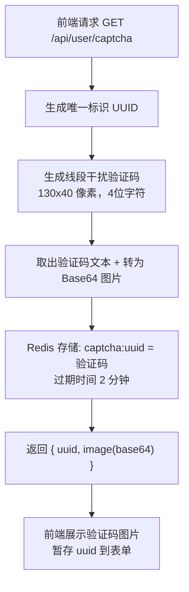

### 1.2 用户注册 — `POST /api/user/register`

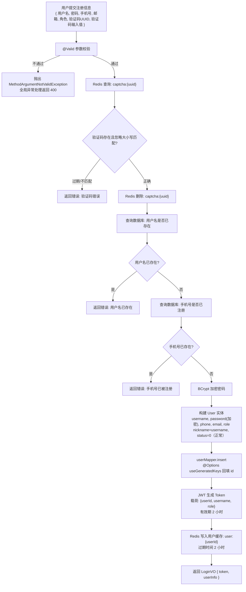

### 1.3 用户登录 — `POST /api/user/login`

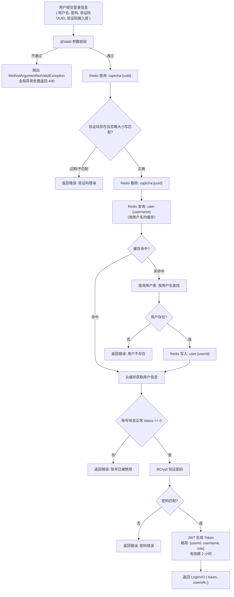

### 1.4 Token 刷新 — `POST /api/user/refresh`

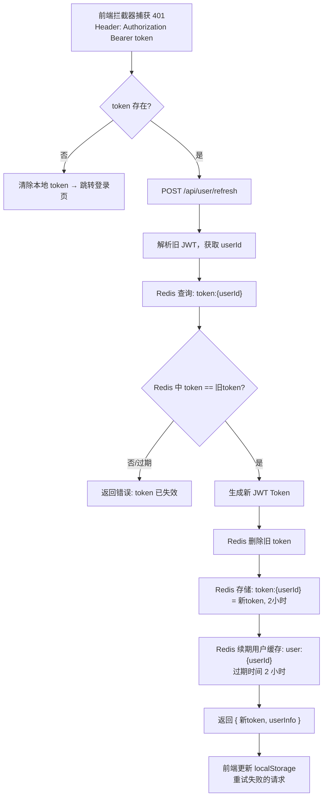

### 1.5 用户登出 — `POST /api/user/logout`

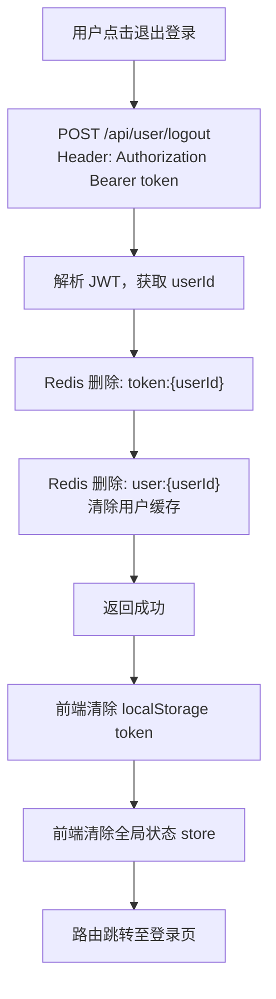

### 1.6 忘记密码 — 发送验证码 `POST /api/user/forgot-code`

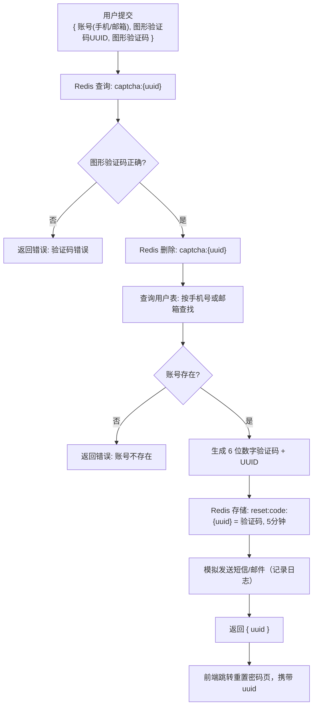

### 1.7 重置密码 — `POST /api/user/reset-password`

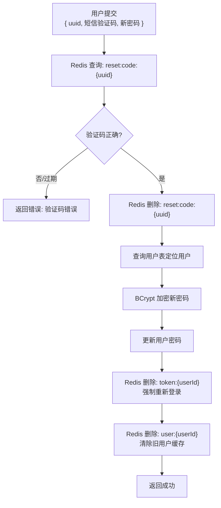

### 1.8 修改密码 — `PUT /api/user/change-password`

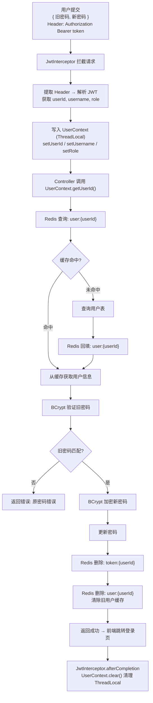

### 1.9 获取当前用户信息 — `GET /api/user/info`

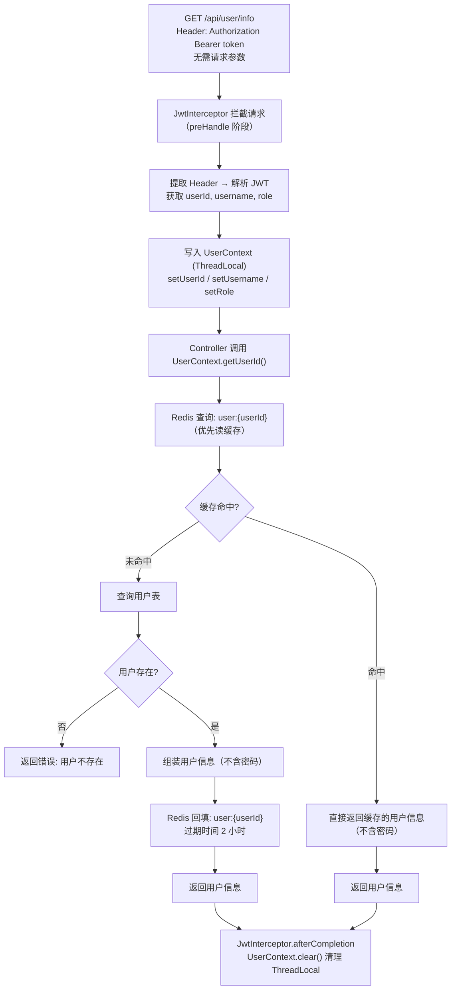

### 1.10 修改个人信息 — `PUT /api/user/profile`

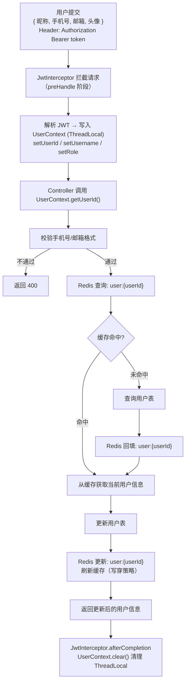

---

## 二、商品模块

### 2.1 商品列表查询 — `GET /api/product/list`

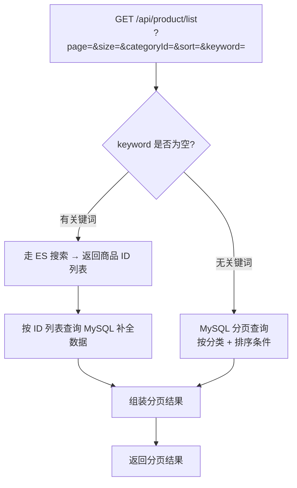

### 2.2 商品详情 — `GET /api/product/detail/{id}`

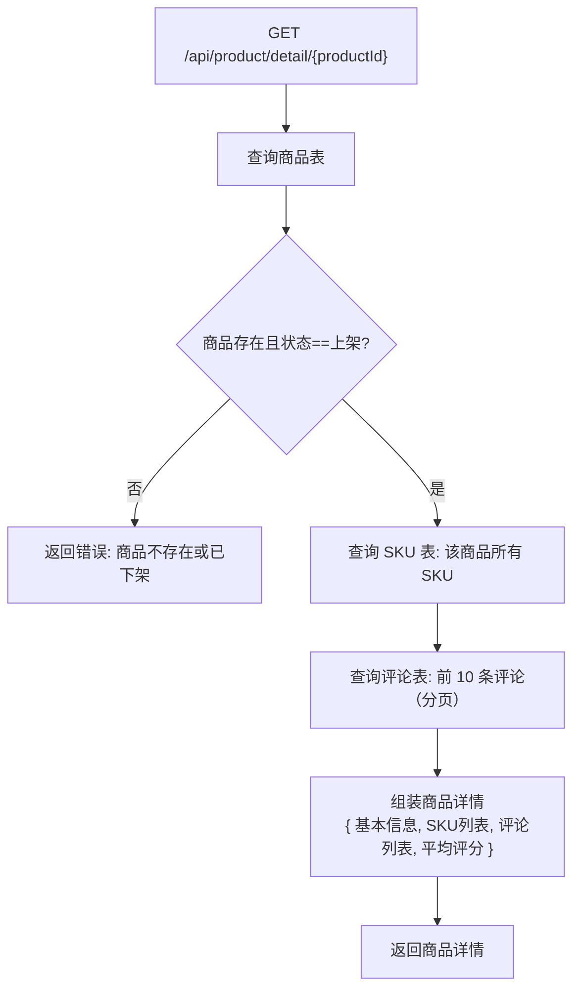

### 2.3 创建商品 — `POST /api/product/create`

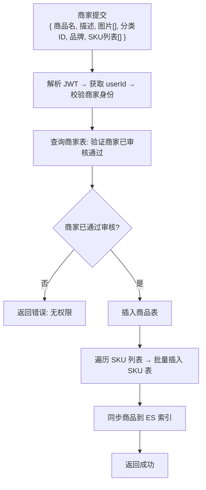

### 2.4 更新商品 — `PUT /api/product/update/{id}`

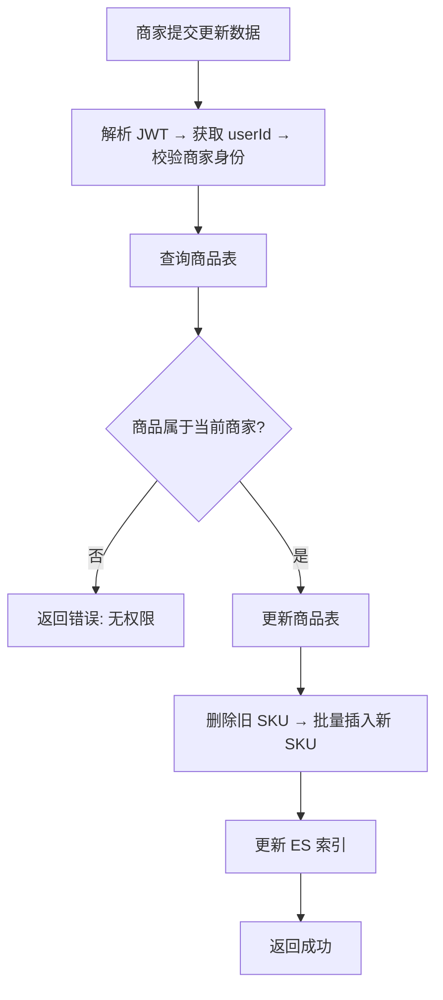

### 2.5 上架商品 — `PUT /api/product/on-shelf/{id}`

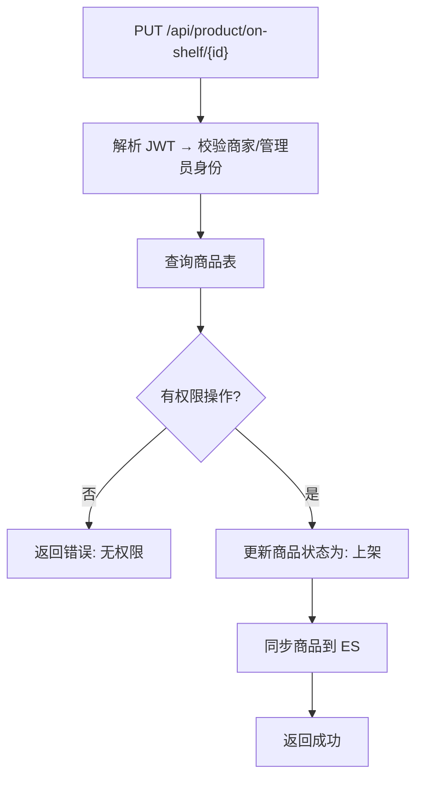

### 2.6 下架商品 — `PUT /api/product/off-shelf/{id}`

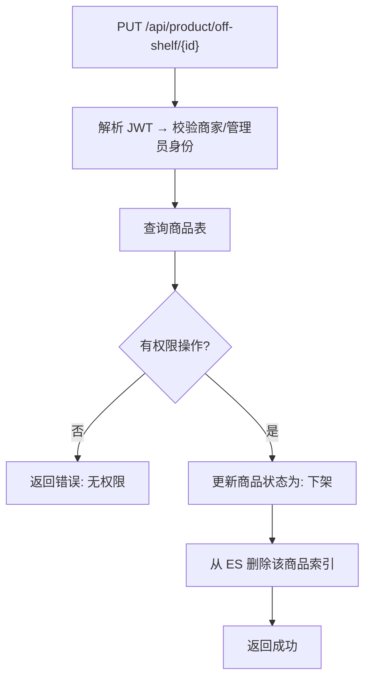

---

## 三、分类模块

### 3.1 获取分类树 — `GET /api/category/tree`

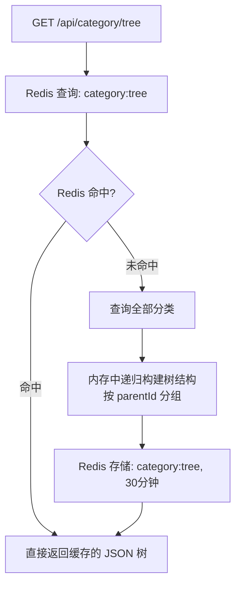

### 3.2 新增分类 — `POST /api/category`

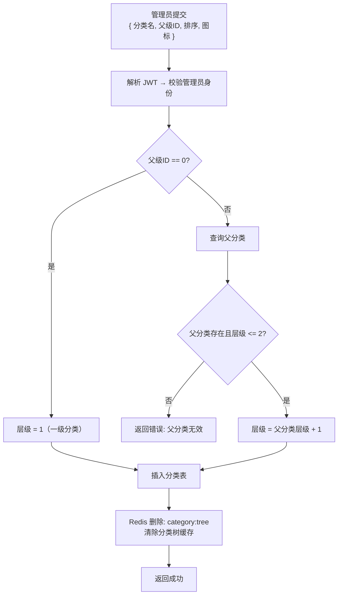

### 3.3 编辑分类 — `PUT /api/category/{id}`

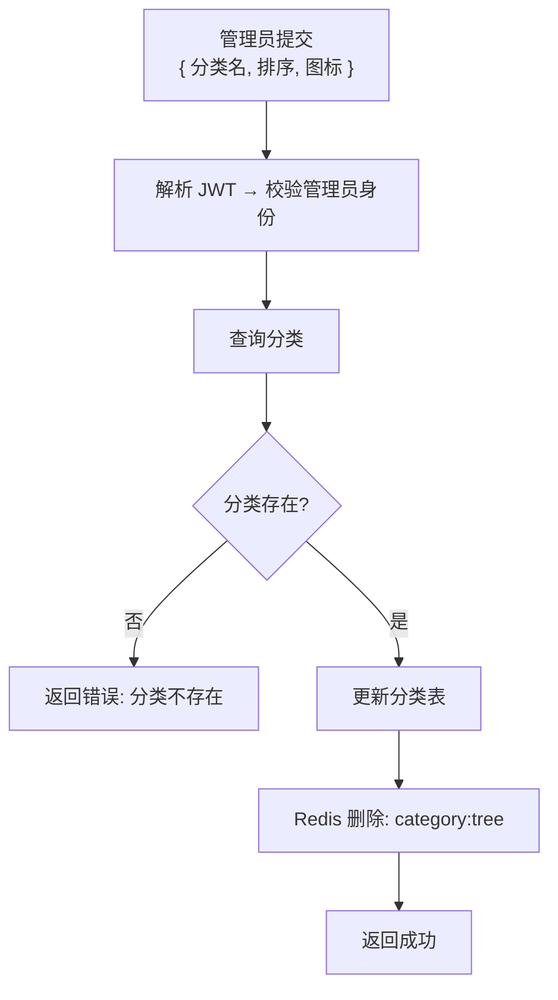

### 3.4 删除分类 — `DELETE /api/category/{id}`

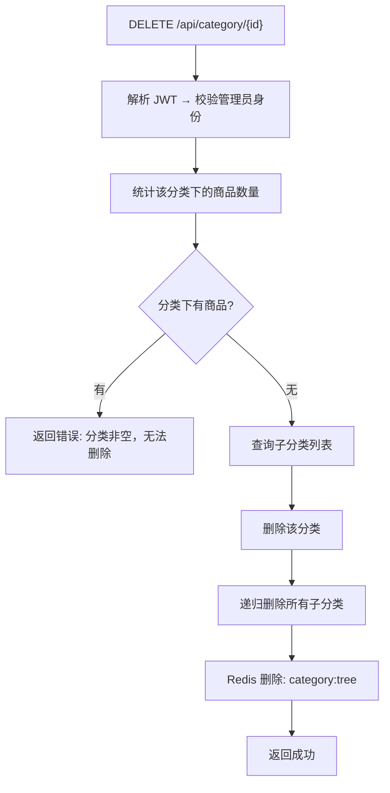

---

## 四、购物车模块

### 4.1 购物车列表 — `GET /api/cart/list`

```mermaid
flowchart TD
    A["GET /api/cart/list<br/>Header: Authorization Bearer token"] --> B["解析 JWT，获取 userId"]
    B --> C["查询购物车表: 当前用户所有项"]
    C --> D["遍历: 联查商品表 + SKU表<br/>补全名称/图片/规格/单价"]
    D --> E["组装购物车列表<br/>{ 商品名, 图片, SKU规格, 单价, 数量, 小计, 选中状态 }"]
    E --> F["返回购物车列表 + 合计金额"]
```

### 4.2 加入购物车 — `POST /api/cart/add`

```mermaid
flowchart TD
    A["用户提交<br/>{ SKU_ID, 数量 }<br/>Header: Authorization Bearer token"] --> B["解析 JWT，获取 userId"]
    B --> C["查询 SKU 表"]
    C --> D{"SKU 存在且库存 >= 数量?"}
    D -->|否| E["返回错误: 库存不足"]
    D -->|是| F["查询商品表"]
    F --> G{"商品状态 == 上架?"}
    G -->|否| H["返回错误: 商品已下架"]
    G -->|是| I["查询购物车表: 是否已有该 SKU"]
    I --> J{"已有该商品?"}
    J -->|是| K["更新: 数量 = 原数量 + 新数量"]
    J -->|否| L["插入购物车项<br/>(userId, productId, skuId, quantity, selected=1)"]
    K --> M["返回成功"]
    L --> M
```

### 4.3 修改数量 — `PUT /api/cart/update`

```mermaid
flowchart TD
    A["用户提交<br/>{ 购物车项ID, 数量 }"] --> B["解析 JWT，获取 userId"]
    B --> C["查询购物车项"]
    C --> D{"属于当前用户?"}
    D -->|否| E["返回错误: 无权操作"]
    D -->|是| F{"数量 > 0?"}
    F -->|是| G["查询 SKU 库存"]
    G --> H{"库存 >= 数量?"}
    H -->|否| I["返回错误: 库存不足"]
    H -->|是| J["更新购物车数量"]
    F -->|数量 == 0| K["删除该购物车项"]
    J --> L["返回成功"]
    K --> L
```

### 4.4 选中/取消 — `PUT /api/cart/select`

```mermaid
flowchart TD
    A["用户提交<br/>{ 选中的购物车项ID[] }"] --> B["解析 JWT，获取 userId"]
    B --> C["先将该用户所有项设为未选中"]
    C --> D["再批量将指定项设为选中"]
    D --> E["返回成功"]
```

### 4.5 删除购物车项 — `DELETE /api/cart/{id}`

```mermaid
flowchart TD
    A["DELETE /api/cart/{cartItemId}"] --> B["解析 JWT，获取 userId"]
    B --> C["查询购物车项"]
    C --> D{"属于当前用户?"}
    D -->|否| E["返回错误: 无权操作"]
    D -->|是| F["删除该购物车项"]
    F --> G["返回成功"]
```

---

## 五、订单模块

### 5.1 获取防重 Token — `GET /api/order/submit-token`

```mermaid
flowchart TD
    A["前端结算页加载<br/>GET /api/order/submit-token"] --> B["解析 JWT，获取 userId"]
    B --> C["生成唯一标识 UUID"]
    C --> D["Redis 存储: submit:{userId}:{uuid} = 1, 5分钟"]
    D --> E["返回 { token: uuid }"]
```

### 5.2 创建订单 — `POST /api/order/create`

```mermaid
flowchart TD
    A["用户提交下单数据<br/>{ 防重Token, 地址ID, 购物车项ID[] }"] --> B["解析 JWT，获取 userId"]
    B --> C["Redis 删除: submit:{userId}:{token}"]
    C --> D{"删除返回 1 ?"}
    D -->|返回 0| E["返回错误: 请勿重复提交（token 已使用/过期）"]
    D -->|返回 1| F["Redis 加分布式锁: lock:order:{userId}, 10秒"]
    F --> G{"获取锁成功?"}
    G -->|否| H["返回错误: 操作频繁"]
    G -->|是| I["开启数据库事务"]
    I --> J["查询购物车选中项"]
    J --> K["遍历校验: 查询 SKU 库存 >= 数量"]
    K --> L{"全部库存充足?"}
    L -->|否| M["事务回滚 → 返回错误: 库存不足"]
    L -->|是| N["查询收货地址 → JSON 快照保存"]
    N --> O["生成订单编号（时间戳+随机数）"]
    O --> P["插入订单表 → 计算总金额"]
    P --> Q["批量插入订单明细<br/>快照单价/数量/小计"]
    Q --> R["遍历扣减库存<br/>UPDATE stock = stock - 数量 WHERE stock >= 数量"]
    R --> S["删除已下单的购物车项"]
    S --> T["事务提交"]
    T --> U["释放分布式锁: lock:order:{userId}"]
    U --> V["返回 { 订单ID, 订单编号 }"]
```

### 5.3 订单列表 — `GET /api/order/list`

```mermaid
flowchart TD
    A["GET /api/order/list<br/>?page=&size=&status="] --> B["解析 JWT，获取 userId"]
    B --> C["分页查询订单表<br/>按 userId + status 筛选"]
    C --> D["遍历: 查询订单明细"]
    D --> E["组装分页结果"]
    E --> F["返回订单列表"]
```

### 5.4 订单详情 — `GET /api/order/detail/{id}`

```mermaid
flowchart TD
    A["GET /api/order/detail/{orderId}"] --> B["解析 JWT，获取 userId"]
    B --> C["查询订单表"]
    C --> D{"订单属于当前用户?"}
    D -->|否| E["返回错误: 无权查看"]
    D -->|是| F["查询订单明细"]
    F --> G["查询支付记录"]
    G --> H["查询退款记录"]
    H --> I["组装订单详情"]
    I --> J["返回订单详情"]
```

### 5.5 取消订单 — `PUT /api/order/cancel/{id}`

```mermaid
flowchart TD
    A["PUT /api/order/cancel/{orderId}<br/>?reason=取消原因"] --> B["解析 JWT，获取 userId"]
    B --> C["查询订单表"]
    C --> D{"订单属于当前用户?"}
    D -->|否| E["返回错误: 无权操作"]
    D -->|是| F{"订单状态 == 待支付?"}
    F -->|否| G["返回错误: 当前状态不可取消"]
    F -->|是| H["更新订单状态为: 已取消<br/>记录取消原因"]
    H --> I["恢复库存<br/>查询订单明细 → 逐项加回 SKU 库存"]
    I --> J["返回成功"]
```

### 5.6 确认收货 — `PUT /api/order/receive/{id}`

```mermaid
flowchart TD
    A["PUT /api/order/receive/{orderId}"] --> B["解析 JWT，获取 userId"]
    B --> C["查询订单表"]
    C --> D{"订单属于当前用户?"}
    D -->|否| E["返回错误: 无权操作"]
    D -->|是| F{"订单状态 == 已发货?"}
    F -->|否| G["返回错误: 当前状态不可确认收货"]
    F -->|是| H["更新订单状态为: 已收货<br/>记录收货时间"]
    H --> I["自动流转为: 已完成"]
    I --> J["返回成功"]
```

---

## 六、支付模块

### 6.1 卡号支付 — `POST /api/payment/card`

```mermaid
flowchart TD
    A["用户提交银行卡信息<br/>{ 订单ID, 卡号, 有效期, CVV }"] --> B["解析 JWT，获取 userId"]
    B --> C["查询订单表"]
    C --> D{"订单属于当前用户 && 状态==待支付?"}
    D -->|否| E["返回错误: 订单状态异常"]
    D -->|是| F["查询支付表: 该订单是否已有记录"]
    F --> G{"已有支付记录?"}
    G -->|已支付| H["直接返回: 已支付（幂等）"]
    G -->|无/未支付| I["Luhn 算法校验卡号"]
    I --> J{"卡号合法?"}
    J -->|否| K["返回错误: 卡号无效"]
    J -->|是| L["校验有效期"]
    L --> M{"未过期?"}
    M -->|过期| N["返回错误: 卡已过期"]
    M -->|未过期| O["模拟扣款 → 插入支付记录(状态=成功)"]
    O --> P["更新订单状态为: 已支付<br/>记录支付时间"]
    P --> Q["更新商品销量 +1"]
    Q --> R["返回支付成功"]
```

### 6.2 生成支付二维码 — `POST /api/payment/qrcode`

```mermaid
flowchart TD
    A["POST /api/payment/qrcode<br/>{ 订单ID }"] --> B["解析 JWT，获取 userId"]
    B --> C["查询订单表"]
    C --> D{"订单有效?"}
    D -->|否| E["返回错误: 订单不存在"]
    D -->|是| F["生成二维码内容<br/>(订单ID + 金额 + 时间戳)"]
    F --> G["Redis 存储: qrcode:{orderId} = 待支付, 5分钟"]
    G --> H["返回 { 二维码内容 }"]
```

### 6.3 确认二维码支付 — `POST /api/payment/confirm-qrcode`

```mermaid
flowchart TD
    A["POST /api/payment/confirm-qrcode<br/>{ 订单ID }"] --> B["解析 JWT，获取 userId"]
    B --> C["Redis 查询: qrcode:{orderId}"]
    C --> D{"二维码未过期?"}
    D -->|过期/不存在| E["返回错误: 二维码已过期"]
    D -->|存在| F["查询支付表: 该订单是否已支付"]
    F --> G{"已支付?"}
    G -->|已支付| H["直接返回: 已支付（幂等）"]
    G -->|未支付| I["插入支付记录(方式=二维码, 状态=成功)"]
    I --> J["更新订单状态为: 已支付"]
    J --> K["Redis 删除: qrcode:{orderId}"]
    K --> L["更新商品销量"]
    L --> M["返回支付成功"]
```

---

## 七、收货地址模块

### 7.1 地址列表 — `GET /api/address/list`

```mermaid
flowchart TD
    A["GET /api/address/list"] --> B["解析 JWT，获取 userId"]
    B --> C["查询地址表: 当前用户所有地址<br/>按 默认优先 + 创建时间倒序"]
    C --> D["返回地址列表"]
```

### 7.2 新增地址 — `POST /api/address`

```mermaid
flowchart TD
    A["用户提交<br/>{ 收件人, 手机号, 省, 市, 区, 详细地址, 是否默认 }"] --> B["解析 JWT，获取 userId"]
    B --> C{"是否设为默认地址?"}
    C -->|是| D["先将该用户其他地址取消默认"]
    C -->|否| E["插入地址表"]
    D --> E
    E --> F["返回成功"]
```

### 7.3 编辑地址 — `PUT /api/address/{id}`

```mermaid
flowchart TD
    A["PUT /api/address/{id}<br/>{ 收件人, 手机号, ... , 是否默认 }"] --> B["解析 JWT，获取 userId"]
    B --> C["查询地址"]
    C --> D{"地址属于当前用户?"}
    D -->|否| E["返回错误: 无权操作"]
    D -->|是| F{"是否设为默认?"}
    F -->|是| G["先将其他地址取消默认"]
    F -->|否| H["更新地址表"]
    G --> H
    H --> I["返回成功"]
```

### 7.4 删除地址 — `DELETE /api/address/{id}`

```mermaid
flowchart TD
    A["DELETE /api/address/{addressId}"] --> B["解析 JWT，获取 userId"]
    B --> C["查询地址"]
    C --> D{"地址属于当前用户?"}
    D -->|否| E["返回错误: 无权操作"]
    D -->|是| F["检查是否有关联的未完成订单"]
    F --> G{"有关联未完成订单?"}
    G -->|是| H["返回错误: 无法删除，有关联订单"]
    G -->|否| I["删除地址"]
    I --> J["返回成功"]
```

### 7.5 设为默认地址 — `PUT /api/address/default/{id}`

```mermaid
flowchart TD
    A["PUT /api/address/default/{addressId}"] --> B["解析 JWT，获取 userId"]
    B --> C["查询地址"]
    C --> D{"地址属于当前用户?"}
    D -->|否| E["返回错误: 无权操作"]
    D -->|是| F["先将该用户所有地址取消默认"]
    F --> G["将指定地址设为默认"]
    G --> H["返回成功"]
```

---

## 八、评论模块

### 8.1 评论列表 — `GET /api/comment/list/{productId}`

```mermaid
flowchart TD
    A["GET /api/comment/list/{productId}<br/>?page=&size=&star="] --> B["分页查询评论表<br/>按商品ID + 评分筛选"]
    B --> C["遍历: 查用户表获取头像/昵称"]
    C --> D["遍历: 查评论表获取追评/回复"]
    D --> E["组装分页结果"]
    E --> F["返回评论列表"]
```

### 8.2 发表初评 — `POST /api/comment`

```mermaid
flowchart TD
    A["用户提交<br/>{ 商品ID, 订单明细ID, 内容, 评分, 图片[] }"] --> B["解析 JWT，获取 userId"]
    B --> C["查询订单明细"]
    C --> D{"订单明细属于当前用户?"}
    D -->|否| E["返回错误: 无权评价"]
    D -->|是| F["查询订单表"]
    F --> G{"订单状态 == 已收货/已完成?"}
    G -->|否| H["返回错误: 收货后才能评价"]
    G -->|是| I["查询评论表: 该订单明细是否已有初评"]
    I --> J{"已有初评?"}
    J -->|是| K["返回错误: 已评价过"]
    J -->|否| L["插入评论(type=初评)"]
    L --> M["上传图片到 OSS → 保存图片 URL"]
    M --> N["更新商品评分缓存"]
    N --> O["返回成功"]
```

### 8.3 发表追评 — `POST /api/comment/append`

```mermaid
flowchart TD
    A["用户提交<br/>{ 初评ID, 追评内容 }"] --> B["解析 JWT，获取 userId"]
    B --> C["查询初评记录"]
    C --> D{"初评存在 && 属于当前用户 && 未追评?"}
    D -->|否| E["返回错误: 不能追评"]
    D -->|是| F["插入评论(关联初评ID, type=追评)"]
    F --> G["返回成功"]
```

### 8.4 商家回复 — `POST /api/comment/reply`

```mermaid
flowchart TD
    A["商家提交<br/>{ 评论ID, 回复内容 }"] --> B["解析 JWT，获取 userId"]
    B --> C["查询商家表: 验证商家身份且已通过审核"]
    C --> D{"是商家且已通过审核?"}
    D -->|否| E["返回错误: 无权限"]
    D -->|是| F["查询该评论"]
    F --> G["查询该评论对应的商品"]
    G --> H{"商品属于当前商家?"}
    H -->|否| I["返回错误: 无权回复"]
    H -->|是| J["插入评论(关联评论ID, type=回复)"]
    J --> K["返回成功"]
```

---

## 九、退款/退货模块

### 9.1 申请退款/退货 — `POST /api/refund`

```mermaid
flowchart TD
    A["用户提交<br/>{ 订单明细ID, 类型(退款/退货), 原因, 金额 }"] --> B["解析 JWT，获取 userId"]
    B --> C["查询订单明细"]
    C --> D{"订单明细属于当前用户?"}
    D -->|否| E["返回错误: 无权操作"]
    D -->|是| F["查询订单表"]
    F --> G{"订单状态 IN [已支付, 已发货, 已收货]?"}
    G -->|否| H["返回错误: 当前状态不可退款"]
    G -->|是| I["查询退款表: 该明细是否已有退款记录"]
    I --> J{"已有退款记录?"}
    J -->|是| K["返回错误: 已申请过退款"]
    J -->|否| L["插入退款记录(status=待审核)"]
    L --> M["返回成功"]
```

### 9.2 退款列表 — `GET /api/refund/list`

```mermaid
flowchart TD
    A["GET /api/refund/list?page=&size="] --> B["解析 JWT → 获取 userId → 获取角色"]
    B --> C{"角色?"}
    C -->|普通用户| D["查询退款表: 按 userId 筛选"]
    C -->|商家| E["查询退款表: 按商家ID筛选"]
    C -->|管理员| F["查询退款表: 全部"]
    D --> G["组装分页结果"]
    E --> G
    F --> G
    G --> H["返回退款列表"]
```

### 9.3 审核退款 — `PUT /api/refund/{id}/review`

```mermaid
flowchart TD
    A["商家/管理员提交<br/>{ 审核结果, 原因 }"] --> B["解析 JWT → 获取 userId → 角色"]
    B --> C["查询退款记录"]
    C --> D{"有审核权限?"}
    D -->|否| E["返回错误: 无权限"]
    D -->|是| F{"退款状态 == 待审核?"}
    F -->|否| G["返回错误: 已审核过"]
    F -->|是| H{"审核通过?"}
    H -->|拒绝| I["更新退款状态: 已拒绝<br/>记录拒绝原因"]
    H -->|通过| J{"退款类型?"}
    J -->|仅退款| K["更新退款状态: 已通过"]
    J -->|退货| L["更新退款状态: 审核中<br/>等待用户寄回"]
    K --> M["更新订单状态: 已取消/退款完成"]
    M --> N["恢复库存"]
    N --> O["返回成功"]
    I --> O
```

---

## 十、即时通讯模块

### 10.1 获取会话列表 — `GET /api/chat/conversations`

```mermaid
flowchart TD
    A["GET /api/chat/conversations"] --> B["解析 JWT，获取 userId"]
    B --> C["查询会话表: 当前用户所有会话"]
    C --> D["遍历: 计算未读数 → 组装会话列表"]
    D --> E["返回会话列表"]
```

### 10.2 获取历史消息 — `GET /api/chat/messages/{conversationId}`

```mermaid
flowchart TD
    A["GET /api/chat/messages/{conversationId}<br/>?page=&size="] --> B["解析 JWT，获取 userId"]
    B --> C["查询会话表"]
    C --> D{"会话参与者包含当前用户?"}
    D -->|否| E["返回错误: 无权查看"]
    D -->|是| F["分页查询消息表"]
    F --> G["标记已读: 更新消息表中对方发送的消息为已读"]
    G --> H["清零该会话的未读数"]
    H --> I["返回分页消息列表"]
```

### 10.3 WebSocket 建立连接 — `ws://host/chat/{userId}`

```mermaid
sequenceDiagram
    actor 前端 as 前端 WebSocket
    participant 后端 as WebSocket 服务端
    participant Redis as Redis
    participant DB as 数据库

    前端 ->> 后端: ws://host/chat/{userId}?token=xxx
    后端 ->> 后端: 解析 JWT 校验身份
    alt Token 无效
        后端 -->> 前端: 关闭连接 (1008)
    else Token 有效
        后端 ->> Redis: 存储 ws:{userId} = sessionId
        后端 ->> DB: 查询用户的会话列表
        后端 -->> 前端: 返回在线会话列表 + 未读数
    end
```

### 10.4 WebSocket 发送消息

```mermaid
sequenceDiagram
    actor 用户A as 用户 A
    participant WS as WebSocket 服务端
    participant DB as 数据库
    participant Redis as Redis
    actor 用户B as 用户 B (商家)

    用户A ->> WS: 发送消息 { conversationId, content, type }
    WS ->> WS: 解析 JSON
    WS ->> DB: 保存消息到消息表
    WS ->> DB: 更新会话表(最后消息内容 + 时间)
    WS ->> DB: 增加对方未读数 +1
    WS ->> Redis: 查询 ws:{对方userId}
    alt 对方在线
        WS -->> 用户B: 实时推送消息
    else 对方离线
        WS ->> WS: 消息已持久化，等待对方上线拉取
    end
    WS -->> 用户A: 回显消息（已发送状态）
```

### 10.5 WebSocket 关闭连接

```mermaid
sequenceDiagram
    actor 前端 as 前端
    participant 后端 as WebSocket 服务端
    participant Redis as Redis

    前端 ->> 后端: WebSocket close / 页面关闭
    后端 ->> 后端: 关闭事件触发
    后端 ->> Redis: 删除 ws:{userId}
    后端 ->> 后端: 清理本地 session 缓存
```

---

## 十一、商家模块

### 11.1 商家入驻申请 — `POST /api/merchant/apply`

```mermaid
flowchart TD
    A["用户提交<br/>{ 店铺名称, 营业执照, 联系电话 }"] --> B["解析 JWT，获取 userId"]
    B --> C["查询用户表"]
    C --> D{"用户角色 == 商家?"}
    D -->|否| E["返回错误: 非商家角色"]
    D -->|是| F["查询商家表: 是否已有申请记录"]
    F --> G{"已有申请记录?"}
    G -->|已通过| H["返回错误: 已是商家"]
    G -->|待审核| I["返回错误: 审核中请等待"]
    G -->|已拒绝| J["可重新提交 → 更新原记录"]
    G -->|无记录| K["插入商家记录(status=待审核)"]
    J --> L["返回成功"]
    K --> L
```

### 11.2 商家订单管理 — `GET /api/merchant/orders`

```mermaid
flowchart TD
    A["GET /api/merchant/orders<br/>?page=&size=&status="] --> B["解析 JWT，获取 userId"]
    B --> C["查询商家表"]
    C --> D{"商家已通过审核?"}
    D -->|否| E["返回错误: 无权限"]
    D -->|是| F["分页查询订单表: 按商家ID + 状态筛选"]
    F --> G["组装分页结果"]
    G --> H["返回订单列表"]
```

### 11.3 商家发货 — `PUT /api/merchant/order/{id}/ship`

```mermaid
flowchart TD
    A["商家提交<br/>{ 快递单号, 物流公司 }"] --> B["解析 JWT，获取 userId"]
    B --> C["查询订单表"]
    C --> D{"订单中商品属于当前商家?"}
    D -->|否| E["返回错误: 无权操作"]
    D -->|是| F{"订单状态 == 已支付?"}
    F -->|否| G["返回错误: 当前状态不可发货"]
    F -->|是| H["更新订单状态: 已发货<br/>记录发货时间 + 物流信息"]
    H --> I["返回成功"]
```

### 11.4 销售统计 — `GET /api/merchant/stats`

```mermaid
flowchart TD
    A["GET /api/merchant/stats?startDate=&endDate="] --> B["解析 JWT，获取 userId"]
    B --> C["聚合查询订单表<br/>按商家ID + 时间范围"]
    C --> D["统计维度<br/>营业额 / 订单量 / 销量排行 / 退款率 / 时段趋势"]
    D --> E["组装统计结果返回"]
```

---

## 十二、管理员模块

### 12.1 用户列表 — `GET /api/admin/users`

```mermaid
flowchart TD
    A["GET /api/admin/users<br/>?page=&size=&keyword=&status="] --> B["解析 JWT → 校验管理员角色"]
    B --> C{"角色 == 管理员?"}
    C -->|否| D["返回错误: 无权限"]
    C -->|是| E["分页查询用户表<br/>按关键词 + 状态筛选"]
    E --> F["返回分页用户列表"]
```

### 12.2 禁用/启用用户 — `PUT /api/admin/user/{id}/disable|enable`

```mermaid
flowchart TD
    A["PUT /api/admin/user/{userId}/disable|enable"] --> B["解析 JWT → 校验管理员"]
    B --> C{"管理员?"}
    C -->|否| D["返回错误: 无权限"]
    C -->|是| E["查询用户表"]
    E --> F["更新用户状态（禁用/启用）"]
    F --> G{"是禁用操作?"}
    G -->|是| H["Redis 删除: token:{userId}<br/>强制下线"]
    G -->|否| I["返回成功"]
    H --> I
```

### 12.3 商家审核列表 — `GET /api/admin/merchants`

```mermaid
flowchart TD
    A["GET /api/admin/merchants<br/>?page=&size=&status="] --> B["解析 JWT → 校验管理员"]
    B --> C["分页查询商家表<br/>按审核状态筛选"]
    C --> D["组装分页结果"]
    D --> E["返回商家申请列表"]
```

### 12.4 审核商家 — `PUT /api/admin/merchant/{id}/audit`

```mermaid
flowchart TD
    A["管理员提交<br/>{ 审核结果, 原因 }"] --> B["解析 JWT → 校验管理员"]
    B --> C["查询商家记录"]
    C --> D{"状态 == 待审核?"}
    D -->|否| E["返回错误: 已审核过"]
    D -->|是| F{"审核通过?"}
    F -->|通过| G["更新商家状态: 已通过<br/>记录审核时间"]
    F -->|拒绝| H["更新商家状态: 已拒绝<br/>记录拒绝原因 + 审核时间"]
    G --> I["返回成功"]
    H --> I
```

### 12.5 全局订单 — `GET /api/admin/orders`

```mermaid
flowchart TD
    A["GET /api/admin/orders<br/>?page=&size=&status=&startDate=&endDate="] --> B["解析 JWT → 校验管理员"]
    B --> C["分页查询订单表<br/>按状态 + 时间范围筛选 (全部商家)"]
    C --> D["组装分页结果"]
    D --> E["返回全平台订单列表"]
```

### 12.6 数据报表 — `GET /api/admin/report`

```mermaid
flowchart TD
    A["GET /api/admin/report?startDate=&endDate="] --> B["解析 JWT → 校验管理员"]
    B --> C["聚合统计"]
    C --> D["平台 GMV / 新增用户数 / 订单总量"]
    C --> E["退款率 / 热销品类 Top10 / 商家排行"]
    C --> F["时段销售趋势"]
    D --> G["组装报表返回"]
    E --> G
    F --> G
```

---

## 十三、搜索模块

### 13.1 搜索建议 — `POST /api/search/suggest`

```mermaid
flowchart TD
    A["用户输入关键词（实时触发）"] --> B["POST /api/search/suggest<br/>{ keyword }"]
    B --> C["构建 ES suggest DSL<br/>completion 补全查询"]
    C --> D["查询 ES: product_index"]
    D --> E["ES 返回建议词列表"]
    E --> F["返回建议词列表"]
```

### 13.2 商品搜索 — `POST /api/search`

```mermaid
flowchart TD
    A["用户回车搜索<br/>POST /api/search<br/>{ keyword, page, size, filters[], sort }"] --> B["构建 ES 搜索 DSL"]
    B --> C["query: bool → must(multi_match: 名称, 描述, 品牌)"]
    C --> D["filter: term(品牌) + range(价格) + term(分类)"]
    D --> E["sort: 综合/价格/销量/新品"]
    E --> F["aggs: 品牌聚合 + 价格区间聚合"]
    F --> G["查询 ES: product_index"]
    G --> H["解析 ES 结果 → 提取商品 ID 列表"]
    H --> I["按 ID 列表查询 MySQL 补全数据"]
    I --> J["记录搜索历史到搜索历史表"]
    J --> K["返回分页结果 + 聚合筛选条件"]
```

### 13.3 搜索历史 — `GET /api/search/history`

```mermaid
flowchart TD
    A["GET /api/search/history"] --> B["解析 JWT，获取 userId"]
    B --> C["查询搜索历史表<br/>按搜索时间倒序，取最近 20 条"]
    C --> D["返回搜索历史列表"]
```

### 13.4 同步商品到 ES

```mermaid
flowchart TD
    A["商品创建/上架/更新 触发同步"] --> B["组装 ES 文档<br/>{ id, 名称, 描述, 品牌, 分类ID/名称, 价格区间, 图片, 销量, 状态, 补全建议词 }"]
    B --> C["ES Index 请求: product_index / _doc / {productId}"]
    C --> D["ES 自动创建或更新文档"]
    D --> E["同步完成"]
```

### 13.5 从 ES 删除商品

```mermaid
flowchart TD
    A["商品下架 触发删除"] --> B["ES Delete 请求: product_index / _doc / {productId}"]
    B --> C["删除完成"]
```

---

## 十四、接口清单

| 模块 | 路径前缀 | 接口数 | 权限 |
|------|----------|--------|------|
| 用户认证 | `/api/user` | 10 | 公开/登录 |
| 商品 | `/api/product` | 6 | 公开/商家/管理员 |
| 分类 | `/api/category` | 4 | 公开/管理员 |
| 购物车 | `/api/cart` | 5 | 登录用户 |
| 订单 | `/api/order` | 6 | 登录用户 |
| 支付 | `/api/payment` | 3 | 登录用户 |
| 收货地址 | `/api/address` | 5 | 登录用户 |
| 评论 | `/api/comment` | 4 | 登录用户/商家 |
| 退款 | `/api/refund` | 3 | 登录用户/商家/管理员 |
| 商家 | `/api/merchant` | 4 | 商家 |
| 管理员 | `/api/admin` | 6 | 管理员 |
| 即时通讯 | `/api/chat` | 2 | 登录用户/商家 |
| 搜索 | `/api/search` | 3 | 公开/登录用户 |
| **合计** | | **61** | |

---

## 十五、缓存策略

| 缓存 Key | 类型 | 过期 | 用途 |
|----------|------|------|------|
| `captcha:{uuid}` | String | 2分钟 | 图形验证码 |
| `reset:code:{uuid}` | String | 5分钟 | 重置密码验证码 |
| `token:{userId}` | String(JWT) | 2小时 | 用户登录态 |
| `submit:{userId}:{uuid}` | String | 5分钟 | 下单防重 |
| `lock:order:{userId}` | String | 10秒 | 下单分布式锁 |
| `qrcode:{orderId}` | String | 5分钟 | 支付二维码 |
| `category:tree` | JSON | 30分钟 | 分类树 |
| `ws:{userId}` | String | 连接期间 | WebSocket 会话映射 |

---

## 十六、数据库表与职责

| 表名 | 对应模块 | 说明 |
|------|----------|------|
| `user` | 认证 | 用户基本信息、密码哈希、角色、状态 |
| `merchant` | 商家 | 店铺信息、营业执照、审核状态 |
| `product` | 商品 | 商品基本信息、上下架状态 |
| `product_sku` | 商品 | 规格、价格、库存 |
| `category` | 分类 | 分类树、层级、排序 |
| `cart_item` | 购物车 | 用户购物车项、选中状态 |
| `order` | 订单 | 订单主表、状态流转、地址快照 |
| `order_item` | 订单 | 订单明细、快照价格数量 |
| `payment` | 支付 | 支付记录、支付方式 |
| `address` | 地址 | 收货地址 |
| `comment` | 评论 | 初评/追评/回复 |
| `refund` | 退款 | 退款申请、审核 |
| `conversation` | 即时通讯 | 会话列表 |
| `message` | 即时通讯 | 消息记录 |
| `search_history` | 搜索 | 用户搜索历史 |

---

## 十七、事务与锁设计

| 场景 | 策略 | 说明 |
|------|------|------|
| 下单 | 分布式锁 + 数据库事务 | Redis 锁防并发，事务保证订单+扣库存原子性 |
| 库存扣减 | 行级锁 `WHERE stock >= ?` | 防止超卖 |
| 支付 | 幂等校验 | 查支付表防重复扣款 |
| 退款审核 | 乐观锁（状态机） | 只有"待审核"状态可审核 |

---

## 十八、部署架构

```mermaid
graph TB
    subgraph 用户浏览器["用户浏览器"]
        BR["浏览器"]
    end

    subgraph Nginx["Nginx (Port 80)"]
        NG["静态文件 + 反向代理"]
    end

    subgraph 应用["Spring Boot 应用 (Port 8080)"]
        BE["chrono-bbs-server<br/>单 JAR 运行"]
    end

    subgraph 基础设施["Docker Compose 基础设施"]
        DB[("MySQL 8.0<br/>Port 3306")]
        RD[("Redis 7<br/>Port 6379")]
        ES[("Elasticsearch 7.17<br/>Port 9200")]
    end

    BR -->|"/" 静态资源| NG
    BR -->|"/api/*"| NG
    BR -->|"/es/*"| NG
    BR -->|"ws:// /chat/"| NG

    NG -->|proxy_pass| BE
    NG -->|proxy_pass| ES
    NG -->|proxy_pass upgrade| BE

    BE --> DB
    BE --> RD
    BE --> ES
```

> Maven 多模块（common / module-mapper / module-service / module-api / module-start）仅用于代码分层组织，运行时合并为单个 Spring Boot JAR。

---

## 十九、前端设计参考

### 页面路由结构

| 路由 | 页面 | 权限 |
|------|------|------|
| `/` | 首页商品列表 | 公开 |
| `/product/:id` | 商品详情 | 公开 |
| `/search` | 搜索结果 | 公开 |
| `/login` | 登录 | 公开 |
| `/register` | 注册 | 公开 |
| `/cart` | 购物车 | 用户 |
| `/checkout` | 结算 | 用户 |
| `/payment/:orderId` | 支付 | 用户 |
| `/orders` | 订单列表 | 用户 |
| `/order/:id` | 订单详情 | 用户 |
| `/profile` | 个人信息 | 用户 |
| `/address` | 地址管理 | 用户 |
| `/chat` | 即时通讯 | 用户/商家 |
| `/merchant/*` | 商家后台 | 商家 |
| `/admin/*` | 管理员后台 | 管理员 |

### 全局状态

| Store | 数据 | 用途 |
|-------|------|------|
| `userStore` | token / userInfo / role | 登录状态、权限判断 |
| `cartStore` | items / totalCount / totalAmount | 购物车 |
| `chatStore` | conversations / unreadCount | 即时通讯未读 |

### 数据流

```mermaid
flowchart LR
    subgraph Vue["Vue 组件"]
        V["页面 Views"]
        C["通用组件"]
    end

    subgraph Store["全局状态 Pinia"]
        US["userStore<br/>token / userInfo / role"]
        CS["cartStore<br/>购物车数据"]
        CHS["chatStore<br/>会话/未读"]
    end

    subgraph API["API 层"]
        AX["Axios<br/>请求/响应拦截器"]
    end

    subgraph Backend["后端"]
        BE["Spring Boot<br/>REST API"]
        ES["Elasticsearch<br/>REST API"]
        WS["WebSocket<br/>ws://"]
    end

    V <--> US
    V <--> CS
    V <--> CHS
    C <--> US

    V --> AX
    AX --> BE
    V --> ES
    V --> WS

    AX -- "请求拦截: 注入 Token" --> AX
    AX -- "响应拦截: 401 → 刷新 → 重试" --> AX
```

---

## 总结

| 模块 | 函数数 | 说明 |
|------|--------|------|
| 用户认证 | 10 | 验证码/注册/登录/登出/刷新/忘记密码/重置密码/改密/信息/修改资料 |
| 商品 | 6 | 列表/详情/创建/更新/上架/下架 |
| 分类 | 4 | 分类树/新增/编辑/删除 |
| 购物车 | 5 | 列表/加入/修改数量/选中/删除 |
| 订单 | 6 | 防重Token/创建/列表/详情/取消/确认收货 |
| 支付 | 3 | 卡号支付/二维码/确认支付 |
| 收货地址 | 5 | 列表/新增/编辑/删除/设为默认 |
| 评论 | 4 | 列表/初评/追评/商家回复 |
| 退款/退货 | 3 | 申请/列表/审核 |
| 即时通讯 | 5 | 会话列表/历史消息/WS连接/发送/关闭 |
| 商家 | 4 | 入驻申请/订单管理/发货/统计 |
| 管理员 | 6 | 用户管理/禁用启用/商家审核/全局订单/报表 |
| 搜索 | 5 | 建议/搜索/历史/同步ES/删除ES |
| **合计** | **66** | |