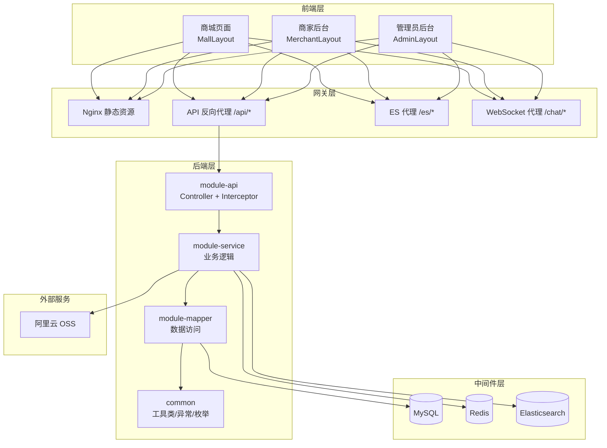
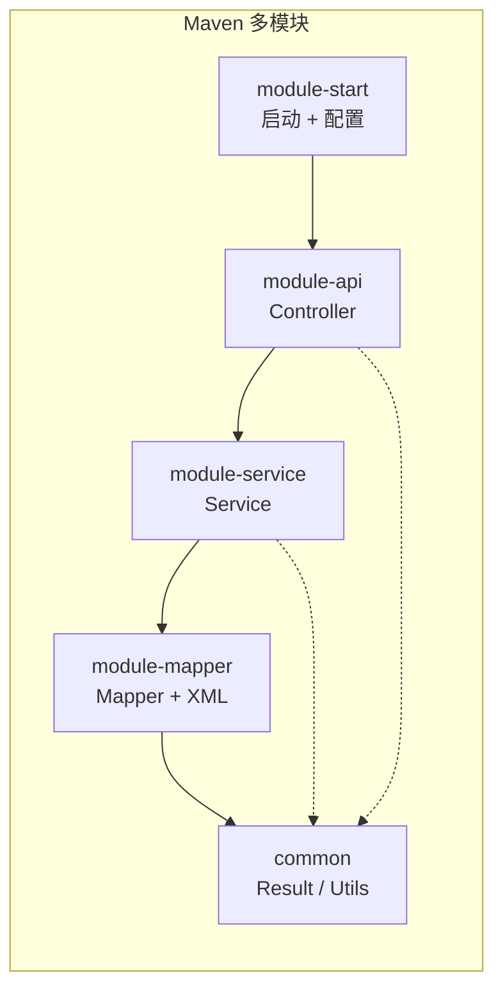
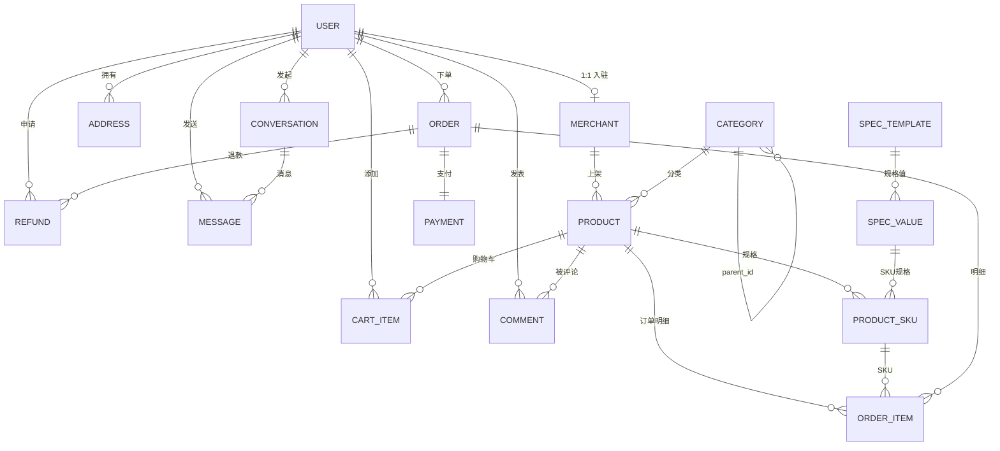

# 网上超市系统 - 服务端概要设计

---

## 一、技术选型

| 类别 | 技术 | 版本/说明 |
|------|------|------|
| 基础框架 | Spring Boot | 3.4.5 |
| JDK | Java 21 | |
| ORM | MyBatis | 3.0.4 |
| 分页 | PageHelper | |
| 数据库 | MySQL | |
| 缓存 | Redis | Jedis / Lettuce |
| 搜索引擎 | Elasticsearch | |
| 认证 | JWT + Redis 双校验 | |
| 鉴权 | Spring AOP + RBAC 注解 | |
| 参数校验 | Spring Validation + 自定义注解 | |
| 接口文档 | Knife4j (OpenAPI 3.0) | 4.5.0 |
| 对象存储 | 阿里云 OSS | |
| 工具库 | Lombok | |
| 日志 | Logback + AOP 操作日志 | |
| 定时任务 | Spring @Scheduled | |

---

## 二、Maven 多模块结构

```
chrono-bbs-server/                # 父项目（聚合）
├── pom.xml                       # 父 POM，依赖管理
├── common/                       # 公共模块
│   └── 统一返回、异常、枚举、工具类、常量
├── module-api/                   # API 模块（Controller + VO + DTO）
│   └── 对外暴露的 REST 接口
├── module-service/               # 业务模块（Service 接口 + 实现）
│   └── 核心业务逻辑（含秒杀券并发控制）
├── module-mapper/                # 数据访问模块（Mapper + 实体 + XML）
│   └── MyBatis 映射层
└── module-start/                 # 启动模块
    └── 启动类 + 全局配置 + 静态资源
```

### 模块依赖关系

```
module-start
    └── module-api
            └── module-service
                    └── module-mapper
                            └── common
```

| 模块 | 职责 |
|------|------|
| **common** | 通用基类：`Result<T>`、`PageResult<T>`、`BusinessException`、错误码枚举、`RedisUtil`、`JwtUtil`、常量定义 |
| **module-mapper** | 实体类 Entity、MyBatis Mapper 接口、XML 映射文件 |
| **module-service** | Service 接口 + Impl 实现、DTO 入参定义、业务逻辑编排 |
| **module-api** | Controller、VO 出参定义、拦截器（鉴权/日志） |
| **module-start** | Spring Boot 启动类、`application.yml`、全局配置（跨域/OSS/Knife4j）、定时任务调度 |

---

## 三、包结构设计

以 `module-api` 为例：

```
com.ncist.controller/
    ├── UserController.java          # 用户接口
    ├── ProductController.java       # 商品接口
    ├── CategoryController.java      # 分类接口
    ├── SearchController.java        # 搜索接口
    ├── CartController.java          # 购物车接口
    ├── OrderController.java         # 订单接口
    ├── PaymentController.java       # 支付接口
    ├── AddressController.java       # 地址接口
    ├── CommentController.java       # 评论接口
    ├── AdminController.java         # 管理员接口
    ├── MerchantController.java      # 商家接口
    ├── ChatController.java          # 即时通讯接口
    └── SeckillController.java       # 秒杀券接口
com.ncist.vo/                        # 出参 VO
com.ncist.interceptor/               # 拦截器（JWT 鉴权、操作日志）
```

以 `module-service` 为例：

```
com.ncist.service/
    ├── UserService.java             # 接口
    ├── impl/UserServiceImpl.java    # 实现
    ├── ProductService.java
    ├── impl/ProductServiceImpl.java
    └── ...（同上按模块划分）
com.ncist.dto/                       # 入参 DTO
```

以 `module-mapper` 为例：

```
com.ncist.entity/                    # 实体类
com.ncist.mapper/                    # Mapper 接口
resources/mapper/                    # MyBatis XML
```

---

## 四、统一响应与异常体系

### 4.1 统一返回格式 `Result<T>`

```java
// common 模块
public class Result<T> {
    private int code;         // 状态码
    private String message;   // 提示信息
    private T data;           // 数据
    private long timestamp;   // 时间戳

    public static <T> Result<T> success(T data) { ... }
    public static <T> Result<T> fail(ErrorCode code) { ... }
    public static <T> Result<T> fail(int code, String msg) { ... }
}
```

### 4.2 分页返回 `PageResult<T>`

```java
// common 模块
public class PageResult<T> {
    private long total;       // 总记录数
    private int page;         // 当前页
    private int size;         // 每页大小
    private List<T> list;     // 数据列表
}
```

### 4.3 错误码枚举 `ErrorCode`

```java
// common 模块，集中管理
public enum ErrorCode {
    // 通用 1xxx
    SUCCESS(200, "操作成功"),
    PARAM_ERROR(400, "参数错误"),
    UNAUTHORIZED(401, "未登录"),
    FORBIDDEN(403, "无权限"),
    NOT_FOUND(404, "资源不存在"),
    SYSTEM_ERROR(500, "系统异常"),

    // 用户 2xxx
    USER_NOT_EXIST(2001, "用户不存在"),
    PASSWORD_ERROR(2002, "密码错误"),
    USERNAME_EXIST(2003, "用户名已存在"),

    // 商品 3xxx
    PRODUCT_NOT_FOUND(3001, "商品不存在"),
    STOCK_INSUFFICIENT(3002, "库存不足"),
    PRODUCT_OFF_SHELF(3003, "商品已下架"),

    // 订单 4xxx
    ORDER_NOT_FOUND(4001, "订单不存在"),
    ORDER_STATUS_ERROR(4002, "订单状态异常"),
    ORDER_CANNOT_CANCEL(4003, "订单不可取消"),

    // 支付 5xxx
    PAY_FAILED(5001, "支付失败"),
    CARD_INVALID(5002, "卡号无效"),

    // 商家 6xxx
    MERCHANT_NOT_APPROVED(6001, "商家未审核通过"),
    MERCHANT_EXIST(6002, "已提交过入驻申请"),

    // 秒杀券 7xxx
    COUPON_NOT_FOUND(7001, "秒杀券不存在"),
    COUPON_SOLD_OUT(7002, "秒杀券已被抢光"),
    COUPON_ALREADY_CLAIMED(7003, "已领取过该秒杀券"),
    COUPON_NOT_STARTED(7004, "秒杀券活动未开始或已结束"),
    COUPON_MIN_AMOUNT(7005, "不满足最低消费门槛"),
    COUPON_EXPIRED(7006, "优惠券已过期或已使用"),
}
```

### 4.4 自定义业务异常

```java
// common 模块
public class BusinessException extends RuntimeException {
    private int code;
    public BusinessException(ErrorCode errorCode) {
        super(errorCode.getMessage());
        this.code = errorCode.getCode();
    }
}
```

### 4.5 全局异常拦截

```java
// module-api 或 module-start
@RestControllerAdvice
public class GlobalExceptionHandler {

    @ExceptionHandler(BusinessException.class)
    public Result<Void> handleBusiness(BusinessException e) {
        return Result.fail(e.getCode(), e.getMessage());
    }

    @ExceptionHandler(MethodArgumentNotValidException.class)
    public Result<Void> handleValid(MethodArgumentNotValidException e) {
        // 提取 @Valid 校验失败信息
    }

    @ExceptionHandler(Exception.class)
    public Result<Void> handleUnknown(Exception e) {
        log.error("未知异常", e);
        return Result.fail(ErrorCode.SYSTEM_ERROR);
    }
}
```

---

## 五、认证鉴权体系

### 5.1 JWT + Redis 双校验流程

```
登录请求 → 校验用户名密码 → 生成 JWT Token → 存入 Redis(userId:token)
         → 返回 Token 给前端

后续请求 → 拦截器提取 Header Authorization → 解析 JWT 获取 userId
         → 校验 Redis 中 Token 是否存在且一致 → 放行/拒绝
```

- **JWT**：承载用户身份信息（userId、role），有效期 2 小时
- **Redis**：存 Token 版本号，支持主动踢人（删除 Redis 对应 Key 即可立即失效）
- **登出**：删除 Redis 中 Token

### 5.2 RBAC 权限控制（Spring AOP）

```java
// 自定义注解
@Target(ElementType.METHOD)
@Retention(RetentionPolicy.RUNTIME)
public @interface RequireRole {
    String[] value();  // 如 {"admin"} 或 {"admin", "merchant"}
}
```

```java
// AOP 切面
@Aspect
@Component
public class RoleAspect {
    @Around("@annotation(requireRole)")
    public Object checkRole(ProceedingJoinPoint pjp, RequireRole requireRole) {
        // 从 JWT 中获取当前用户角色 → 判断是否在允许列表中 → 否 → 抛 BusinessException
    }
}
```

Controller 使用示例：

```java
@RequireRole("admin")
@GetMapping("/admin/users")
public Result<?> listUsers() { ... }

@RequireRole({"admin", "merchant"})
@PutMapping("/product/{id}")
public Result<?> updateProduct() { ... }
```

### 5.3 验证码

验证码分为两种类型，均存入 Redis：

| 类型 | 用途 | Redis Key | 有效期 | 说明 |
|------|------|-----------|--------|------|
| 图形验证码 | 登录/注册/获取重置密码验证码 | `verify:{uuid}` | 5min | 生成 UUID + 验证码图片 |
| 短信/邮箱验证码 | 忘记密码时重置密码 | `reset:code:{uuid}` | 5min | 课程阶段直接返回在响应中 |

- 登录/注册时需输入图形验证码，防止暴力破解
- 忘记密码时：先校验图形验证码 → 发送短信/邮箱验证码 → 用该验证码重置密码
- 验证码使用后立即从 Redis 删除，保证一次性有效

---

## 六、参数校验

### 6.1 Spring Validation 注解

```java
// DTO 示例
public class RegisterDTO {
    @NotBlank(message = "用户名不能为空")
    @Size(min = 3, max = 20, message = "用户名长度3-20")
    private String username;

    @NotBlank(message = "密码不能为空")
    @Size(min = 6, max = 20, message = "密码长度6-20")
    private String password;

    @NotBlank(message = "手机号不能为空")
    @Pattern(regexp = "^1[3-9]\\d{9}$", message = "手机号格式不正确")
    private String phone;

    @EnumValue(enumClass = UserRoleEnum.class, message = "角色值不合法")
    private Integer role;
}
```

### 6.2 自定义校验注解 `@EnumValue`

```java
@Target(ElementType.FIELD)
@Retention(RetentionPolicy.RUNTIME)
@Constraint(validatedBy = EnumValueValidator.class)
public @interface EnumValue {
    Class<? extends Enum<?>> enumClass();
    String message() default "枚举值不合法";
}
```

---

## 七、并发控制与幂等设计

### 7.1 乐观锁

```sql
-- product_sku 表已有字段，无需额外添加
UPDATE product_sku SET stock = stock - ? WHERE id = ? AND stock >= ?
-- 条件不满足时返回 0 行，业务层判断后提示"库存不足"
```

### 7.2 Redis 分布式锁

```java
// 下单时对 userId 加锁，防并发重复下单
String lockKey = "lock:order:" + userId;
boolean locked = redisUtil.tryLock(lockKey, 10);  // 10 秒超时
if (!locked) {
    throw new BusinessException(ErrorCode.ORDER_DUPLICATE);
}
try {
    // 下单逻辑
} finally {
    redisUtil.unlock(lockKey);
}
```

### 7.3 防重复提交 Token

```
下单前：前端调 GET /api/order/submit-token → 后端生成 UUID 存 Redis(5分钟过期)
下单时：前端携带该 Token → 后端校验并立即删除 → 原子性保证一次有效
        若 Token 不存在 → 重复提交 → 拒绝
```

### 7.4 支付幂等

```java
// payment 表 order_id 唯一，支付前先查
Payment existing = paymentMapper.selectByOrderId(orderId);
if (existing != null && existing.getStatus() == SUCCESS) {
    return Result.success();  // 幂等返回
}
// 执行支付...
```

---

## 八、事务管理

### 8.1 声明式事务

```java
@Service
public class OrderServiceImpl implements OrderService {

    @Override
    @Transactional(rollbackFor = Exception.class)
    public Order createOrder(Long userId, CreateOrderDTO dto) {
        // 1. 校验购物车 + 库存
        // 2. 扣减 Redis 库存（仅扣 Redis，不在此事务里）
        // 3. 生成订单号 → 插入 order 表
        // 4. 插入 order_item 表
        // 5. 删除购物车选中项
        // 6. 扣减 MySQL 库存 → 同步 Redis
        // 任何步骤异常 → 全部回滚
    }
}
```

### 8.2 事务边界

| 操作 | 是否在同一事务 | 说明 |
|------|------|------|
| 插 order + 插 order_item + 清购物车 + 扣 MySQL 库存 | ✅ 同一事务 | MySQL 写操作，ACID 保证 |
| 扣 Redis 库存 | ❌ 独立操作 | Redis 不支持回滚，在下单成功/失败后分别补偿 |
| 发送 ES 同步消息 | ❌ 事务后异步 | 不影响主流程 |

---

## 九、ES 数据同步策略

### 9.1 同步方式

采用 **异步 + MQ 或线程池**，不阻塞主流程：

```
商品上架/更新 → Service 层处理完 MySQL → 异步发送 ES 更新消息
商品下架/删除 → Service 层处理完 MySQL → 异步发送 ES 删除消息
```

> 课程设计阶段可用 `@Async` + 线程池替代 MQ，简化架构。

### 9.2 同步内容

| 操作 | ES 动作 |
|------|------|
| 商品上架 | INSERT 到 `product_index` |
| 商品更新（名称/价格/描述） | UPDATE `product_index` |
| 商品下架/删除 | DELETE 从 `product_index` |
| 订单支付（销量变化） | 定时任务批量更新 `sales` 字段 |

---

## 十、文件上传（阿里云 OSS）

### 10.1 上传流程

```
前端选择图片 → 调用 POST /api/upload/image
             → 后端校验（格式：jpg/png/webp，大小：≤2MB）
             → 压缩（按比例缩放到 800px 宽）
             → 上传到 OSS（目录：product/日期/uuid.jpg）
             → 返回 OSS URL → 前端存储到表单
```

### 10.2 校验规则

| 规则 | 值 |
|------|------|
| 允许格式 | jpg, jpeg, png, webp |
| 单张最大 | 2MB |
| 一次最多 | 4 张 |
| 压缩宽度 | 800px（等比缩放） |

---

## 十一、定时任务

| 任务 | 执行频率 | 说明 |
|------|------|------|
| `cancelTimeoutOrders` | 每 5 分钟 | 扫描 `status=待支付 AND created_at < 30分钟前` 的订单，改为已取消，恢复库存 |
| `syncSalesFromRedis` | 每 10 分钟 | 读取 Redis `product:{id}:sales`，批量 UPDATE MySQL `product.sales` |
| `cleanSearchHistory` | 每天凌晨 3:00 | 删除 `searched_at < 30天前` 的历史记录 |
| `syncStockFromRedis` | 每 5 分钟 | 读取 Redis 库存，批量同步 MySQL `product_sku.stock`（兜底保障） |
| `cleanChatMessages` | 每天凌晨 4:00 | 删除 `message.created_at < 30天前` 的历史消息 |

```java
@Configuration
@EnableScheduling
public class ScheduleConfig {

    @Scheduled(cron = "0 */5 * * * ?")
    public void cancelTimeoutOrders() { ... }

    @Scheduled(cron = "0 */10 * * * ?")
    public void syncSalesFromRedis() { ... }

    @Scheduled(cron = "0 0 3 * * ?")
    public void cleanSearchHistory() { ... }

    @Scheduled(cron = "0 */5 * * * ?")
    public void syncStockFromRedis() { ... }

    @Scheduled(cron = "0 0 4 * * ?")
    public void cleanChatMessages() { ... }
}
```

---

## 十二、日志体系

### 12.1 Logback 文件日志

- 控制台输出：开发环境 `DEBUG`，生产 `INFO`
- 文件按天滚动：`logs/application.%d{yyyy-MM-dd}.log`
- 保留 30 天

### 12.2 AOP 操作日志

```java
@Target(ElementType.METHOD)
@Retention(RetentionPolicy.RUNTIME)
public @interface OperationLog {
    String value();       // 操作描述，如"审核商家入驻"
    String module();      // 模块，如"管理员"
}
```

```java
@Aspect
@Component
public class OperationLogAspect {
    @Around("@annotation(opLog)")
    public Object around(ProceedingJoinPoint pjp, OperationLog opLog) {
        // 记录：用户ID、用户名、IP、操作模块、操作描述、请求参数、耗时、结果
        // 存入 operation_log 表
    }
}
```

### 12.3 操作日志表（新增）

| 字段 | 类型 | 说明 |
|------|------|------|
| id | BIGINT PK | 主键 |
| user_id | BIGINT | 操作人 ID |
| username | VARCHAR(50) | 操作人用户名 |
| ip | VARCHAR(50) | 操作 IP |
| module | VARCHAR(50) | 模块 |
| action | VARCHAR(200) | 操作描述 |
| params | TEXT | 请求参数（JSON） |
| result | VARCHAR(50) | 结果（成功/失败） |
| cost_time | BIGINT | 耗时（ms） |
| created_at | DATETIME | 操作时间 |

> 此表追加到 [db-design.md](./db-design.md) 中。

---

## 十三、WebSocket 即时通讯

### 13.1 概述

用户和商家之间支持**一对一私聊**，用户从商品详情页点击"联系卖家"即可发起会话。

| 特性 | 说明 |
|------|------|
| 协议 | WebSocket + STOMP |
| 持久化 | 消息存入 MySQL，30 天自动清理 |
| 历史记录 | 分页查询，上拉加载更多 |
| 离线消息 | 支持，接收方上线后自动推送未读消息 |
| 未读计数 | 会话级别维护未读数，存储在 Redis + MySQL |

### 13.2 数据库表

详见 [db-design.md](./db-design.md) 第九章：

- **`conversation`**：会话表，`(user_id, merchant_id)` 唯一约束
- **`message`**：消息表，`conversation_id` 关联会话

### 13.3 Spring WebSocket 配置

```java
@Configuration
@EnableWebSocketMessageBroker
public class WebSocketConfig implements WebSocketMessageBrokerConfigurer {

    @Override
    public void registerStompEndpoints(StompEndpointRegistry registry) {
        // 客户端连接端点
        registry.addEndpoint("/ws")
                .setAllowedOriginPatterns("*")
                .withSockJS();  // 兼容不支持 WebSocket 的浏览器
    }

    @Override
    public void configureMessageBroker(MessageBrokerRegistry registry) {
        // 客户端订阅前缀（接收消息）
        registry.enableSimpleBroker("/queue", "/topic");
        // 服务端接收消息前缀
        registry.setApplicationDestinationPrefixes("/app");
    }
}
```

### 13.4 消息推送路径设计

| 路径 | 方向 | 说明 |
|------|------|------|
| `/app/chat.send` | 客户端 → 服务端 | 发送消息 |
| `/queue/chat/{userId}` | 服务端 → 客户端 | 个人消息推送（一对一） |
| `/queue/chat/notify` | 服务端 → 客户端 | 系统通知（新会话、离线消息提醒） |

### 13.5 发送消息流程

```
┌─────────┐     ┌─────────────┐     ┌──────────┐     ┌─────────┐
│ 发送方   │     │  WebSocket  │     │  MySQL   │     │ 接收方   │
│ (用户)   │     │  Controller │     │          │     │ (商家)  │
└────┬────┘     └──────┬──────┘     └────┬─────┘     └────┬────┘
     │                 │                │                 │
     │ /app/chat.send  │                │                 │
     │────────────────▶│                │                 │
     │                 │ INSERT message │                 │
     │                 │───────────────▶│                 │
     │                 │ UPDATE unread  │                 │
     │                 │───────────────▶│                 │
     │                 │                │                 │
     │                 │ /queue/chat/{merchantId}         │
     │                 │─────────────────────────────────▶│
     │                 │                │    (在线则收到)  │
     │    return OK    │                │                 │
     │◀────────────────│                │                 │
     │                 │                │                 │
     接收方离线？                                               │
     ─────────────────────────────────────────────────────  │
     下次上线 → 查 message WHERE is_read=0 → 批量推送         │
```

### 13.6 核心代码设计

#### ChatController

```java
@RestController
public class ChatController {

    @MessageMapping("/chat.send")
    public void sendMessage(@Payload SendMessageDTO dto, SimpMessageHeaderAccessor headerAccessor) {
        // 1. 从 JWT 解析发送者信息
        // 2. 校验发送者是 conversation 的参与者
        // 3. 构建 message 对象 → 入库
        // 4. 更新 conversation 的 last_message + 对方未读数
        // 5. 将消息推送到接收方的 /queue/chat/{receiverId}
        // 6. 如果接收方在线 → 实时送达
        //    如果接收方离线 → 消息已入库，下次上线拉取
    }
}
```

#### 查询历史消息

```java
// REST 接口，分页拉取
@GetMapping("/api/chat/history/{conversationId}")
public Result<PageResult<MessageVO>> history(
        @PathVariable Long conversationId,
        @RequestParam int page,
        @RequestParam(defaultValue = "20") int size) {
    // 1. 校验当前用户是该会话的参与者
    // 2. PageHelper 分页查询 message
    // 3. 返回历史消息（从新到旧）
}
```

#### 会话列表

```java
// REST 接口
@GetMapping("/api/chat/conversations")
public Result<List<ConversationVO>> listConversations() {
    // 查询当前用户的所有会话，按 last_message_time 倒序
    // 返回：对方头像/名称、最后一条消息摘要、未读数、最后消息时间
}
```

#### 标记已读

```java
@PutMapping("/api/chat/read/{conversationId}")
public Result<Void> markRead(@PathVariable Long conversationId) {
    // UPDATE message SET is_read=1 WHERE conversation_id=? AND is_read=0
    // 重置当前用户在 conversation 中的未读数为 0
}
```

### 13.7 在线状态管理（Redis）

| 缓存 Key | 内容 | 说明 |
|------|------|------|
| `online:{userId}` | true | 用户 WebSocket 连接时 SET，断开时 DEL，用于判断是否在线 |

```java
// 连接建立时
@EventListener(SessionConnectEvent.class)
public void onConnect(SessionConnectEvent event) {
    Long userId = extractUserId(event);
    redisUtil.set("online:" + userId, "1", 30, TimeUnit.MINUTES);
    // 推送离线期间收到的未读消息
    pushOfflineMessages(userId);
}

// 连接断开时
@EventListener(SessionDisconnectEvent.class)
public void onDisconnect(SessionDisconnectEvent event) {
    Long userId = extractUserId(event);
    redisUtil.del("online:" + userId);
}
```

### 13.8 安全性

| 措施 | 说明 |
|------|------|
| 连接鉴权 | WebSocket 握手时从请求参数 `?token=xxx` 校验 JWT，拒绝未登录连接 |
| 越权防护 | 发送消息时校验 `sender_id` 必须是 `conversation` 的参与者之一 |
| 频率限制 | 同一用户每秒最多发送 5 条消息，防刷屏（Redis 计数） |

---

## 十四、接口文档（Knife4j）

现有依赖 `knife4j-openapi3-jakarta-spring-boot-starter` 4.5.0 已支持，启动后访问：

```
http://localhost:8080/doc.html
```

Controller 添加 Swagger 注解即可：

```java
@Tag(name = "商品管理", description = "商品增删改查接口")
@RestController
@RequestMapping("/api/product")
public class ProductController {

    @Operation(summary = "分页查询商品列表")
    @GetMapping("/list")
    public Result<PageResult<ProductVO>> list(ProductPageDTO dto) { ... }
}
```

---

## 十五、UML 建模

### 15.1 部署图



### 15.2 组件图



### 15.3 ER 图


```