# Detailed Design

> [简体中文](../zh/detailed-design.md) | English

> This system uses a **monolithic service architecture**. The Maven multi-module setup is only used for code layering and organization; at runtime it is a single Spring Boot process. User information is passed through the request chain via `UserContext` (`ThreadLocal`).

---

## I. User Authentication Module

### 1.1 Get Graphic Captcha — `GET /api/user/captcha`

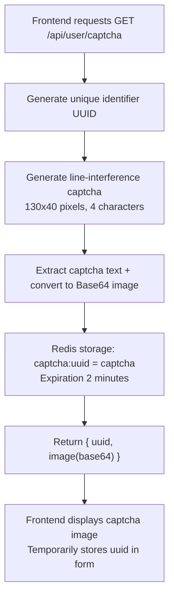

### 1.2 User Registration — `POST /api/user/register`

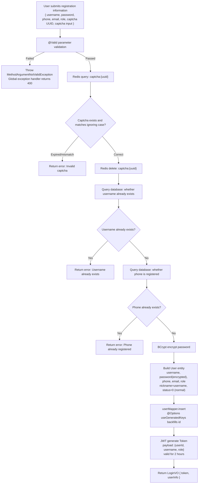

### 1.3 User Login — `POST /api/user/login`

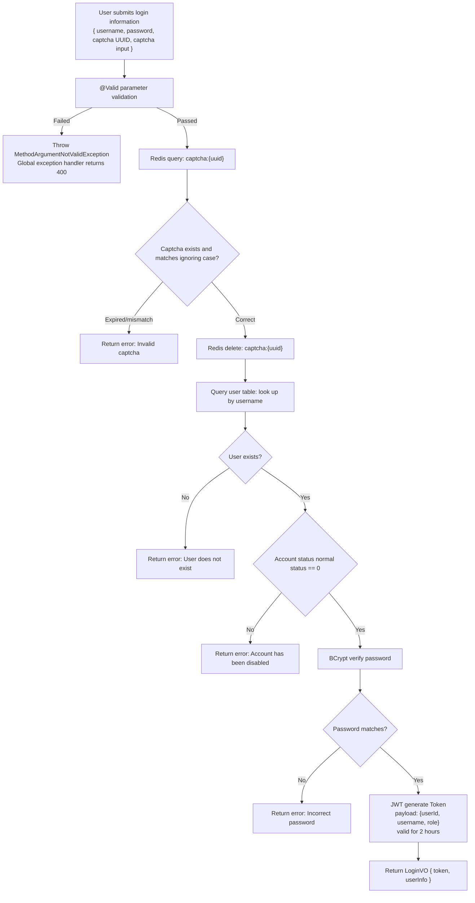

### 1.4 Token Refresh — `POST /api/user/refresh`

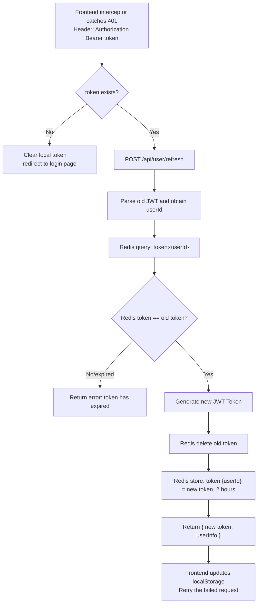

### 1.5 User Logout — `POST /api/user/logout`

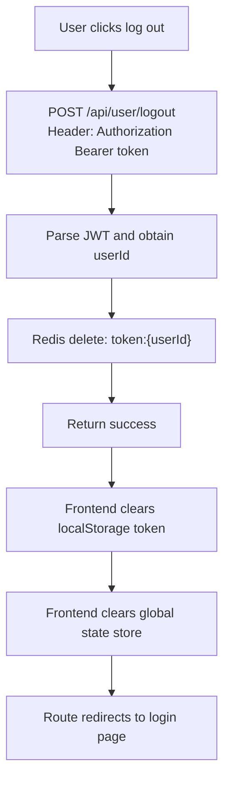

### 1.6 Forgot Password — Send Verification Code `POST /api/user/forgot-code`

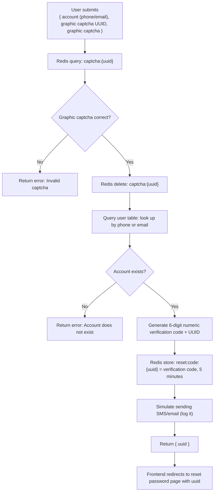

### 1.7 Reset Password — `POST /api/user/reset-password`

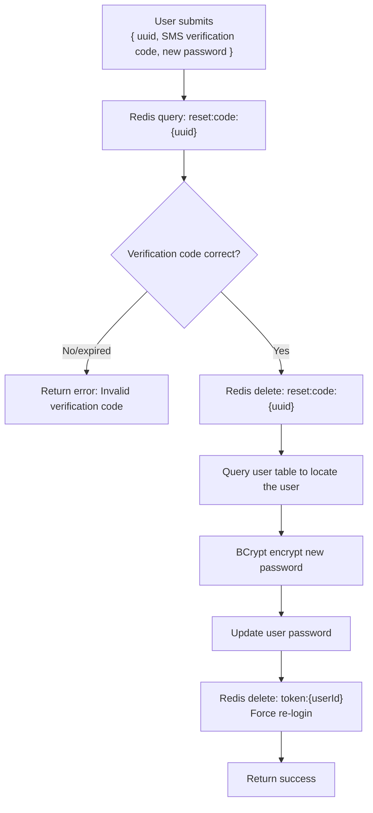

### 1.8 Change Password — `PUT /api/user/change-password`

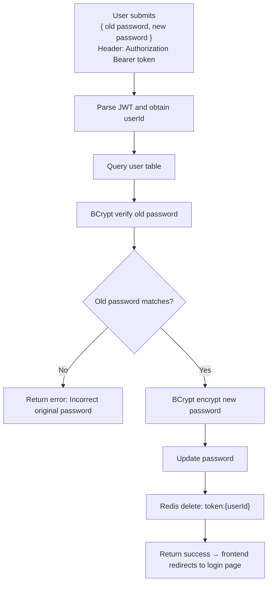

### 1.9 Get Current User Information — `GET /api/user/info`

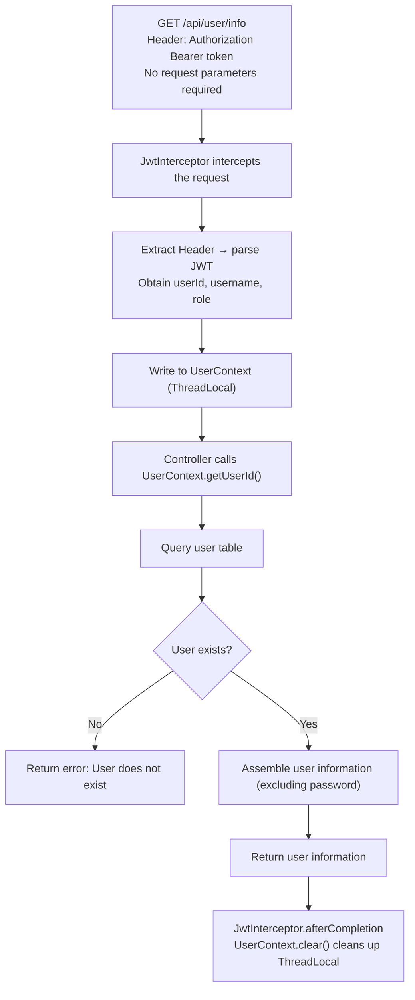

### 1.10 Update Personal Information — `PUT /api/user/profile`

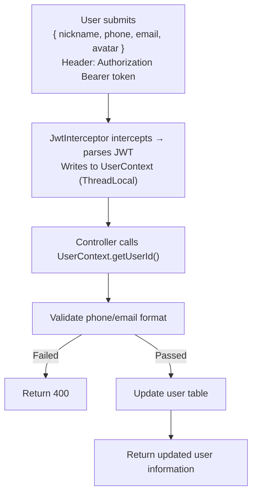

---

## II. Product Module

### 2.1 Product List Query — `GET /api/product/list`

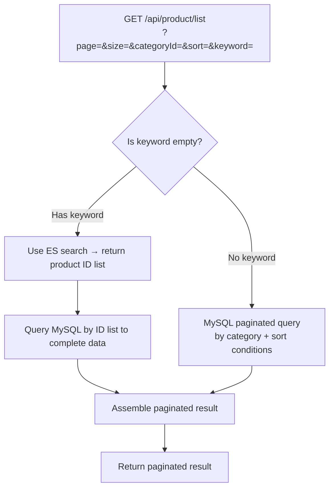

### 2.2 Product Details — `GET /api/product/detail/{id}`

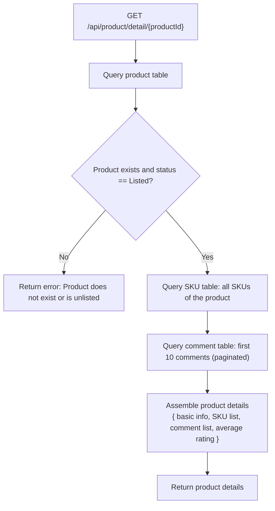

### 2.3 Create Product — `POST /api/product/create`

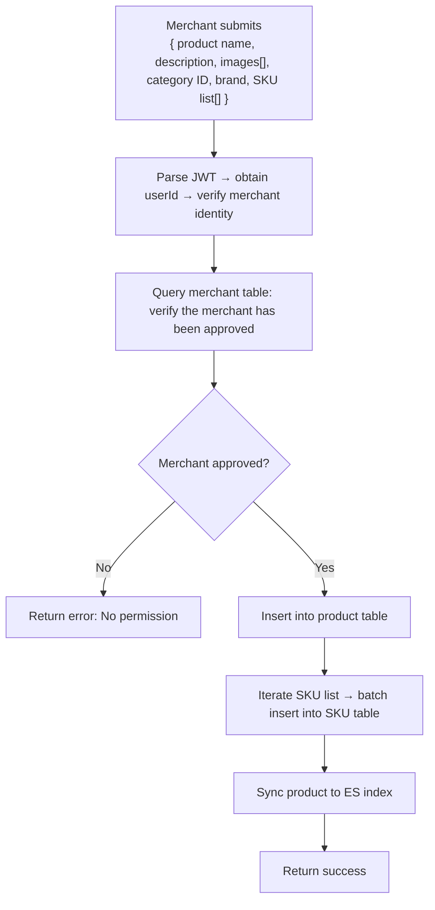

### 2.4 Update Product — `PUT /api/product/update/{id}`

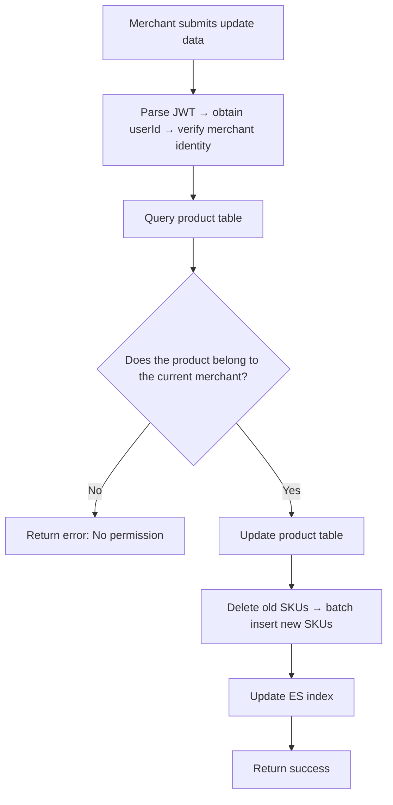

### 2.5 List Product — `PUT /api/product/on-shelf/{id}`

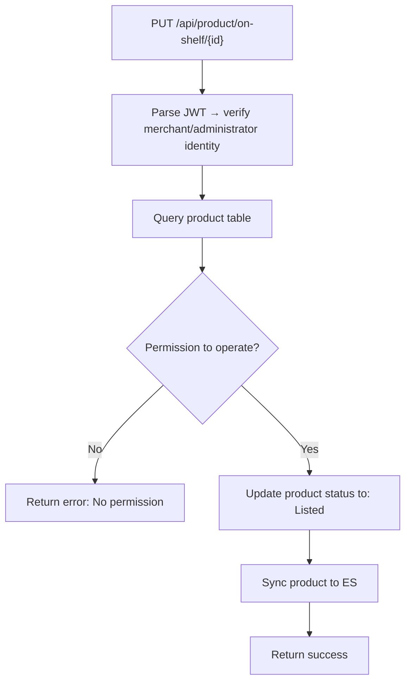

### 2.6 Unlist Product — `PUT /api/product/off-shelf/{id}`

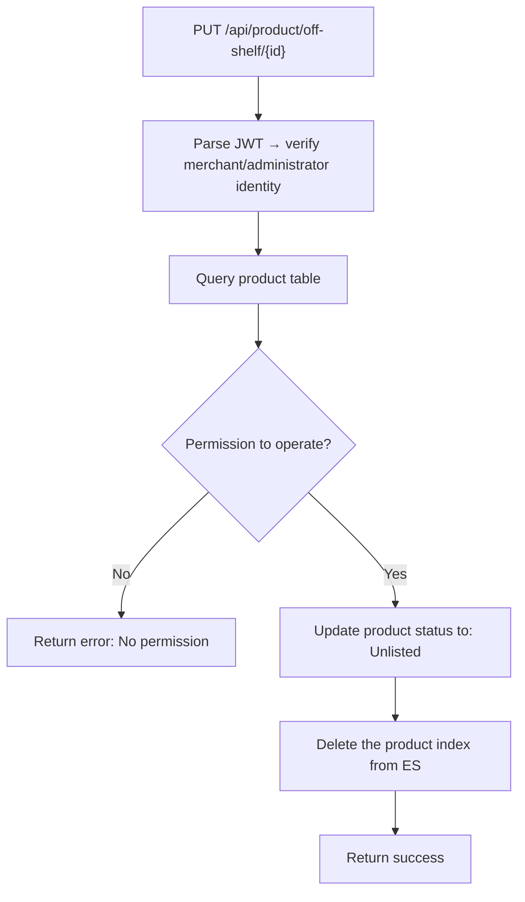

---

## III. Category Module

### 3.1 Get Category Tree — `GET /api/category/tree`

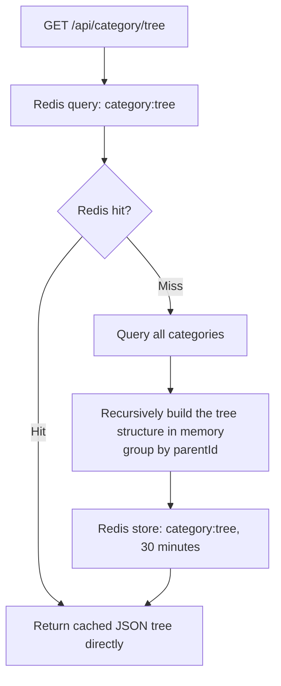

### 3.2 Add Category — `POST /api/category`

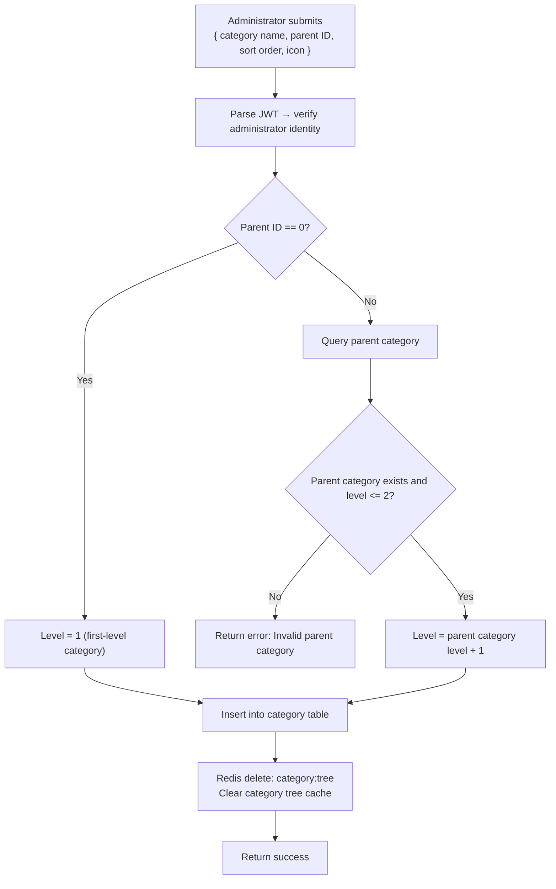

### 3.3 Edit Category — `PUT /api/category/{id}`

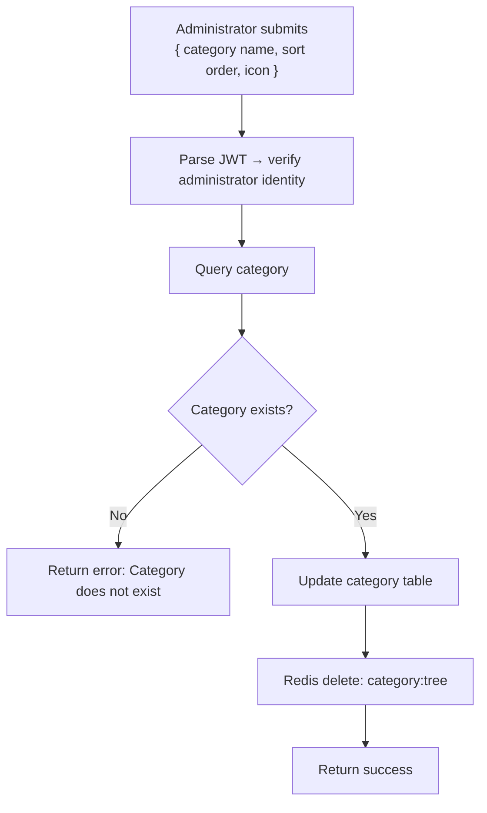

### 3.4 Delete Category — `DELETE /api/category/{id}`

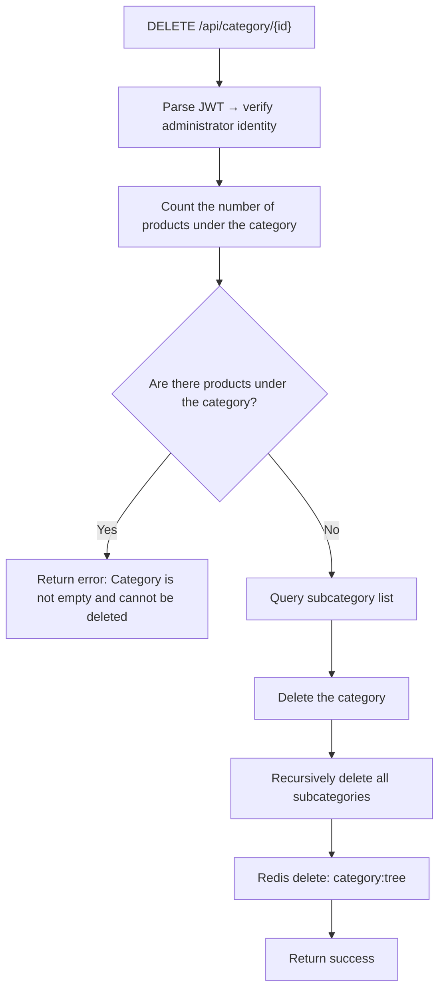

---

## IV. Cart Module

### 4.1 Cart List — `GET /api/cart/list`

```mermaid
flowchart TD
    A["GET /api/cart/list<br/>Header: Authorization Bearer token"] --> B["Parse JWT and obtain userId"]
    B --> C["Query cart table: all items of the current user"]
    C --> D["Iterate: join query product table + SKU table<br/>complete name/image/specification/unit price"]
    D --> E["Assemble cart list<br/>{ product name, image, SKU specification, unit price, quantity, subtotal, selected status }"]
    E --> F["Return cart list + total amount"]
```

### 4.2 Add to Cart — `POST /api/cart/add`

```mermaid
flowchart TD
    A["User submits<br/>{ SKU_ID, quantity }<br/>Header: Authorization Bearer token"] --> B["Parse JWT and obtain userId"]
    B --> C["Query SKU table"]
    C --> D{"SKU exists and stock >= quantity?"}
    D -->|No| E["Return error: Insufficient stock"]
    D -->|Yes| F["Query product table"]
    F --> G{"Product status == Listed?"}
    G -->|No| H["Return error: Product has been unlisted"]
    G -->|Yes| I["Query cart table: whether the SKU is already present"]
    I --> J{"Product already in cart?"}
    J -->|Yes| K["Update: quantity = original quantity + new quantity"]
    J -->|No| L["Insert cart item<br/>(userId, productId, skuId, quantity, selected=1)"]
    K --> M["Return success"]
    L --> M
```

### 4.3 Update Quantity — `PUT /api/cart/update`

```mermaid
flowchart TD
    A["User submits<br/>{ cart item ID, quantity }"] --> B["Parse JWT and obtain userId"]
    B --> C["Query cart item"]
    C --> D{"Belongs to the current user?"}
    D -->|No| E["Return error: No permission to operate"]
    D -->|Yes| F{"Quantity > 0?"}
    F -->|Yes| G["Query SKU stock"]
    G --> H{"Stock >= quantity?"}
    H -->|No| I["Return error: Insufficient stock"]
    H -->|Yes| J["Update cart quantity"]
    F -->|Quantity == 0| K["Delete the cart item"]
    J --> L["Return success"]
    K --> L
```

### 4.4 Select/Deselect — `PUT /api/cart/select`

```mermaid
flowchart TD
    A["User submits<br/>{ selected cart item IDs[] }"] --> B["Parse JWT and obtain userId"]
    B --> C["First set all items of the user to unselected"]
    C --> D["Then batch set the specified items to selected"]
    D --> E["Return success"]
```

### 4.5 Delete Cart Item — `DELETE /api/cart/{id}`

```mermaid
flowchart TD
    A["DELETE /api/cart/{cartItemId}"] --> B["Parse JWT and obtain userId"]
    B --> C["Query cart item"]
    C --> D{"Belongs to the current user?"}
    D -->|No| E["Return error: No permission to operate"]
    D -->|Yes| F["Delete the cart item"]
    F --> G["Return success"]
```

---

## V. Order Module

### 5.1 Get Anti-duplication Token — `GET /api/order/submit-token`

```mermaid
flowchart TD
    A["Frontend checkout page loads<br/>GET /api/order/submit-token"] --> B["Parse JWT and obtain userId"]
    B --> C["Generate unique identifier UUID"]
    C --> D["Redis store: submit:{userId}:{uuid} = 1, 5 minutes"]
    D --> E["Return { token: uuid }"]
```

### 5.2 Create Order — `POST /api/order/create`

```mermaid
flowchart TD
    A["User submits order data<br/>{ anti-duplication Token, address ID, cart item IDs[] }"] --> B["Parse JWT and obtain userId"]
    B --> C["Redis delete: submit:{userId}:{token}"]
    C --> D{"Delete returns 1?"}
    D -->|Returns 0| E["Return error: Do not submit repeatedly (token already used/expired)"]
    D -->|Returns 1| F["Redis acquire distributed lock: lock:order:{userId}, 10 seconds"]
    F --> G{"Lock acquired successfully?"}
    G -->|No| H["Return error: Too many operations"]
    G -->|Yes| I["Begin database transaction"]
    I --> J["Query selected cart items"]
    J --> K["Iterate and validate: query SKU stock >= quantity"]
    K --> L{"All stock sufficient?"}
    L -->|No| M["Roll back transaction → return error: Insufficient stock"]
    L -->|Yes| N["Query shipping address → save JSON snapshot"]
    N --> O["Generate order number (timestamp + random number)"]
    O --> P["Insert into order table → calculate total amount"]
    P --> Q["Batch insert order items<br/>snapshot unit price/quantity/subtotal"]
    Q --> R["Iterate and deduct stock<br/>UPDATE stock = stock - quantity WHERE stock >= quantity"]
    R --> S["Delete the ordered cart items"]
    S --> T["Commit transaction"]
    T --> U["Release distributed lock: lock:order:{userId}"]
    U --> V["Return { order ID, order number }"]
```

### 5.3 Order List — `GET /api/order/list`

```mermaid
flowchart TD
    A["GET /api/order/list<br/>?page=&size=&status="] --> B["Parse JWT and obtain userId"]
    B --> C["Paginated query on order table<br/>filter by userId + status"]
    C --> D["Iterate: query order items"]
    D --> E["Assemble paginated result"]
    E --> F["Return order list"]
```

### 5.4 Order Details — `GET /api/order/detail/{id}`

```mermaid
flowchart TD
    A["GET /api/order/detail/{orderId}"] --> B["Parse JWT and obtain userId"]
    B --> C["Query order table"]
    C --> D{"Does the order belong to the current user?"}
    D -->|No| E["Return error: No permission to view"]
    D -->|Yes| F["Query order items"]
    F --> G["Query payment records"]
    G --> H["Query refund records"]
    H --> I["Assemble order details"]
    I --> J["Return order details"]
```

### 5.5 Cancel Order — `PUT /api/order/cancel/{id}`

```mermaid
flowchart TD
    A["PUT /api/order/cancel/{orderId}<br/>?reason=cancellation reason"] --> B["Parse JWT and obtain userId"]
    B --> C["Query order table"]
    C --> D{"Does the order belong to the current user?"}
    D -->|No| E["Return error: No permission to operate"]
    D -->|Yes| F{"Order status == Pending Payment?"}
    F -->|No| G["Return error: Cannot cancel in the current status"]
    F -->|Yes| H["Update order status to: Cancelled<br/>Record cancellation reason"]
    H --> I["Restore stock<br/>Query order items → add each SKU's stock back"]
    I --> J["Return success"]
```

### 5.6 Confirm Receipt — `PUT /api/order/receive/{id}`

```mermaid
flowchart TD
    A["PUT /api/order/receive/{orderId}"] --> B["Parse JWT and obtain userId"]
    B --> C["Query order table"]
    C --> D{"Does the order belong to the current user?"}
    D -->|No| E["Return error: No permission to operate"]
    D -->|Yes| F{"Order status == Shipped?"}
    F -->|No| G["Return error: Cannot confirm receipt in the current status"]
    F -->|Yes| H["Update order status to: Received<br/>Record receipt time"]
    H --> I["Automatically transition to: Completed"]
    I --> J["Return success"]
```

---

## VI. Payment Module

### 6.1 Card Payment — `POST /api/payment/card`

```mermaid
flowchart TD
    A["User submits bank card information<br/>{ order ID, card number, expiry date, CVV }"] --> B["Parse JWT and obtain userId"]
    B --> C["Query order table"]
    C --> D{"Order belongs to current user && status == Pending Payment?"}
    D -->|No| E["Return error: Abnormal order status"]
    D -->|Yes| F["Query payment table: whether the order already has a record"]
    F --> G{"Payment record already exists?"}
    G -->|Paid| H["Return directly: Already paid (idempotent)"]
    G -->|None/unpaid| I["Validate card number with Luhn algorithm"]
    I --> J{"Card number valid?"}
    J -->|No| K["Return error: Invalid card number"]
    J -->|Yes| L["Validate expiry date"]
    L --> M{"Not expired?"}
    M -->|Expired| N["Return error: Card has expired"]
    M -->|Not expired| O["Simulate deduction → insert payment record (status=success)"]
    O --> P["Update order status to: Paid<br/>Record payment time"]
    P --> Q["Update product sales +1"]
    Q --> R["Return payment success"]
```

### 6.2 Generate Payment QR Code — `POST /api/payment/qrcode`

```mermaid
flowchart TD
    A["POST /api/payment/qrcode<br/>{ order ID }"] --> B["Parse JWT and obtain userId"]
    B --> C["Query order table"]
    C --> D{"Order valid?"}
    D -->|No| E["Return error: Order does not exist"]
    D -->|Yes| F["Generate QR code content<br/>(order ID + amount + timestamp)"]
    F --> G["Redis store: qrcode:{orderId} = pending payment, 5 minutes"]
    G --> H["Return { QR code content }"]
```

### 6.3 Confirm QR Code Payment — `POST /api/payment/confirm-qrcode`

```mermaid
flowchart TD
    A["POST /api/payment/confirm-qrcode<br/>{ order ID }"] --> B["Parse JWT and obtain userId"]
    B --> C["Redis query: qrcode:{orderId}"]
    C --> D{"QR code not expired?"}
    D -->|Expired/nonexistent| E["Return error: QR code has expired"]
    D -->|Exists| F["Query payment table: whether the order has been paid"]
    F --> G{"Paid?"}
    G -->|Paid| H["Return directly: Already paid (idempotent)"]
    G -->|Unpaid| I["Insert payment record (method=QR code, status=success)"]
    I --> J["Update order status to: Paid"]
    J --> K["Redis delete: qrcode:{orderId}"]
    K --> L["Update product sales"]
    L --> M["Return payment success"]
```

---

## VII. Shipping Address Module

### 7.1 Address List — `GET /api/address/list`

```mermaid
flowchart TD
    A["GET /api/address/list"] --> B["Parse JWT and obtain userId"]
    B --> C["Query address table: all addresses of the current user<br/>sort by default first + creation time descending"]
    C --> D["Return address list"]
```

### 7.2 Add Address — `POST /api/address`

```mermaid
flowchart TD
    A["User submits<br/>{ recipient, phone, province, city, district, detailed address, whether default }"] --> B["Parse JWT and obtain userId"]
    B --> C{"Set as default address?"}
    C -->|Yes| D["First unset the default flag on the user's other addresses"]
    C -->|No| E["Insert into address table"]
    D --> E
    E --> F["Return success"]
```

### 7.3 Edit Address — `PUT /api/address/{id}`

```mermaid
flowchart TD
    A["PUT /api/address/{id}<br/>{ recipient, phone, ... , whether default }"] --> B["Parse JWT and obtain userId"]
    B --> C["Query address"]
    C --> D{"Does the address belong to the current user?"}
    D -->|No| E["Return error: No permission to operate"]
    D -->|Yes| F{"Set as default?"}
    F -->|Yes| G["First unset the default flag on other addresses"]
    F -->|No| H["Update address table"]
    G --> H
    H --> I["Return success"]
```

### 7.4 Delete Address — `DELETE /api/address/{id}`

```mermaid
flowchart TD
    A["DELETE /api/address/{addressId}"] --> B["Parse JWT and obtain userId"]
    B --> C["Query address"]
    C --> D{"Does the address belong to the current user?"}
    D -->|No| E["Return error: No permission to operate"]
    D -->|Yes| F["Check whether there are associated incomplete orders"]
    F --> G{"Associated incomplete orders?"}
    G -->|Yes| H["Return error: Cannot delete; associated orders exist"]
    G -->|No| I["Delete address"]
    I --> J["Return success"]
```

### 7.5 Set as Default Address — `PUT /api/address/default/{id}`

```mermaid
flowchart TD
    A["PUT /api/address/default/{addressId}"] --> B["Parse JWT and obtain userId"]
    B --> C["Query address"]
    C --> D{"Does the address belong to the current user?"}
    D -->|No| E["Return error: No permission to operate"]
    D -->|Yes| F["First unset the default flag on all of the user's addresses"]
    F --> G["Set the specified address as default"]
    G --> H["Return success"]
```

---

## VIII. Comment Module

### 8.1 Comment List — `GET /api/comment/list/{productId}`

```mermaid
flowchart TD
    A["GET /api/comment/list/{productId}<br/>?page=&size=&star="] --> B["Paginated query on comment table<br/>filter by product ID + rating"]
    B --> C["Iterate: query user table for avatar/nickname"]
    C --> D["Iterate: query comment table for follow-up reviews/replies"]
    D --> E["Assemble paginated result"]
    E --> F["Return comment list"]
```

### 8.2 Post Initial Review — `POST /api/comment`

```mermaid
flowchart TD
    A["User submits<br/>{ product ID, order item ID, content, rating, images[] }"] --> B["Parse JWT and obtain userId"]
    B --> C["Query order item"]
    C --> D{"Does the order item belong to the current user?"}
    D -->|No| E["Return error: No permission to review"]
    D -->|Yes| F["Query order table"]
    F --> G{"Order status == Received/Completed?"}
    G -->|No| H["Return error: Can only review after receipt"]
    G -->|Yes| I["Query comment table: whether the order item already has an initial review"]
    I --> J{"Initial review already exists?"}
    J -->|Yes| K["Return error: Already reviewed"]
    J -->|No| L["Insert comment (type=initial review)"]
    L --> M["Upload images to OSS → save image URLs"]
    M --> N["Update product rating cache"]
    N --> O["Return success"]
```

### 8.3 Post Follow-up Review — `POST /api/comment/append`

```mermaid
flowchart TD
    A["User submits<br/>{ initial review ID, follow-up content }"] --> B["Parse JWT and obtain userId"]
    B --> C["Query initial review record"]
    C --> D{"Initial review exists && belongs to current user && no follow-up yet?"}
    D -->|No| E["Return error: Cannot post follow-up review"]
    D -->|Yes| F["Insert comment (linked to initial review ID, type=follow-up review)"]
    F --> G["Return success"]
```

### 8.4 Merchant Reply — `POST /api/comment/reply`

```mermaid
flowchart TD
    A["Merchant submits<br/>{ comment ID, reply content }"] --> B["Parse JWT and obtain userId"]
    B --> C["Query merchant table: verify merchant identity and approval status"]
    C --> D{"Is a merchant and approved?"}
    D -->|No| E["Return error: No permission"]
    D -->|Yes| F["Query the comment"]
    F --> G["Query the product corresponding to the comment"]
    G --> H{"Does the product belong to the current merchant?"}
    H -->|No| I["Return error: No permission to reply"]
    H -->|Yes| J["Insert comment (linked to comment ID, type=reply)"]
    J --> K["Return success"]
```

---

## IX. Refund/Return Module

### 9.1 Apply for Refund/Return — `POST /api/refund`

```mermaid
flowchart TD
    A["User submits<br/>{ order item ID, type (refund/return), reason, amount }"] --> B["Parse JWT and obtain userId"]
    B --> C["Query order item"]
    C --> D{"Does the order item belong to the current user?"}
    D -->|No| E["Return error: No permission to operate"]
    D -->|Yes| F["Query order table"]
    F --> G{"Order status IN [Paid, Shipped, Received]?"}
    G -->|No| H["Return error: Cannot refund in the current status"]
    G -->|Yes| I["Query refund table: whether the item already has a refund record"]
    I --> J{"Refund record already exists?"}
    J -->|Yes| K["Return error: Refund already requested"]
    J -->|No| L["Insert refund record (status=Pending Review)"]
    L --> M["Return success"]
```

### 9.2 Refund List — `GET /api/refund/list`

```mermaid
flowchart TD
    A["GET /api/refund/list?page=&size="] --> B["Parse JWT → obtain userId → obtain role"]
    B --> C{"Role?"}
    C -->|Regular User| D["Query refund table: filter by userId"]
    C -->|Merchant| E["Query refund table: filter by merchant ID"]
    C -->|Administrator| F["Query refund table: all"]
    D --> G["Assemble paginated result"]
    E --> G
    F --> G
    G --> H["Return refund list"]
```

### 9.3 Review Refund — `PUT /api/refund/{id}/review`

```mermaid
flowchart TD
    A["Merchant/Administrator submits<br/>{ review result, reason }"] --> B["Parse JWT → obtain userId → role"]
    B --> C["Query refund record"]
    C --> D{"Has review permission?"}
    D -->|No| E["Return error: No permission"]
    D -->|Yes| F{"Refund status == Pending Review?"}
    F -->|No| G["Return error: Already reviewed"]
    F -->|Yes| H{"Approve?"}
    H -->|Reject| I["Update refund status: Rejected<br/>Record rejection reason"]
    H -->|Approve| J{"Refund type?"}
    J -->|Refund Only| K["Update refund status: Approved"]
    J -->|Return| L["Update refund status: Under Review<br/>Waiting for the user to send the item back"]
    K --> M["Update order status: Cancelled/Refund Completed"]
    M --> N["Restore stock"]
    N --> O["Return success"]
    I --> O
```

---

## X. Instant Messaging Module

### 10.1 Get Conversation List — `GET /api/chat/conversations`

```mermaid
flowchart TD
    A["GET /api/chat/conversations"] --> B["Parse JWT and obtain userId"]
    B --> C["Query conversation table: all conversations of the current user"]
    C --> D["Iterate: calculate unread counts → assemble conversation list"]
    D --> E["Return conversation list"]
```

### 10.2 Get Message History — `GET /api/chat/messages/{conversationId}`

```mermaid
flowchart TD
    A["GET /api/chat/messages/{conversationId}<br/>?page=&size="] --> B["Parse JWT and obtain userId"]
    B --> C["Query conversation table"]
    C --> D{"Does the conversation include the current user?"}
    D -->|No| E["Return error: No permission to view"]
    D -->|Yes| F["Paginated query on message table"]
    F --> G["Mark as read: update messages sent by the other party in the message table as read"]
    G --> H["Reset the conversation's unread count to zero"]
    H --> I["Return paginated message list"]
```

### 10.3 WebSocket Connection Establishment — `ws://host/chat/{userId}`

```mermaid
sequenceDiagram
    actor Frontend as Frontend WebSocket
    participant Backend as WebSocket Server
    participant Redis as Redis
    participant DB as Database

    Frontend ->> Backend: ws://host/chat/{userId}?token=xxx
    Backend ->> Backend: Parse JWT to verify identity
    alt Invalid Token
        Backend -->> Frontend: Close connection (1008)
    else Valid Token
        Backend ->> Redis: Store ws:{userId} = sessionId
        Backend ->> DB: Query the user's conversation list
        Backend -->> Frontend: Return online conversation list + unread count
    end
```

### 10.4 WebSocket Send Message

```mermaid
sequenceDiagram
    actor UserA as User A
    participant WS as WebSocket Server
    participant DB as Database
    participant Redis as Redis
    actor UserB as User B (Merchant)

    UserA ->> WS: Send message { conversationId, content, type }
    WS ->> WS: Parse JSON
    WS ->> DB: Save message to message table
    WS ->> DB: Update conversation table (last message content + time)
    WS ->> DB: Increment the other party's unread count by 1
    WS ->> Redis: Query ws:{otherUserId}
    alt Other party online
        WS -->> UserB: Push message in real time
    else Other party offline
        WS ->> WS: Message persisted; wait for the other party to come online and pull
    end
    WS -->> UserA: Echo message (sent status)
```

### 10.5 WebSocket Close Connection

```mermaid
sequenceDiagram
    actor Frontend as Frontend
    participant Backend as WebSocket Server
    participant Redis as Redis

    Frontend ->> Backend: WebSocket close / page closed
    Backend ->> Backend: Close event triggered
    Backend ->> Redis: Delete ws:{userId}
    Backend ->> Backend: Clean up local session cache
```

---

## XI. Merchant Module

### 11.1 Merchant Onboarding Application — `POST /api/merchant/apply`

```mermaid
flowchart TD
    A["User submits<br/>{ store name, business license, contact phone }"] --> B["Parse JWT and obtain userId"]
    B --> C["Query user table"]
    C --> D{"User role == Merchant?"}
    D -->|No| E["Return error: Not a merchant role"]
    D -->|Yes| F["Query merchant table: whether an application record already exists"]
    F --> G{"Application record already exists?"}
    G -->|Approved| H["Return error: Already a merchant"]
    G -->|Pending Review| I["Return error: Under review, please wait"]
    G -->|Rejected| J["Can resubmit → update the original record"]
    G -->|No record| K["Insert merchant record (status=Pending Review)"]
    J --> L["Return success"]
    K --> L
```

### 11.2 Merchant Order Management — `GET /api/merchant/orders`

```mermaid
flowchart TD
    A["GET /api/merchant/orders<br/>?page=&size=&status="] --> B["Parse JWT and obtain userId"]
    B --> C["Query merchant table"]
    C --> D{"Merchant approved?"}
    D -->|No| E["Return error: No permission"]
    D -->|Yes| F["Paginated query on order table: filter by merchant ID + status"]
    F --> G["Assemble paginated result"]
    G --> H["Return order list"]
```

### 11.3 Merchant Shipment — `PUT /api/merchant/order/{id}/ship`

```mermaid
flowchart TD
    A["Merchant submits<br/>{ tracking number, logistics company }"] --> B["Parse JWT and obtain userId"]
    B --> C["Query order table"]
    C --> D{"Do the products in the order belong to the current merchant?"}
    D -->|No| E["Return error: No permission to operate"]
    D -->|Yes| F{"Order status == Paid?"}
    F -->|No| G["Return error: Cannot ship in the current status"]
    F -->|Yes| H["Update order status: Shipped<br/>Record shipping time + logistics information"]
    H --> I["Return success"]
```

### 11.4 Sales Statistics — `GET /api/merchant/stats`

```mermaid
flowchart TD
    A["GET /api/merchant/stats?startDate=&endDate="] --> B["Parse JWT and obtain userId"]
    B --> C["Aggregate query on order table<br/>by merchant ID + time range"]
    C --> D["Statistics dimensions<br/>Revenue / Order Volume / Sales Ranking / Refund Rate / Time-period Trend"]
    D --> E["Assemble statistics result and return"]
```

---

## XII. Administrator Module

### 12.1 User List — `GET /api/admin/users`

```mermaid
flowchart TD
    A["GET /api/admin/users<br/>?page=&size=&keyword=&status="] --> B["Parse JWT → verify administrator role"]
    B --> C{"Role == Administrator?"}
    C -->|No| D["Return error: No permission"]
    C -->|Yes| E["Paginated query on user table<br/>filter by keyword + status"]
    E --> F["Return paginated user list"]
```

### 12.2 Disable/Enable User — `PUT /api/admin/user/{id}/disable|enable`

```mermaid
flowchart TD
    A["PUT /api/admin/user/{userId}/disable|enable"] --> B["Parse JWT → verify administrator"]
    B --> C{"Administrator?"}
    C -->|No| D["Return error: No permission"]
    C -->|Yes| E["Query user table"]
    E --> F["Update user status (disabled/enabled)"]
    F --> G{"Is this a disable operation?"}
    G -->|Yes| H["Redis delete: token:{userId}<br/>Force logout"]
    G -->|No| I["Return success"]
    H --> I
```

### 12.3 Merchant Review List — `GET /api/admin/merchants`

```mermaid
flowchart TD
    A["GET /api/admin/merchants<br/>?page=&size=&status="] --> B["Parse JWT → verify administrator"]
    B --> C["Paginated query on merchant table<br/>filter by review status"]
    C --> D["Assemble paginated result"]
    D --> E["Return merchant application list"]
```

### 12.4 Review Merchant — `PUT /api/admin/merchant/{id}/audit`

```mermaid
flowchart TD
    A["Administrator submits<br/>{ review result, reason }"] --> B["Parse JWT → verify administrator"]
    B --> C["Query merchant record"]
    C --> D{"Status == Pending Review?"}
    D -->|No| E["Return error: Already reviewed"]
    D -->|Yes| F{"Approve?"}
    F -->|Approve| G["Update merchant status: Approved<br/>Record review time"]
    F -->|Reject| H["Update merchant status: Rejected<br/>Record rejection reason + review time"]
    G --> I["Return success"]
    H --> I
```

### 12.5 Global Orders — `GET /api/admin/orders`

```mermaid
flowchart TD
    A["GET /api/admin/orders<br/>?page=&size=&status=&startDate=&endDate="] --> B["Parse JWT → verify administrator"]
    B --> C["Paginated query on order table<br/>filter by status + time range (all merchants)"]
    C --> D["Assemble paginated result"]
    D --> E["Return platform-wide order list"]
```

### 12.6 Data Report — `GET /api/admin/report`

```mermaid
flowchart TD
    A["GET /api/admin/report?startDate=&endDate="] --> B["Parse JWT → verify administrator"]
    B --> C["Aggregate statistics"]
    C --> D["Platform GMV / New users / Total orders"]
    C --> E["Refund rate / Top 10 best-selling categories / Merchant ranking"]
    C --> F["Sales trend by time period"]
    D --> G["Assemble report and return"]
    E --> G
    F --> G
```

---

## XIII. Search Module

### 13.1 Search Suggestions — `POST /api/search/suggest`

```mermaid
flowchart TD
    A["User enters keyword (triggered in real time)"] --> B["POST /api/search/suggest<br/>{ keyword }"]
    B --> C["Build ES suggest DSL<br/>completion autocomplete query"]
    C --> D["Query ES: product_index"]
    D --> E["ES returns suggestion term list"]
    E --> F["Return suggestion term list"]
```

### 13.2 Product Search — `POST /api/search`

```mermaid
flowchart TD
    A["User presses Enter to search<br/>POST /api/search<br/>{ keyword, page, size, filters[], sort }"] --> B["Build ES search DSL"]
    B --> C["query: bool → must(multi_match: name, description, brand)"]
    C --> D["filter: term(brand) + range(price) + term(category)"]
    D --> E["sort: relevance/price/sales/new arrivals"]
    E --> F["aggs: brand aggregation + price range aggregation"]
    F --> G["Query ES: product_index"]
    G --> H["Parse ES results → extract product ID list"]
    H --> I["Query MySQL by ID list to complete data"]
    I --> J["Record search history in search history table"]
    J --> K["Return paginated results + aggregation filter conditions"]
```

### 13.3 Search History — `GET /api/search/history`

```mermaid
flowchart TD
    A["GET /api/search/history"] --> B["Parse JWT and obtain userId"]
    B --> C["Query search history table<br/>in descending order of search time, take the latest 20"]
    C --> D["Return search history list"]
```

### 13.4 Sync Products to ES

```mermaid
flowchart TD
    A["Triggered by product creation/listing/update"] --> B["Assemble ES document<br/>{ id, name, description, brand, category ID/name, price range, image, sales, status, autocomplete suggestion terms }"]
    B --> C["ES Index request: product_index / _doc / {productId}"]
    C --> D["ES automatically creates or updates the document"]
    D --> E["Sync complete"]
```

### 13.5 Delete Product from ES

```mermaid
flowchart TD
    A["Triggered by product unlisting"] --> B["ES Delete request: product_index / _doc / {productId}"]
    B --> C["Deletion complete"]
```

---

## XIV. Flash-sale Coupon Module

### 14.1 Coupon List and Details — `GET /api/seckill/list`, `GET /api/seckill/detail/{id}`

```mermaid
flowchart TD
    A["Coupon Center / Homepage coupon entry"] --> B["GET /api/seckill/list<br/>{ status?, page, size }"]
    B --> C["Validate status ∈ {0,1}, with pagination parameter fallbacks"]
    C --> D["Query seckill_coupon pagination + total count"]
    D --> E["Assemble SeckillCouponVO<br/>{ name, discount type/value, threshold, remaining quantity, per-user limit, time, status }"]
    E --> F["Return PageResult"]

    A --> G["Click coupon card"]
    G --> H["GET /api/seckill/detail/{id}"]
    H --> I{"Does the coupon exist"}
    I -->|No| J["404 Coupon not found"]
    I -->|Yes| K["Return coupon details"]
```

### 14.2 Claim Coupon — `POST /api/seckill/claim/{couponId}`

```mermaid
flowchart TD
    A["Logged-in user clicks to claim"] --> B["Validate coupon exists + activity is in progress"]
    B --> C["Redis lazy-load seckill:remain:{couponId}"]
    C --> D["DECR remaining stock"]
    D --> E{"Result < 0 ?"}
    E -->|Yes| F["Restore stock → Sold out"]
    E -->|No| G["INCR seckill:claimed:{couponId}:{userId}"]
    G --> H{"Exceeds per-user limit?"}
    H -->|Yes| I["Restore stock/count → Already claimed"]
    H -->|No| J["Insert user_coupon (status=0)"]
    J --> K["MySQL remain_count - 1"]
    K --> L["Return SeckillClaimVO"]
    J -->|Exception| M["Transaction rollback + Redis compensation"]
    C -->|Redis unavailable| N["Degrade: atomic database deduction<br/>UPDATE ... WHERE remain_count > 0"]
    N --> O["Validate per-user limit in database"]
```

**Key design:**

- Redis deducts stock first, then records the claim count, avoiding overselling and over-claiming under high concurrency.
- When Redis fails, degrade to atomic database deduction (`remain_count > 0` conditional update) to ensure availability.
- When database writes fail, compensate Redis (restore stock, roll back count) to ensure eventual consistency.

### 14.3 Order Deduction — `POST /api/seckill/calculate`

```mermaid
flowchart TD
    A["Select coupon on checkout page"] --> B["POST /api/seckill/calculate<br/>{ totalAmount, userCouponId }"]
    B --> C{"userCouponId is empty"}
    C -->|Yes| D["Original price is the amount payable"]
    C -->|No| E["Validate user coupon exists/belongs to current user/unused"]
    E --> F["Validate coupon not expired"]
    F --> G["Validate minimum spend threshold is met"]
    G --> H["Calculate discount: fixed-amount coupons use face value; percentage coupons calculated by discount rate"]
    H --> I["Return { originalAmount, discountAmount, finalAmount, couponName }"]
```

### 14.4 Admin Management and Status Refresh

| API | Permission | Description |
|------|------|------|
| `POST /api/seckill/create` | Administrator | Create coupon; initialize `remain_count` to `total_count` |
| `PUT /api/seckill/update/{id}` | Administrator | Modify coupon information; synchronize remaining stock and Redis keys when the total changes |
| `DELETE /api/seckill/{id}` | Administrator | Delete coupon |
| `GET /api/seckill/my-coupons` | Logged-in user | My coupons, filtered by unused/used/expired |

`SeckillStatusScheduler` refreshes once every 30 seconds:

- Not Started → In Progress: `start_time <= now and status = 0`
- In Progress → Ended: `end_time < now and status = 1`
- Unused user coupons are batch-marked as expired when the activity ends.

---

## XV. API List

| Module | Path Prefix | Number of APIs | Permission |
|------|----------|--------|------|
| User Authentication | `/api/user` | 9 | Public/Login |
| Product | `/api/product` | 6 | Public/Merchant/Administrator |
| Category | `/api/category` | 2 | Public/Administrator |
| Cart | `/api/cart` | 7 | Logged-in User/Merchant |
| Order | `/api/order` | 7 | Logged-in User/Merchant/Administrator |
| Payment | `/api/payment` | 3 | Logged-in User/Merchant |
| Shipping Address | `/api/address` | 6 | Logged-in User/Merchant |
| Comment | `/api/comment` | 4 | Guest view/Logged-in User/Merchant/Administrator |
| Refund | `/api/refund` | 4 | Logged-in User/Merchant/Administrator |
| Merchant | `/api/merchant` | 6 | Registered user onboarding/Merchant |
| Administrator | `/api/admin` | 10 | Administrator |
| File Upload | `/api/upload` | 1 | Logged-in User/Merchant/Administrator |
| Instant Messaging | `/api/chat` | 5 | Logged-in User/Merchant |
| Search | `/api/search` | 5 | Public/Logged-in User |
| Flash-sale Coupon | `/api/seckill` | 8 | Public view/Logged-in claim/Administrator |
| **Total** | | **83** | |

---

## XVI. Caching Strategy

| Caching Key | Type | Expiration | Purpose |
|----------|------|------|------|
| `captcha:{uuid}` | String | 2 minutes | Graphic captcha |
| `reset:code:{uuid}` | String | 5 minutes | Password reset verification code |
| `token:{userId}` | String(JWT) | 2 hours | User login state |
| `submit:{userId}:{uuid}` | String | 5 minutes | Order submission anti-duplication |
| `lock:order:{userId}` | String | 10 seconds | Order placement distributed lock |
| `qrcode:{orderId}` | String | 5 minutes | Payment QR code |
| `category:tree` | JSON | 30 minutes | Category tree |
| `ws:{userId}` | String | During connection | WebSocket session mapping |

---

## XVII. Database Tables and Responsibilities

| Table Name | Corresponding Module | Description |
|------|----------|------|
| `user` | Authentication | Basic user information, password hash, role, status |
| `merchant` | Merchant | Store information, business license, review status |
| `category` | Category | Category tree, level, sort order |
| `spec_template` | Product | Specification templates (color/size, etc.) |
| `spec_value` | Product | Specification values (red/XL, etc.) |
| `product` | Product | Basic product information, listed/unlisted status |
| `product_sku` | Product | Specification, price, stock |
| `cart_item` | Cart | User cart items, selected status |
| `order` | Order | Order master table, state transitions, address snapshot |
| `order_item` | Order | Order items, snapshot price and quantity |
| `payment` | Payment | Payment records, payment method |
| `refund` | Refund | Refund applications, review |
| `address` | Shipping Address | Shipping address |
| `comment` | Comment | Initial review/follow-up review/reply |
| `search_history` | Search | User search history |
| `conversation` | Instant Messaging | Conversation list |
| `message` | Instant Messaging | Message records |
| `seckill_coupon` | Flash-sale Coupon | Coupon definition, total/remaining quantity, activity time window |
| `user_coupon` | Flash-sale Coupon | User coupon claim records, usage status |
| `operation_log` | Admin Backend | AOP operation logs |

---

## XVIII. Transaction and Lock Design

| Scenario | Strategy | Description |
|------|------|------|
| Order placement | Distributed Lock + Database Transaction | Redis lock prevents concurrency; transaction guarantees atomicity of order + stock deduction |
| Stock deduction | Row-level lock `WHERE stock >= ?` | Prevents overselling |
| Claiming flash-sale coupons | Redis atomic deduction + Database Transaction | Redis `DECR`/`INCR` prevents overselling and over-claiming; compensate Redis if MySQL writes fail |
| Payment | Idempotency check | Query payment table to prevent duplicate charges |
| Refund review | Optimistic Locking (state machine) | Only the "Pending Review" status can be reviewed |

---

## XIX. Deployment Architecture

```mermaid
graph TB
    subgraph UserBrowser["User Browser"]
        BR["Browser"]
    end

    subgraph Nginx["Nginx (Port 80)"]
        NG["Static files + reverse proxy"]
    end

    subgraph App["Spring Boot Application (Port 8080)"]
        BE["chrono-bbs-server<br/>Runs as a single JAR"]
    end

    subgraph Infrastructure["Docker Compose Infrastructure"]
        DB[("MySQL 8.0<br/>Port 3306")]
        RD[("Redis 7<br/>Port 6379")]
        ES[("Elasticsearch 7.17<br/>Port 9200")]
    end

    BR -->|"/" static resources| NG
    BR -->|"/api/*"| NG
    BR -->|"/es/*"| NG
    BR -->|"ws:// /chat/"| NG

    NG -->|proxy_pass| BE
    NG -->|proxy_pass| ES
    NG -->|proxy_pass upgrade| BE

    BE --> DB
    BE --> RD
    BE --> ES
```

> The Maven multi-module setup (common / module-mapper / module-service / module-api / module-start) is only used for code layering and organization; at runtime it is merged into a single Spring Boot JAR.

---

## XX. Frontend Design Reference

### Page Route Structure

| Route | Page | Permission |
|------|------|------|
| `/` | Home product list | Public |
| `/product/:id` | Product details | Public |
| `/search` | Search results | Public |
| `/login` | Login | Public |
| `/register` | Register | Public |
| `/cart` | Cart | User |
| `/checkout` | Checkout | User |
| `/payment/:orderId` | Payment | User |
| `/orders` | Order list | User |
| `/order/:id` | Order details | User |
| `/profile` | Personal information | User |
| `/address` | Address management | User |
| `/chat` | Instant Messaging | User/Merchant |
| `/merchant/*` | Merchant Backend | Merchant |
| `/admin/*` | Administrator Backend | Administrator |

### Global State

| Store | Data | Purpose |
|-------|------|------|
| `userStore` | token / userInfo / role | Login state, permission checks |
| `cartStore` | items / totalCount / totalAmount | Cart |
| `chatStore` | conversations / unreadCount | Instant messaging unread |

### Data Flow

```mermaid
flowchart LR
    subgraph Vue["Vue Components"]
        V["Page Views"]
        C["Common Components"]
    end

    subgraph Store["Global State Pinia"]
        US["userStore<br/>token / userInfo / role"]
        CS["cartStore<br/>Cart data"]
        CHS["chatStore<br/>Conversations/Unread"]
    end

    subgraph API["API Layer"]
        AX["Axios<br/>Request/Response interceptors"]
    end

    subgraph Backend["Backend"]
        BE["Spring Boot<br/>REST API"]
        ES["Elasticsearch<br/>REST API"]
        WS["WebSocket<br/>ws://"]
    end

    V <--> US
    V <--> CS
    V <--> CHS
    C <--> US

    V --> AX
    AX --> BE
    V --> ES
    V --> WS

    AX -- "Request interception: inject Token" --> AX
    AX -- "Response interception: 401 → refresh → retry" --> AX
```

---

## Summary

| Module | Number of Functions | Description |
|------|--------|------|
| User Authentication | 10 | Captcha/register/login/logout/refresh/forgot password/reset password/change password/info/update profile |
| Product | 6 | List/details/create/update/list/unlist |
| Category | 4 | Category tree/add/edit/delete |
| Cart | 5 | List/add/update quantity/select/delete |
| Order | 6 | Anti-duplication token/create/list/details/cancel/confirm receipt |
| Payment | 3 | Card payment/QR code/confirm payment |
| Shipping Address | 5 | List/add/edit/delete/set default |
| Comment | 4 | List/initial review/follow-up review/merchant reply |
| Refund/Return | 3 | Apply/list/review |
| Instant Messaging | 5 | Conversation list/message history/WS connection/send/close |
| Merchant | 4 | Onboarding application/order management/shipment/statistics |
| Administrator | 6 | User management/disable-enable/merchant review/global orders/report |
| Search | 5 | Suggestions/search/history/sync ES/delete ES |
| **Total** | **66** | |
