# Object-Oriented Development Steps and Design Analysis for the Online Supermarket System

> [简体中文](../zh/object-oriented-development.md) | English

> This document uses the "Online Supermarket System" as its background to explain the complete object-oriented development steps from requirements to design, implementation, and testing, and analyzes the key design decisions.
>
> Note: This document focuses on analysis methods, responsibility allocation, and design steps. It describes things using business concepts and does not elaborate on specific technology products, frameworks, or code naming.

---

## I. Basic Understanding of Object-Oriented Development

### 1.1 Core Ideas

Object-oriented development is not about writing code first and adding design later; instead, it proceeds step by step around "objects":

1. **Identify objects**: Find things in the business that have clear responsibilities, such as User, Product, Order, and Coupon.
2. **Encapsulate behavior**: Keep data and operations on that data in the same object, avoiding the separation of data and behavior.
3. **Assign responsibilities**: Clarify what each object "is responsible for and not responsible for", and complete use cases through collaboration among objects.
4. **Abstraction and polymorphism**: Abstract common behavior and isolate the parts that change, making the system easy to extend.
5. **Iterative refinement**: Requirements, analysis, design, and implementation are not a one-off waterfall; they are progressively refined and repeatedly validated.

### 1.2 Analysis Path of This Project

This project adopts an analysis path that is "requirements-driven, use-case-centered, domain-model-as-backbone, responsibility-assignment-as-core":

The focus of this path is: **first figure out what the system needs to do, then decide which objects will do it, and only finally decide how to implement it**.

---

## II. Overall Steps of Object-Oriented Development

### 2.1 Eight Phases

| Phase | Core Question | Main Activities | Deliverables | Quality Check |
|------|----------|----------|--------|----------|
| 1. Requirements Elicitation | For whom and what problems does the system solve | Interviews, observation, organizing business processes, clarifying scope | Requirements list, business rules, constraints | Are roles complete? Is the boundary clear? |
| 2. Use Case Modeling | How users use the system | Identify roles, use cases, main flows and exception flows | Use case diagram, use case specifications | Does each role have complete use cases? |
| 3. Domain Analysis | What objects exist in the business | Noun analysis, identify objects and relationships, build a domain model | Domain object list, relationship diagram | Are object responsibilities single-purpose? Are relationships necessary? |
| 4. Object Analysis | What each object is responsible for | Responsibility assignment, object collaboration, sequence analysis | Responsibility table, collaboration diagram, sequence diagram | Is there a "god object"? Are responsibilities balanced? |
| 5. Architecture Design | How the system is layered and partitioned | Layering, module division, dependency direction, interface boundaries | Architecture diagram, module list | Are dependencies unidirectional? Are modules highly cohesive? |
| 6. Detailed Design | How each part is implemented | Object details, interface contracts, data model, states and exceptions | Class diagram, interface specification, data design, state diagram | Is the design implementable? Are exceptions covered? |
| 7. Implementation | How to turn the design into a runnable system | Code in dependency order, unit testing, integration | Runnable system, test records | Does it conform to the design? Do tests pass? |
| 8. Testing and Maintenance | Whether the system meets requirements | Integration testing, end-to-end testing, acceptance, defect fixing | Test report, issue list, change records | Requirements coverage, boundary coverage, regression passed |

### 2.2 Relationships Between Phases

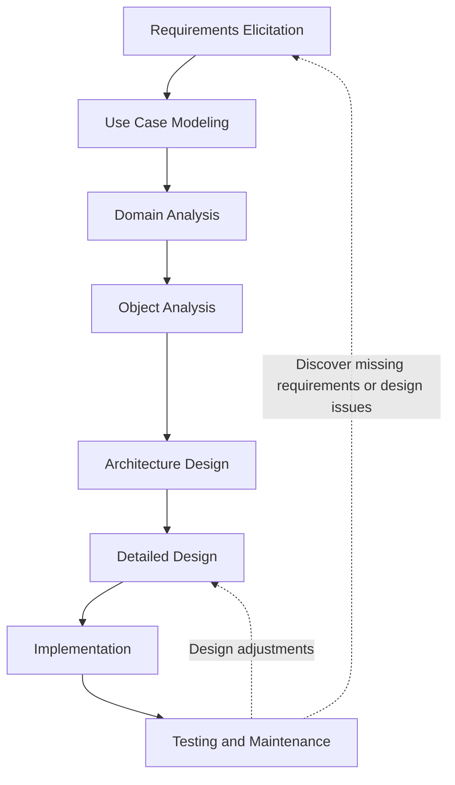

**Key principles:**

- Each phase must have clear inputs and outputs; you cannot move to the next phase "by feel".
- Problems found in the next phase must be traced back to the previous phase for correction, rather than patched temporarily in code.
- Documents are not the goal; their purpose is to keep requirements, design, and implementation traceable.

---

## III. Requirements Elicitation and Analysis

### 3.1 Business Goals and Scope

This system targets the online supermarket business. Its core goals are:

- Enable customers to find products by category or keyword, view product details, and complete purchases.
- Enable merchants to manage their own products, orders, refunds, and comments.
- Enable administrators to manage users, review merchants, manage categories and platform-wide product orders, and view sales reports.
- Through collaboration among objects such as Cart, Order, Payment, Refund, and Coupon, form a complete transaction loop.

**Scope boundaries:**

- Included: product browsing, cart, order placement, simulated payment, refunds, comments, merchant onboarding, backend management, coupons.
- Not included: real bank payment clearing, real logistics tracking, real SMS/email channels.
- Designed for but not fully implemented at present: search service, real-time chat.

### 3.2 Role Identification

| Role | Goal | Main Use Cases |
|------|------|----------|
| Guest | Browse products and decide whether to register | Browse products, view details, filter by category, view comments, browse the coupon center |
| Registered User | Complete purchases, after-sales, and interaction | Login, cart, place order, pay, confirm receipt, refund, comment, claim coupons |
| Merchant | Run the store and handle orders and after-sales | Onboarding application, product management, inventory management, order shipment, refund review, comment reply, sales statistics |
| Administrator | Maintain platform order and data | User management, merchant review, category management, platform-wide product/order management, refund review, coupon management, sales reports |

### 3.3 Use Case Diagram

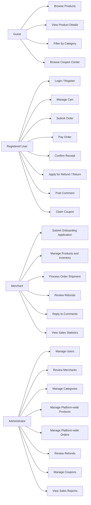

### 3.4 Core Use Case Specifications

#### Use Case 1: User Registration and Login

| Item | Content |
|------|------|
| Actors | Guest, Registered User |
| Preconditions | The user can access the system |
| Main Flow | Enter account information → verify captcha → verify account uniqueness → create user → return login state |
| Exception Flow | Account already exists, invalid captcha, password does not meet rules, account disabled |
| Postconditions | The user obtains a login state and can access use cases requiring identity |

#### Use Case 2: Browse and Find Products

| Item | Content |
|------|------|
| Actors | Guest, Registered User, Merchant, Administrator |
| Preconditions | The product is listed |
| Main Flow | Enter homepage → filter level by level by category or enter keywords → view product list → open product details |
| Exception Flow | Category does not exist, product unlisted, product does not exist |
| Postconditions | The user obtains product information and can add to cart or initiate a consultation |

#### Use Case 3: Manage Cart

| Item | Content |
|------|------|
| Actors | Registered User |
| Preconditions | The user is logged in and the product is listed |
| Main Flow | Select product specification and quantity → add to cart → modify quantity or selected state → delete unwanted products |
| Exception Flow | Insufficient stock, product unlisted, invalid quantity, not logged in |
| Postconditions | Cart data and the user's selection state remain consistent |

#### Use Case 4: Submit Order

| Item | Content |
|------|------|
| Actors | Registered User |
| Preconditions | There are selected products in the cart, the shipping address is valid, and stock is sufficient |
| Main Flow | Confirm shipping address → confirm products and amount → obtain anti-duplicate submission token → create order → deduct stock → clear ordered cart items |
| Exception Flow | Insufficient stock, invalid address, duplicate submission, product status change, amount validation failure |
| Postconditions | A pending-payment order is generated; order items save the price and address snapshot at order time |

#### Use Case 5: Pay Order

| Item | Content |
|------|------|
| Actors | Registered User |
| Preconditions | The order is in pending payment status |
| Main Flow | Select payment method → validate payment information → record payment result → set order to paid |
| Exception Flow | Order status does not allow payment, payment information format error, duplicate payment |
| Postconditions | Payment record and order status are consistent; duplicate payment does not cause duplicate charges |

#### Use Case 6: Apply for and Review Refund

| Item | Content |
|------|------|
| Actors | Registered User, Merchant, Administrator |
| Preconditions | The order is paid or completed and meets refund conditions |
| Main Flow | The user selects an order item and fills in the reason → generate refund application → merchant or administrator reviews → execute refund after approval |
| Exception Flow | Refund amount exceeds item subtotal, duplicate application, status does not allow, review comment missing |
| Postconditions | Refund request status and order status are synchronized; refund amount is traceable |

#### Use Case 7: Merchant Onboarding and Review

| Item | Content |
|------|------|
| Actors | Registered User, Administrator |
| Preconditions | The user is registered |
| Main Flow | The user submits store information → the system saves it as pending review → administrator reviews → the user obtains merchant identity after approval |
| Exception Flow | Duplicate application, incomplete materials, review comment missing |
| Postconditions | Merchant status and user role remain consistent |

#### Use Case 8: Claim Coupon and Order Deduction

| Item | Content |
|------|------|
| Actors | Guest, Registered User, Administrator |
| Preconditions | The coupon is within the activity time and the remaining quantity is greater than zero |
| Main Flow | Browse coupon list → view coupon details → log in and claim → select coupon at order time → calculate discount → create order and redeem |
| Exception Flow | Sold out, per-user limit exceeded, activity not started or ended, order amount below threshold, coupon used or expired |
| Postconditions | User coupon status and order discount amount are consistent; stock and claim quantity never become negative |

### 3.5 Requirements Classification

| Category | Content |
|------|------|
| Functional Requirements | Registration and login, products and categories, cart, orders, payment, refunds, comments, merchants, administrators, coupons, search, chat |
| Non-functional Requirements | Response time, concurrency capability, security, availability, maintainability, data consistency |
| Business Constraints | Three-level categories, amounts stored in the smallest currency unit, address snapshot at order time, order state machine, stock must not be negative, coupon per-user limit |
| Scope Constraints | Course design project; payment and messaging channels use simulated or simplified implementations |

### 3.6 Extracting Candidate Objects from Requirements

Use "noun analysis": find nouns in use case descriptions and determine whether each is an object, an attribute, or an irrelevant concept.

| Noun | Is Object | Reasoning |
|------|----------|----------|
| User | Yes | Has identity, role, and status, and behaviors such as registration and login |
| Merchant | Yes | Has store information and review status, and responsibilities for product and order management |
| Product | Yes | Has name, description, images, and status, and listing/unlisting behavior |
| Product SKU | Yes | Has price and stock, and is the smallest unit of a transaction |
| Category | Yes | Has hierarchy and parent-child relationships, and supports product organization |
| Cart Item | Yes | Has user, product SKU, quantity, and selected state |
| Order | Yes | Has status, amount, and address snapshot, and cancel and confirm-receipt behaviors |
| Order Item | Yes | Saves the product, price, and quantity snapshot at order time |
| Payment Record | Yes | Records payment method, amount, and result |
| Refund Request | Yes | Records refund reason, amount, and review status |
| Shipping Address | Yes | Has recipient, phone, region, and detailed address |
| Comment | Yes | Has content, rating, follow-up review, and reply |
| Coupon | Yes | Has face value, threshold, total quantity, remaining quantity, and activity time |
| User Coupon | Yes | Records the coupon claimed by a user and its usage status |
| Conversation and Message | Yes | Have participants, message content, and read status |
| Amount, Quantity, Status | No | They are value attributes of objects and should not be separately modeled as business objects |
| Page, Button | No | They are UI elements, not domain objects |

---

## IV. Domain Analysis: Building the Domain Model

### 4.1 Domain Object List

| Domain Object | Business Meaning | Key Attributes | Main Responsibilities |
|----------|----------|----------|----------|
| User | System user | Account, password, nickname, role, status | Maintain identity information, role, and availability status |
| Merchant | Onboarded store | Store name, contact information, review status, review comment | Maintain store profile, undertake product and order management |
| Category | Product category | Name, parent, level, sort order, icon | Organize products and provide the category tree |
| Specification Template | Specification type | Name | Define specification dimensions such as color and size |
| Specification Value | Specification value | Owning template, value, sort order | Provide specific specification options |
| Product | Sellable product | Name, description, images, brand, category, merchant, status, sales | Maintain product information and listed/unlisted status |
| Product SKU | Tradable unit | Owning product, specification combination, price, stock | Carry price and stock, participate in cart and orders |
| Cart Item | User's intended purchase item | User, product SKU, quantity, selected state | Record purchase intention, support modification and deletion |
| Order | A single transaction | Order number, user, address snapshot, amount, status, time nodes | Manage transaction status and amount |
| Order Item | Product line within an order | Order, product, SKU, quantity, unit price, subtotal | Save the price and quantity snapshot at order time |
| Payment Record | Payment result | Order, payment method, amount, status, time | Record the payment fact and support idempotency checks |
| Refund Request | After-sales application | Order item, applicant, type, amount, reason, review status | Manage the refund process and review result |
| Shipping Address | Receiving information | Recipient, phone, region, detailed address, default flag | Provide the order address and support order snapshots |
| Comment | Product review | Product, user, order item, content, rating, follow-up review, reply | Record reviews and merchant replies |
| Coupon | Claimable coupon | Name, discount type, discount value, threshold, total quantity, remaining quantity, time window, per-user limit | Define activity rules and inventory |
| User Coupon | Coupon claimed by a user | User, coupon, status, used order, claim time, use time | Record claim and redemption status |
| Conversation | Dialogue between user and merchant | Participants, last message, unread count | Organize messages and maintain unread status |
| Message | A single chat message | Conversation, sender, content, type, read status | Save messages and read facts |
| Operation Log | Backend operation record | Operator, module, action, parameters, result, duration | Support auditing and issue tracking |

### 4.2 Domain Object Relationships

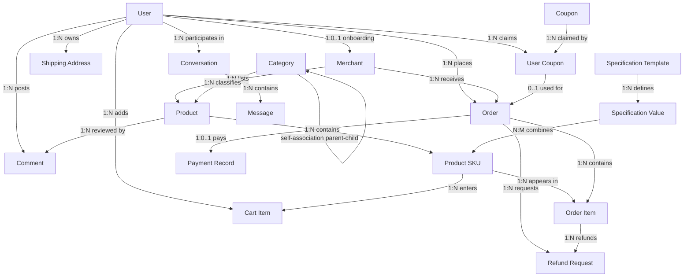

### 4.3 Aggregates and Consistency Boundaries

| Aggregate Root | Objects within Aggregate | Consistency Requirements |
|--------|------------|------------|
| User | User, role, status | Account is unique; role and status are valid |
| Merchant | Merchant, review information | A user has at most one merchant identity |
| Product | Product, SKU, specification combination | Product and SKUs are valid at the same time; price and stock never negative |
| Cart | Cart Item | The same user does not have duplicate entries for the same SKU; quantity is valid |
| Order | Order, order item, payment record, refund request | Order state transitions are valid; amount and items are consistent |
| Coupon | Coupon, user coupon | Total quantity and remaining quantity are consistent; user claim quantity does not exceed the per-user limit |
| Comment | Comment, follow-up review, reply | Comments must come from real order items |
| Conversation | Conversation, message | There is only one conversation for the same user-merchant pair; unread count and messages are consistent |

**Significance of aggregate design:**

- Objects within an aggregate are maintained uniformly by the aggregate root, preventing external parties from arbitrarily modifying internal state.
- Operations across aggregates are completed through explicit business actions; for example, "place order" affects orders, stock, and cart at the same time.
- Aggregate boundaries are also an important basis for designing transaction boundaries.

### 4.4 Business Rules and Invariants

| Rule | Constraint Description | Handling on Violation |
|------|----------|--------------|
| Category hierarchy | At most three levels; the parent must exist and levels must be continuous | Reject creation or modification |
| Product status | Unlisted products cannot be added to cart or ordered | Prompt that the product is unavailable for purchase |
| Stock | Stock must not be negative | Conditional deduction; on failure, prompt insufficient stock |
| Cart | Merge quantities for the same SKU under the same user | Accumulate or update when already present |
| Order status | Only valid state transitions are allowed | Directly reject illegal transitions |
| Order amount | The payable amount is consistent with items, discounts, and shipping | Do not create the order if amount validation fails |
| Address snapshot | Address changes after ordering do not affect historical orders | Save a snapshot at order time |
| Payment idempotency | Duplicate payment for the same order records only one success | Return the success result directly for already-paid orders |
| Refund amount | Must not exceed the subtotal of the corresponding order item | Reject the application if exceeded |
| Coupon per-user limit | Claim quantity must not exceed the per-user limit | Reject the claim if exceeded |
| Coupon threshold | The order amount must reach the minimum spend | Cannot be used if not reached |
| Coupon validity | Can only be claimed and used within the activity time | Mark as expired after expiration |
| Merchant review | Only approved merchants can access operating features | Block unapproved or rejected merchants |
| Comment eligibility | Only products in completed orders can be reviewed | Reject posting without eligibility |
| Operation log | Key backend operations must leave a trail | Record operator, action, and result |

### 4.5 State Models

#### Order Status

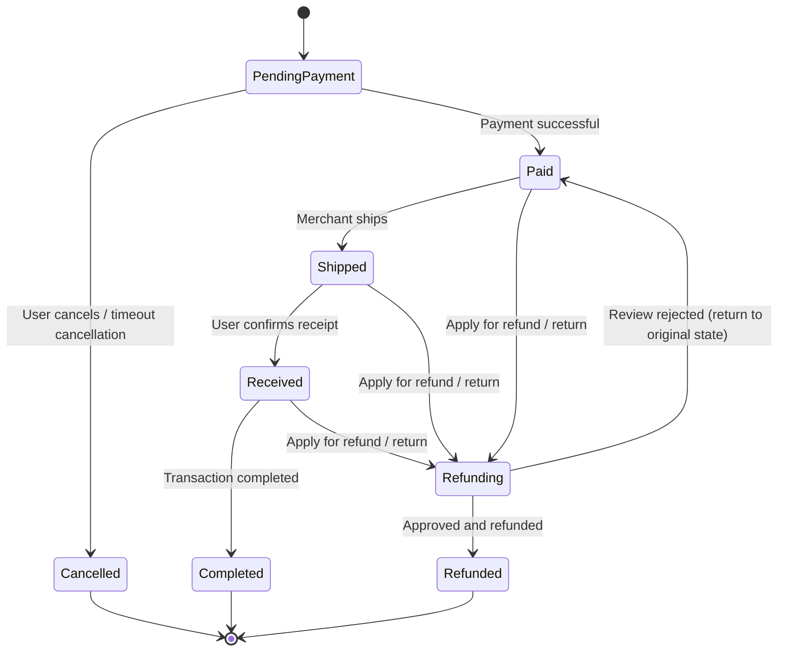

#### Refund Request Status

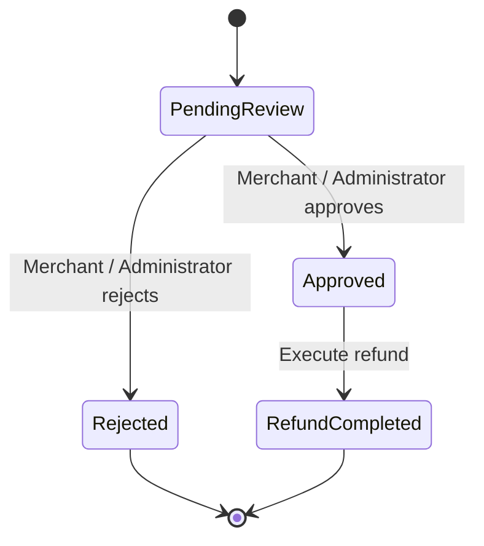

#### User Coupon Status

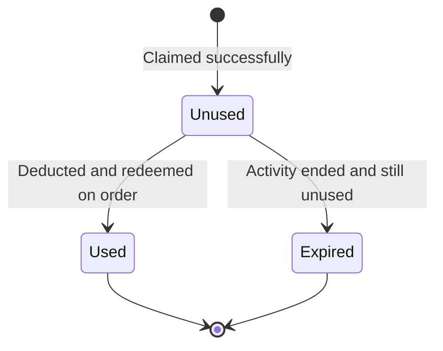

### 4.6 Domain Model Checks

- Does each object have only one core responsibility?
- Do the relationships between objects express real business meaning?
- Has behavior that should belong to an object been placed in an external process?
- Have value attributes been mistakenly modeled as independent objects?
- Do aggregate boundaries align with transaction boundaries?
- Do state transitions cover both normal and exception flows?
- Is there data that could be computed but is stored redundantly?

---

## V. Object Analysis: Responsibility Assignment and Collaboration

### 5.1 Three Types of Analysis Objects

| Type | Responsibility | Manifestation in This Project |
|------|------|--------------|
| Boundary Object | Interact with users, receive input, display results | Login page, product page, cart page, order page, merchant backend, administrator backend |
| Control Object | Coordinate the execution order of a use case | Login handler, order placement handler, payment handler, refund handler, coupon claim handler |
| Entity Object | Express business concepts and rules | User, Product, Order, Coupon, Refund Request, etc. |

The focus of object analysis is not "which pages exist", but **which objects a use case passes through from boundary to entity, and what responsibility each object bears**.

### 5.2 Object Collaboration in Key Use Cases

#### 5.2.1 Login Collaboration

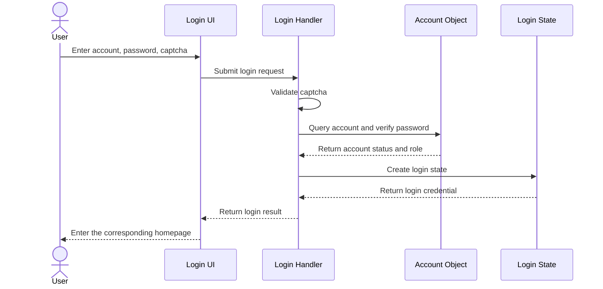

**Responsibility description:**

- The Login UI is only responsible for collecting input and displaying results.
- The Login Handler is responsible for process orchestration, captcha validation, and exception handling.
- The Account Object is responsible for account lookup, password verification, and status determination.
- The Login State is responsible for generating and invalidating credentials.

#### 5.2.2 Order Placement Collaboration

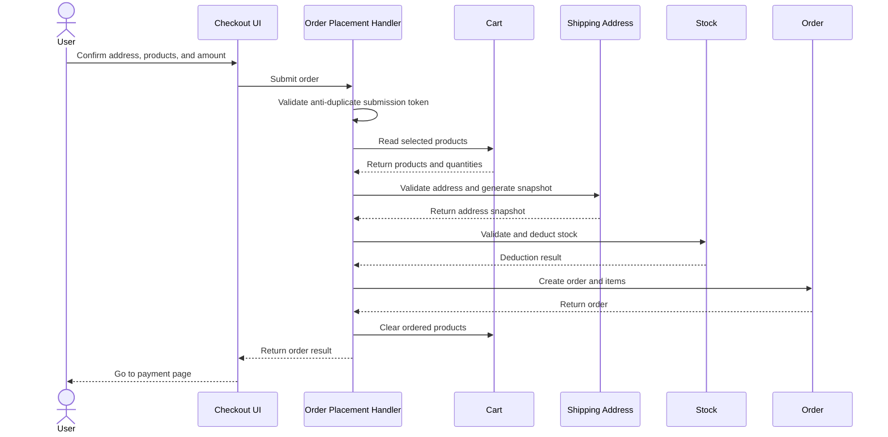

**Responsibility description:**

- The Checkout UI is responsible for confirming information and does not directly modify stock or orders.
- The Order Placement Handler is responsible for use case orchestration, validation order, and failure compensation.
- The Cart provides the items to purchase, the address provides the snapshot, the stock is responsible for deduction, and the order is responsible for saving the transaction result.
- If any step fails, already-executed steps must be guaranteed to be rollbackable or compensable.

#### 5.2.3 Payment Collaboration

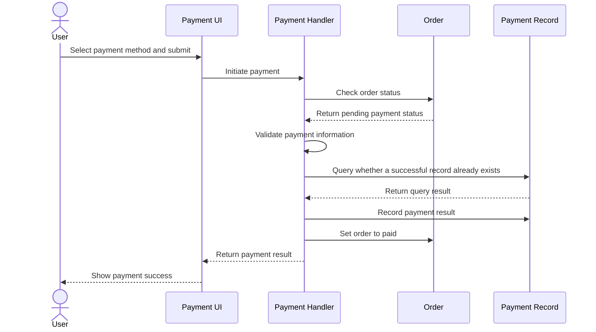

**Responsibility description:**

- The Payment Handler is responsible for payment method validation, idempotency checks, and state transitions.
- The Order object is responsible for determining whether the current status allows payment.
- The Payment Record is responsible for saving the payment fact and avoiding duplicate charges.

#### 5.2.4 Coupon Claim Collaboration

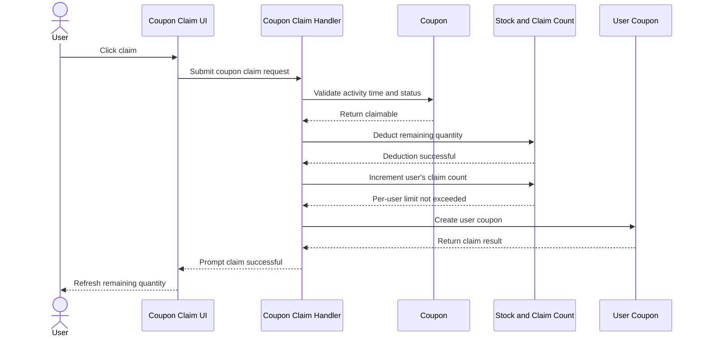

**Responsibility description:**

- The Coupon Claim Handler is responsible for activity validation, stock deduction, per-user limit validation, and failure compensation.
- The Coupon object provides activity rules, and the User Coupon object records the claim fact.
- Stock and claim count are high-frequency changing data and must remain consistent with the final data in the database.

#### 5.2.5 Refund Collaboration

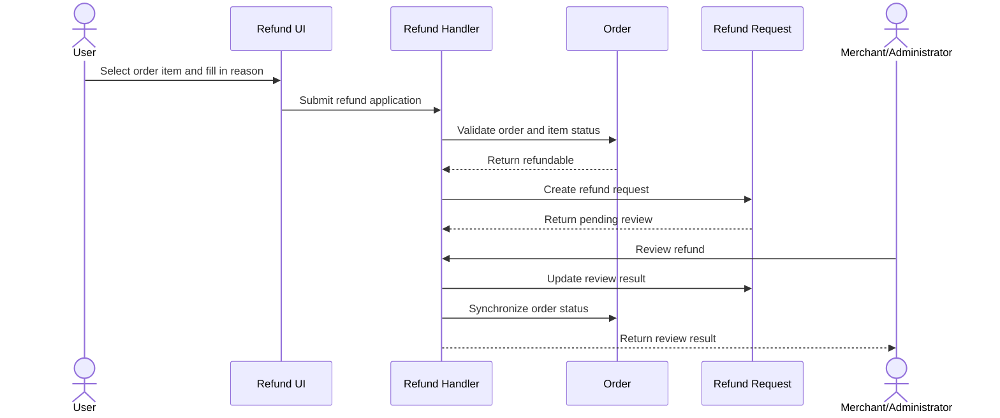

**Responsibility description:**

- The Refund Handler is responsible for eligibility validation, amount validation, review transitions, and status synchronization.
- The Order object is responsible for determining whether the order and items allow refunds.
- The Refund Request object is responsible for saving the application, review, and refund result.

### 5.3 Responsibility Assignment Table

| Object | Core Responsibility | Main Collaborators |
|------|----------|------------|
| User | Maintain identity, role, and status | Login Handler, Merchant, Order |
| Merchant | Maintain store profile and review status | User, Product, Order, Administrator |
| Product | Maintain product information and listing status | Category, Merchant, SKU |
| Product SKU | Maintain price and stock | Product, Cart, Order |
| Cart | Maintain the user's intended purchase items | User, Product SKU, Order Placement Handler |
| Order | Maintain transaction status and amount | User, Merchant, Payment Record, Refund Request |
| Payment Record | Record payment facts and idempotency checks | Order, Payment Handler |
| Refund Request | Maintain refund applications and review | Order, Order Item, Review Handler |
| Coupon | Maintain activity rules and inventory | Coupon Claim Handler, User Coupon, Order |
| User Coupon | Maintain claim and redemption status | User, Coupon, Order |
| Comment | Maintain reviews, follow-up reviews, and replies | User, Merchant, Order Item |
| Conversation | Maintain dialogue and unread count | User, Merchant, Message |
| Operation Log | Record backend operation facts | Administrator, various backend handlers |

### 5.4 Responsibility Assignment Principles

1. **Information Expert**: Whoever owns the data is responsible for the behavior most related to that data. For example, stock deduction is the responsibility of the Product SKU, not the UI.
2. **Creator**: Whoever has the information needed to create an object is responsible for creating it. For example, the order is created by the Order Placement Handler because it has the user, cart, address, and amount information.
3. **Controller**: The UI does not directly execute business rules; control objects coordinate the use case flow.
4. **Low Coupling**: Objects should collaborate through as few stable interfaces as possible, avoiding one object directly manipulating another object's internal data.
5. **High Cohesion**: An object does only one kind of thing, avoiding a "god object" that "knows everything and can do everything".
6. **Single Responsibility**: An object should ideally have only one reason to change.
7. **Dependency Inversion**: Business rules depend on stable abstractions, not concrete implementations.

---

## VI. Architecture Design

### 6.1 Layered Architecture

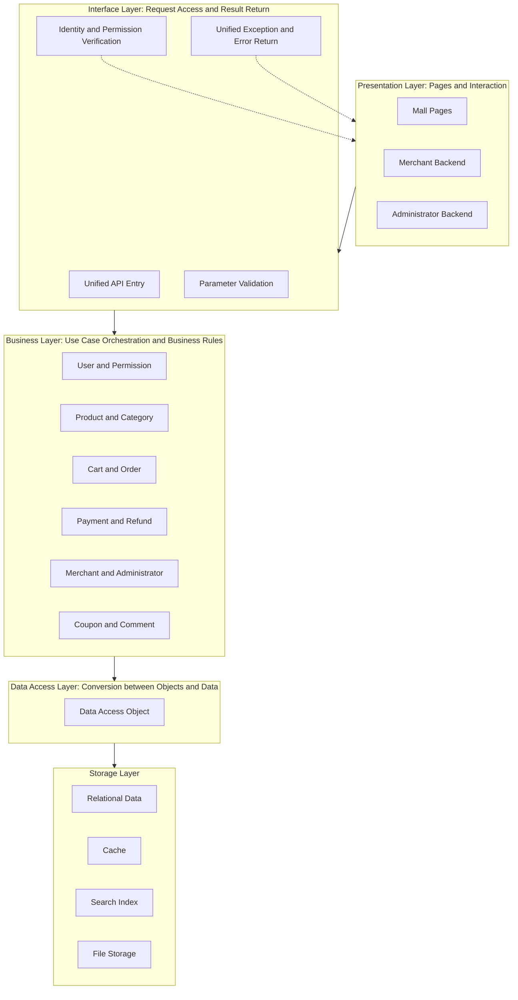

**Layer responsibilities:**

- **Presentation Layer**: Page display, user input, and status feedback; no business rules.
- **Interface Layer**: Receive requests, validate identity and parameters, call the business layer, and uniformly return results and exceptions.
- **Business Layer**: Implement use case flows, business rules, transaction boundaries, and object collaboration.
- **Data Access Layer**: Complete the conversion between business objects and data records; does not carry business rules.
- **Storage Layer**: Relational data, cache, search index, and file storage.

### 6.2 Module Division

| Module | Responsibility | Dependency Direction | Externally Provided |
|------|------|----------|----------|
| Foundation Module | Unified return, error codes, exceptions, user context, common utilities | Does not depend on business modules | Common capabilities |
| Data Access Module | Business objects, data access interfaces, data query definitions | Depends on the foundation module | Data access capabilities |
| Business Module | Use case implementation, business rules, object collaboration | Depends on the data access module | Business services |
| Interface Module | Request access, parameter validation, permission validation, unified exceptions | Depends on the business module | External APIs |
| Startup Module | Application assembly, configuration, interceptors, runtime entry | Depends on the interface module | Runnable system |

**Dependency principles:**

- The dependency direction is unidirectional downward; lower layers are not allowed to depend upward on upper layers.
- The interface module does not access data directly, and the business module does not handle pages directly.
- The foundation module remains stable, avoiding frequent modifications due to business changes.

### 6.3 Interface Design

#### 6.3.1 Unified Return Structure

All APIs use a unified return structure containing:

| Part | Meaning |
|------|------|
| Status Code | Indicates success or a specific error type |
| Message | User-facing error description |
| Data | Business return content; may be empty |

The benefit of a unified return is that the frontend needs only one set of handling logic, error codes can be maintained centrally, and API behavior is predictable.

#### 6.3.2 Unified Error Codes

Error codes are divided by business module, for example:

- Account and login errors
- Product and category errors
- Cart errors
- Order and payment errors
- Refund errors
- Merchant and administrator errors
- Coupon errors
- File upload errors

Each error code corresponds to a clear business meaning and message, avoiding all exceptions returning "system error".

#### 6.3.3 Parameter Validation

- Input objects are validated uniformly: required, length, format, range.
- Business validation is placed in the business layer: stock, status, permissions, ownership relationships.
- Validation failure returns a clear error and does not enter business processing.

#### 6.3.4 Permission Design

| Role | Accessible Scope |
|------|------------|
| Guest | Product browsing, product details, categories, public coupon list, comment viewing |
| Registered User | Guest permissions + cart, orders, payment, addresses, refunds, comments, coupon claiming |
| Merchant | User permissions + products, orders, refunds, comments, statistics in the merchant backend |
| Administrator | Users, merchants, categories, products, orders, refunds, coupons, reports in the admin backend |

Permission validation is divided into two layers:

1. **Identity validation**: Whether logged in and whether the login state is valid.
2. **Role validation**: Whether the current role is allowed to access the feature.

#### 6.3.5 Idempotency and Anti-duplication

- Obtain an anti-duplicate submission token before placing an order; validate it on submission and invalidate it immediately.
- Query whether a successful payment record already exists before payment to avoid duplicate charges.
- Validate both stock and the user's claim quantity when claiming coupons to avoid over-claiming.
- Refund review is only allowed to proceed from the "Pending Review" status to avoid duplicate reviews.

### 6.4 Data Design

| Design Point | Description |
|--------|------|
| Entities and Relationships | Users, merchants, products, orders, etc. are modeled as tables by business object, with relationships expressed through association fields |
| Amount | Stored in the smallest currency unit to avoid decimal precision issues |
| Snapshot | Orders save address snapshots and product price snapshots to avoid later changes affecting historical data |
| Status | Use explicit status values to express the lifecycles of orders, refunds, coupons, etc. |
| Index | Create indexes on high-frequency query fields; use composite indexes for combined queries |
| Cache | Use caching for popular products, category trees, stock, sales, captchas, etc. |
| Search Index | Product name, description, brand, category, price, etc. enter the search index |
| Audit | Key backend operations record operator, action, parameters, result, and duration |

### 6.5 UI Design

| UI Area | Design Points |
|----------|----------|
| Mall Pages | Top navigation, category entries, product list, product details, cart, orders, personal center |
| Merchant Backend | Product management, comment management, order management, refund review, sales statistics |
| Administrator Backend | User management, merchant review, category management, platform-wide products/orders, refund review, coupon management, sales reports |
| State Feedback | Clear feedback for states such as loading, empty data, failure, no permission, insufficient stock, and operation success |
| Routing and Permissions | Different roles enter different layouts; accessing restricted pages while not logged in redirects to login |
| Consistency | The same business uses consistent field names, amount formats, and status copy across pages |

### 6.6 Cross-cutting Concerns

| Concern | Design Approach | Effect |
|--------|----------|------|
| Authentication | Uniformly validate login credentials when requests enter | Avoid repeating validation logic in every API |
| Permission Control | Determine by role and resource ownership | Prevent unauthorized access |
| Parameter Validation | Uniform validation of inputs | Keep illegal requests outside the business layer |
| Exception Handling | Uniformly catch and convert to standard errors | Avoid leaking exception information and ensure consistent return format |
| Operation Log | Uniformly record key operations | Support auditing and issue tracking |
| Transaction Management | Define transaction boundaries in the business layer | Ensure consistency of operations such as orders, stock, and payment |
| Cache | Centrally cache high-frequency read data | Reduce data access pressure |
| Scheduled Tasks | Timeout order cancellation, status refresh, history cleanup | Handle business not triggered by users |

### 6.7 Design Principles

| Principle | Manifestation in This Project |
|------|------------------|
| Single Responsibility | Pages are only responsible for display, business handlers for flow, and data access for object-data conversion |
| Open-Closed Principle | When adding payment methods, discount types, or business modules, extend rather than modify existing flows as much as possible |
| Dependency Inversion | The business layer depends on stable abstract interfaces, not concrete implementations |
| Interface Segregation | Split interfaces by business domain to avoid one interface bearing too many unrelated responsibilities |
| Liskov Substitution | Implementations of the same business type follow a unified contract; replacing an implementation does not affect callers |
| High Cohesion and Low Coupling | Objects in the same business domain are kept together; cross-domain collaboration uses a small number of stable interfaces |
| Information Hiding | Object internal state is modified through behavior; internal data that can be modified at will is not exposed |
| Separation of Concerns | Cross-cutting logic such as authentication, validation, exceptions, and logging is separated from business logic |

### 6.8 Reuse and Variation Isolation

| Design Idea | Application Scenario | Effect |
|----------|----------|------|
| Separation of Interface and Implementation | Service interfaces and implementations in each business domain | Callers depend on contracts; implementations are replaceable and testable |
| Unified Entry and Unified Return | All external APIs | Consistent frontend handling; errors can be managed centrally |
| Object Assembly and Step-by-Step Construction | Complex objects such as orders, products, and coupons | Avoid too many constructor parameters and improve readability |
| Discount Calculation Branching by Type | Fixed-amount coupons and percentage coupons | Centrally extend calculation logic when adding discount types |
| State-Driven Flow | Orders, refunds, coupons | Constrain behavior with states and avoid illegal operations |
| Centralized Handling of Cross-cutting Logic | Authentication, exceptions, logging, validation | Business code is purer and rules are more consistent |
| Cache and Data Compensation | Stock, sales, coupon remaining quantity | Balance access speed with eventual consistency |
| Scheduled Task Compensation | Timeout orders, status refresh, history cleanup | Handle backend flows not triggered by users |

---

## VII. Detailed Design Steps

Detailed design is the process of translating "objects and responsibilities" into "implementable contracts and structures". It is recommended to proceed in the following steps.

### 7.1 Step 1: Clarify Design Goals and Constraints

**Input:** Requirements analysis, domain model, non-functional requirements.

**Activities:**

- Clarify the system boundary, role scope, and core use cases that must be implemented.
- Clarify business constraints: amount precision, non-negative stock, state transitions, permission scope.
- Clarify non-functional constraints: response time, concurrency, availability, maintainability.
- Clarify design trade-offs: which features are fully implemented and which are reserved in design.

**Output:** Design goal list, constraint list, scope description.

**Checkpoint:** Are design goals verifiable? Are constraints specific? Is the scope consistent with requirements?

### 7.2 Step 2: Divide Subsystems and Modules

**Input:** Domain model, use case grouping.

**Activities:**

- Divide subsystems by business domain: user and permission, product and category, cart and order, payment and refund, merchant and administrator, coupon and comment.
- Divide layers by responsibility: presentation, interface, business, data access, storage.
- Clarify module dependency directions and prohibit circular dependencies.
- Clarify the capabilities each module provides externally.

**Output:** Architecture diagram, module list, dependency relationships.

**Checkpoint:** Does each module have clear responsibilities? Are dependencies unidirectional? Is there responsibility overlap?

### 7.3 Step 3: Design Domain Objects and Responsibilities

**Input:** Domain model, use case specifications.

**Activities:**

- Define attributes, behavior, and invariants for each object.
- Clarify aggregate roots and aggregate boundaries.
- Place business rules in the most appropriate object.
- Distinguish entity objects, value objects, and computed attributes.
- Identify create, read, update, and delete relationships between objects.

**Output:** Object responsibility table, object relationship diagram, business rule list.

**Checkpoint:** Is there a god object? Are there objects with only data and no behavior? Are rules centralized and traceable?

### 7.4 Step 4: Design Object Collaboration and Sequences

**Input:** Object responsibilities, core use cases.

**Activities:**

- Draw object collaboration sequences for each core use case.
- Clarify which object is responsible for each step, which object is called, and what result is returned.
- Identify failure points and compensation actions.
- Check for direct cross-layer calls or responsibility violations.

**Output:** Use case sequence diagrams, collaboration descriptions, exception handling descriptions.

**Checkpoint:** Does each use case have a complete main flow and exception flow? Can consistency be maintained after failure?

### 7.5 Step 5: Design Interface Contracts

**Input:** Use case specifications, object collaboration.

**Activities:**

- Define interface groups by business domain.
- Define the input parameters, output parameters, error codes, and permission requirements of each API.
- Unify the return structure and exception format.
- Design common parameters such as pagination, filtering, and sorting.
- Design idempotency, anti-duplicate submission, and permission validation rules.

**Output:** API list, input/output parameter descriptions, error code descriptions, permission matrix.

**Checkpoint:** Do the APIs cover all use cases? Are error codes clear? Are permissions confirmed API by API?

### 7.6 Step 6: Design the Data Model

**Input:** Domain objects, interface contracts.

**Activities:**

- Map domain objects to data tables and association relationships.
- Design primary keys, unique constraints, indexes, and status fields.
- Design snapshot fields to save the address and price at order time.
- Design the precision and format of fields such as amount, quantity, and time.
- Design cache keys, search indexes, and data synchronization methods.
- Design data initialization and test data.

**Output:** Data design description, table relationship diagram, index description, initialization scripts.

**Checkpoint:** Is data redundant but reasonable? Do indexes support high-frequency queries? Do snapshots cover key historical information?

### 7.7 Step 7: Design States and Exceptions

**Input:** Business rules, object lifecycles.

**Activities:**

- Establish state diagrams for objects such as orders, refunds, and coupons.
- Clarify the operations allowed and prohibited in each state.
- Design exception categories: parameter errors, permission errors, state errors, insufficient resources, duplicate operations, system errors.
- Design rollback, compensation, and prompts after failure.
- Design handling for timeouts, duplicate submissions, and concurrency conflicts.

**Output:** State diagrams, state transition tables, exception list, compensation strategies.

**Checkpoint:** Are illegal states intercepted? Are exceptions understandable and recoverable? Does compensation cover key failure points?

### 7.8 Step 8: Design UI and Interaction

**Input:** Use case specifications, interface contracts.

**Activities:**

- Design layouts by role: mall, merchant backend, administrator backend.
- Design page information structures: lists, details, forms, dialogs, status prompts.
- Design navigation relationships between pages and permission interception.
- Design states such as loading, empty data, failure, and no permission.
- Design form validation, submission feedback, and confirmation for dangerous operations.

**Output:** Page structure description, interaction flows, UI prototypes, routing and permission descriptions.

**Checkpoint:** Can users smoothly complete the main flow? Is there feedback for abnormal states? Do different roles see the correct entries?

### 7.9 Step 9: Design Non-functional Capabilities

**Input:** Non-functional requirements, architecture design.

**Activities:**

- Performance: cache hot data, optimize high-frequency queries, limit pagination size.
- Security: password encryption, login state validation, role permissions, parameter validation, prevent unauthorized access.
- Availability: exception fallbacks, failure compensation, scheduled tasks, health checks.
- Maintainability: clear layering, single responsibility, unified error codes, synchronized documentation.
- Testability: decouple business logic from the UI so key use cases can be verified independently.

**Output:** Non-functional design description, risk list, verification methods.

**Checkpoint:** Does each non-functional requirement have a corresponding design? Are there verifiable metrics?

### 7.10 Step 10: Design Review and Baseline

**Input:** All design deliverables.

**Activities:**

- Organize a joint review by requirements, design, and implementation personnel.
- Check requirements coverage, responsibility assignment, interface consistency, and data consistency.
- Record issues, owners, and modification plans.
- Form a design baseline; subsequent changes must record the reason and impact.

**Output:** Review records, issue list, design baseline.

**Checkpoint:** Do all requirements have corresponding designs? Are issues closed? Are changes traceable?

---

## VIII. Implementation and Testing Steps

### 8.1 Implementation Order

It is recommended to proceed from stable to volatile and from foundation to business according to dependencies:

1. Foundation capabilities: unified return, error codes, exceptions, identity context.
2. User and permission: registration, login, roles, status.
3. Product and category: category tree, products, specifications, stock.
4. Cart: add, modify, delete, select.
5. Order and payment: order placement, stock deduction, payment, state transitions.
6. Refund and comment: after-sales flow, reviews and replies.
7. Merchant and administrator: onboarding review, product and order management, reports.
8. Coupon: activities, claiming, deduction, redemption.
9. Search and chat: implement gradually according to the design reservations.

**Implementation principles:**

- Close the loop on core use cases first, then fill in edge features.
- Whenever a business domain is completed, complete the API documentation, data scripts, and tests at the same time.
- When design issues are found, modify the design before the code to avoid design-implementation divergence.

### 8.2 Coding Standards

- Clear layering: presentation, interface, business, and data access each perform their own duties.
- Consistent naming: business objects, interfaces, and error codes use unified terminology.
- Unified exceptions: business exceptions and system exceptions are handled separately.
- Explicit transactions: define transaction boundaries in the business layer; avoid arbitrarily starting transactions in the UI or data layer.
- Appropriate comments: explain business rules and design intent; do not repeat the literal meaning of the code.
- Change records: important modifications synchronously update the changelog and related documents.

### 8.3 Test Levels

| Level | Test Target | Purpose | Example |
|------|----------|------|------|
| Unit Test | A single business object or processing logic | Verify rules and branches | Insufficient stock, discount calculation, state transition |
| Integration Test | Collaboration between multiple objects and data access | Verify collaboration and data consistency | Order placement deducts stock, payment idempotency, coupon per-user limit |
| End-to-End Test | Complete flow from UI to data | Verify that users can complete business tasks | Login, order placement, payment, refund |
| Acceptance Test | Requirements and business rules | Verify that the system meets goals | Role permissions, core flows, exception prompts |

### 8.4 Test Case Design Methods

- **Normal flow**: Every step is valid; verify the main flow can be completed.
- **Boundary values**: Stock is 0, quantity is 1, amount just reaches the threshold, claim quantity just equals the per-user limit.
- **Exception flows**: Missing parameters, status not allowed, unauthorized access, duplicate submission.
- **Concurrency scenarios**: Same product ordered simultaneously, same coupon claimed simultaneously, same order paid repeatedly.
- **Permission matrix**: Verify accessible and inaccessible APIs and pages role by role.
- **Data consistency**: Order and item amounts are consistent, stock and sales are consistent, coupon total and remaining quantity are consistent.

### 8.5 Quality Gates

- Code compiles and key use cases run.
- Unit tests and integration tests pass.
- API documentation is consistent with actual behavior.
- Data initialization scripts can be executed repeatedly.
- Changelog records are complete.
- Design documents and implementation are updated synchronously.

---

## IX. Design Deliverables and Document Mapping

| Phase | Main Deliverables | Corresponding Document |
|------|----------|----------|
| Requirements Elicitation and Analysis | Business background, roles, functional requirements, business rules, priorities | Requirements Analysis Document |
| Feasibility Analysis | Technical, schedule, economic, and operational feasibility | Feasibility Analysis Document |
| Domain Analysis | Domain objects, relationships, aggregates, business rules, state models | Database Design Document, Detailed Design Document |
| Object Analysis | Responsibility assignment, object collaboration, sequence descriptions | Detailed Design Document |
| Architecture Design | Layering, modules, dependencies, interface boundaries | Server Design Document, Client Design Document |
| Detailed Design | Interface contracts, data design, states and exceptions, UI design | Detailed Design Document, API Documentation, HMI Design Document |
| Implementation and Testing | Runnable system, test cases, test records | Test Specification, Changelog |
| Modeling Deliverables | Use cases, components, relationships, sequences, activity flows | Modeling Diagram Files |

> Documents should maintain consistent terminology, roles, and states. Any design change should synchronously update the corresponding documents and change records.

---

## X. Design Checklist

### 10.1 Requirements Checks

- [ ] Are roles complete? Are there unidentified participants?
- [ ] Does each role have complete main-flow use cases?
- [ ] Does each use case have preconditions, postconditions, and exception flows?
- [ ] Are non-functional requirements and business constraints clear?
- [ ] Is the scope boundary clear? Does it state what is not implemented for now?

### 10.2 Domain Checks

- [ ] Do domain objects come from the business rather than from pages or data tables?
- [ ] Does each object have clear responsibilities and key attributes?
- [ ] Do object relationships express real business meaning?
- [ ] Do aggregate boundaries match consistency requirements?
- [ ] Are business rules centralized, traceable, and verifiable?
- [ ] Do state models cover normal and exception flows?

### 10.3 Responsibility Checks

- [ ] Is there a god object bearing too many responsibilities?
- [ ] Are there anemic objects with only data and no behavior?
- [ ] Are business rules placed in the correct objects?
- [ ] Do objects collaborate through stable interfaces?
- [ ] Does the UI directly manipulate business data or data storage?

### 10.4 Architecture Checks

- [ ] Is the layering clear? Are dependencies unidirectional?
- [ ] Are modules highly cohesive and loosely coupled?
- [ ] Does the interface layer only perform access, validation, and return?
- [ ] Does the business layer carry use case orchestration and business rules?
- [ ] Are cross-cutting concerns handled centrally rather than scattered everywhere?

### 10.5 Data Checks

- [ ] Are the precision and format of amounts, quantities, and times consistent?
- [ ] Are necessary snapshot data saved?
- [ ] Do primary keys, unique constraints, and indexes meet query and consistency requirements?
- [ ] Is there consistency assurance between cached data and final data?
- [ ] Can data initialization scripts be executed repeatedly?

### 10.6 Interface Checks

- [ ] Do the APIs cover all core use cases?
- [ ] Are input parameters, output parameters, and error codes clear?
- [ ] Are permissions confirmed API by API?
- [ ] Are duplicate submission, duplicate payment, and duplicate claiming handled?
- [ ] Is the API documentation consistent with actual behavior?

### 10.7 UI Checks

- [ ] Do different roles enter the correct layouts and pages?
- [ ] Is the main flow smooth and are the steps clear?
- [ ] Is there feedback for loading, empty data, failure, and no permission?
- [ ] Are dangerous operations confirmed?
- [ ] Are form validation and error prompts clear?

### 10.8 Testing Checks

- [ ] Do unit tests cover core rules and branches?
- [ ] Do integration tests cover object collaboration and data consistency?
- [ ] Do end-to-end tests cover core business flows?
- [ ] Are boundaries, exceptions, concurrency, and permissions tested?
- [ ] Is regression testing performed after defect fixes?

---

## XI. Summary

The object-oriented development of this project can be summarized as one main line:

1. **Start from the business**: First identify roles, use cases, and business rules, and clarify the system boundary.
2. **Build the domain model**: Turn nouns in the business into objects with responsibilities, and clarify relationships, aggregates, and states.
3. **Assign object responsibilities**: Let each object do what it understands best, and complete use cases through collaboration.
4. **Design architecture and interfaces**: Use layering and modules to control complexity, and use stable contracts to isolate change.
5. **Carry out detailed design**: Translate objects, collaboration, data, states, exceptions, and UI one by one into implementable designs.
6. **Implement and verify**: Implement in dependency order, and verify requirements and design with unit, integration, and end-to-end tests.
7. **Maintain continuously**: When requirements change, trace back to design and documents to keep code, design, and documents consistent.

The core of object-oriented development is not "how many objects are used", but **whether responsibilities are clear, collaboration is reasonable, and change is controllable**. As long as the analysis order from requirements to objects, from objects to responsibilities, and from responsibilities to collaboration is maintained, the system can remain understandable, maintainable, and extensible as features are added and requirements change.
