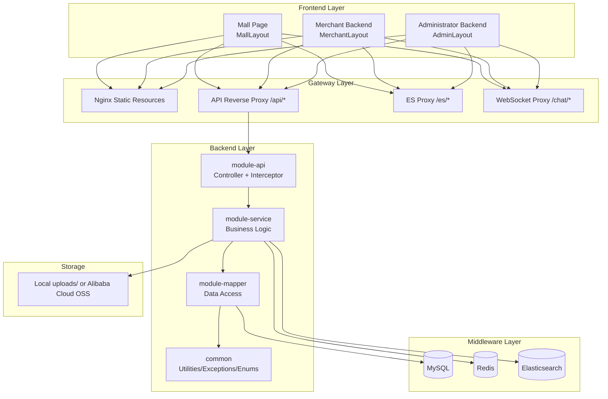
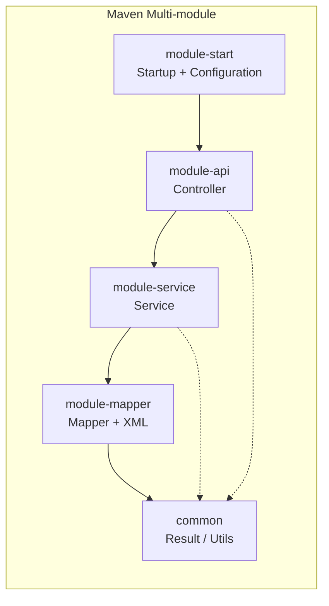
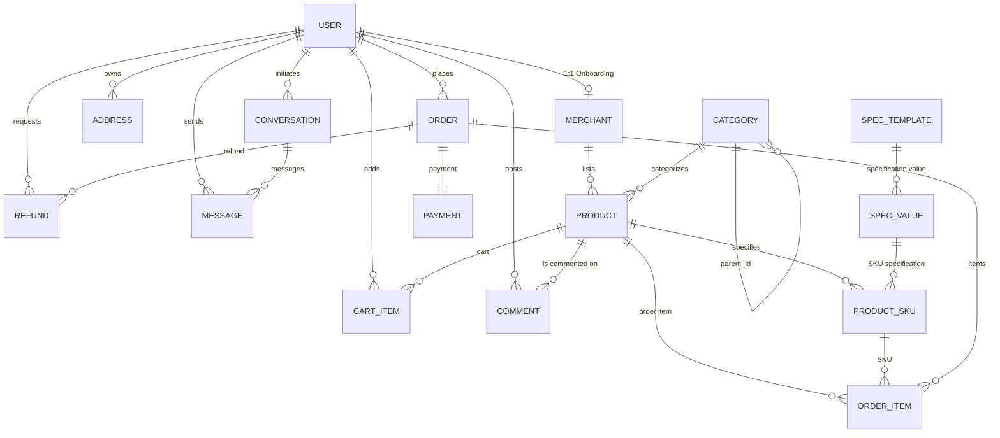
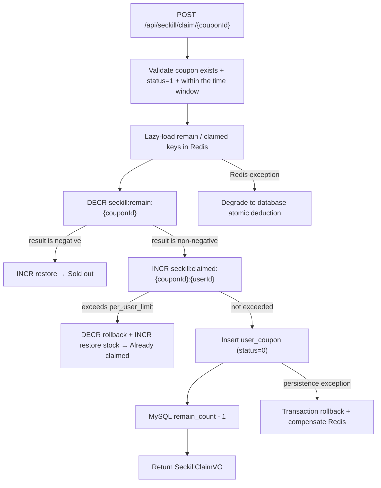

# Online Supermarket System - Server High-Level Design

> [简体中文](../zh/server-design.md) | English

---

## 1. Technology Selection

| Category | Technology | Version/Notes |
|------|------|------|
| Base framework | Spring Boot | 3.4.5 |
| JDK | Java 21 | |
| ORM | MyBatis | 3.0.4 |
| Pagination | PageHelper | |
| Database | MySQL | |
| Cache | Redis | Jedis / Lettuce |
| Search engine | Elasticsearch | |
| Authentication | JWT + Redis dual validation | |
| Authorization | Service-layer role/ownership checks | |
| Parameter validation | Spring Validation + custom annotations | |
| API documentation | Knife4j (OpenAPI 3.0) | 4.5.0 |
| Image storage | Local directory / Alibaba Cloud OSS | |
| Utility library | Lombok | |
| Logging | Logback (AOP operation log reserved, not enabled) | |
| Scheduled tasks | Spring @Scheduled | |

---

## 2. Maven Multi-module Structure

```
chrono-bbs-server/                # Parent project (aggregation)
├── pom.xml                       # Parent POM, dependency management
├── common/                       # Common module
│   └── Unified response, exceptions, enums, utility classes, constants
├── module-api/                   # API module (Controller + VO + DTO)
│   └── REST APIs exposed externally
├── module-service/               # Business module (Service interfaces + implementations)
│   └── Core business logic
├── module-mapper/                # Data access module (Mapper + entities + XML)
│   └── MyBatis mapping layer
└── module-start/                 # Startup module
    └── Startup class + global configuration + static resources
```

### Module Dependencies

```
module-start
    └── module-api
            └── module-service
                    └── module-mapper
                            └── common
```

| Module | Responsibilities |
|------|------|
| **common** | Common base classes: `Result<T>`, `PageResult<T>`, `BusinessException`, error code enums, `JwtUtil`, `UserContext`, `@Public` annotation |
| **module-mapper** | Entity classes, MyBatis Mapper interfaces, XML mapping files |
| **module-service** | Service interfaces + Impl implementations, DTO input definitions, business logic orchestration |
| **module-api** | Controllers, VO output definitions, WebSocket endpoint, global exception handling |
| **module-start** | Spring Boot startup class, `application.yml`, global configuration (CORS/OSS/Knife4j), scheduled task scheduling |

---

## 3. Package Structure Design

Taking `module-api` as an example:

```
com.ncist.controller/
    ├── AuthController.java          # Authentication APIs
    ├── ProductController.java       # Product APIs
    ├── CategoryController.java      # Category APIs
    ├── SearchController.java        # Search APIs
    ├── CartController.java          # Cart APIs
    ├── OrderController.java         # Order APIs
    ├── PaymentController.java       # Payment APIs
    ├── AddressController.java       # Address APIs
    ├── CommentController.java       # Comment APIs
    ├── RefundController.java        # Refund APIs
    ├── MerchantController.java      # Merchant APIs
    ├── AdminController.java         # Administrator APIs
    ├── SeckillController.java       # Flash-sale coupon APIs
    ├── UploadController.java        # File upload APIs
    └── ChatController.java          # Instant messaging APIs
com.ncist.websocket/                 # WebSocket endpoint (@ServerEndpoint)
com.ncist.vo/                        # Output VOs
com.ncist.interceptor/               # Interceptor (JWT authorization, in module-start)
```

Taking `module-service` as an example:

```
com.ncist.service/
    ├── AuthService.java             # Interface
    ├── impl/AuthServiceImpl.java    # Implementation
    ├── ProductService.java
    ├── impl/ProductServiceImpl.java
    └── ... (same pattern, divided by module)
com.ncist.dto/                       # Input DTOs
com.ncist.scheduler/                 # Scheduled tasks (flash-sale coupon status refresh)
```

Taking `module-mapper` as an example:

```
com.ncist.entity/                    # Entity classes
com.ncist.mapper/                    # Mapper interfaces
resources/mapper/                    # MyBatis XML
```

---

## 4. Unified Response and Exception System

### 4.1 Unified Return Format `Result<T>`

```java
// common module
public class Result<T> {
    private int code;         // Status code
    private String message;   // Message
    private T data;           // Data
    private long timestamp;   // Timestamp

    public static <T> Result<T> success(T data) { ... }
    public static <T> Result<T> fail(ErrorCode code) { ... }
    public static <T> Result<T> fail(int code, String msg) { ... }
}
```

### 4.2 Paginated Return `PageResult<T>`

```java
// common module
public class PageResult<T> {
    private long total;       // Total record count
    private int page;         // Current page
    private int size;         // Page size
    private List<T> list;     // Data list
}
```

### 4.3 Error Code Enum `ErrorCode`

```java
// common module, centrally managed
public enum ErrorCode {
    // General 1xxx
    SUCCESS(200, "Operation successful"),
    PARAM_ERROR(400, "Parameter error"),
    UNAUTHORIZED(401, "Not logged in"),
    FORBIDDEN(403, "No permission"),
    NOT_FOUND(404, "Resource not found"),
    SYSTEM_ERROR(500, "System error"),

    // User 2xxx
    USER_NOT_EXIST(2001, "User does not exist"),
    PASSWORD_ERROR(2002, "Incorrect password"),
    USERNAME_EXIST(2003, "Username already exists"),

    // Product 3xxx
    PRODUCT_NOT_FOUND(3001, "Product not found"),
    STOCK_INSUFFICIENT(3002, "Insufficient stock"),
    PRODUCT_OFF_SHELF(3003, "Product has been unlisted"),

    // Order 4xxx
    ORDER_NOT_FOUND(4001, "Order not found"),
    ORDER_STATUS_ERROR(4002, "Invalid order status"),
    ORDER_CANNOT_CANCEL(4003, "Order cannot be cancelled"),

    // Payment 5xxx
    PAY_FAILED(5001, "Payment failed"),
    CARD_INVALID(5002, "Invalid card number"),

    // Merchant 6xxx
    MERCHANT_NOT_APPROVED(6001, "Merchant has not been approved"),
    MERCHANT_EXIST(6002, "Onboarding application already submitted"),
}
```

### 4.4 Custom Business Exception

```java
// common module
public class BusinessException extends RuntimeException {
    private int code;
    public BusinessException(ErrorCode errorCode) {
        super(errorCode.getMessage());
        this.code = errorCode.getCode();
    }
}
```

### 4.5 Global Exception Handling

```java
// module-api
@RestControllerAdvice
public class GlobalExceptionHandler {

    @ExceptionHandler(BusinessException.class)
    public Result<Void> handleBusiness(BusinessException e) {
        return Result.fail(e.getCode(), e.getMessage());
    }

    @ExceptionHandler(MethodArgumentNotValidException.class)
    public Result<Void> handleValid(MethodArgumentNotValidException e) {
        // Extract @Valid validation failure information
    }

    @ExceptionHandler(Exception.class)
    public Result<Void> handleUnknown(Exception e) {
        log.error("Unknown exception", e);
        return Result.fail(ErrorCode.SYSTEM_ERROR);
    }
}
```

---

## 5. Authentication and Authorization System

### 5.1 JWT + Redis Dual Validation Flow

```
Login request → Validate username and password → Generate JWT token → Store in Redis(token:{userId} = token)
              → Return the token to the frontend

Subsequent requests → Interceptor extracts Header Authorization → Parse JWT to obtain userId
                    → Validate whether the token exists and matches in Redis → Allow/Reject
```

- **JWT**: Carries user identity information (userId, role), valid for 2 hours.
- **Redis**: Stores the current valid token string (`token:{userId}`) and supports active kick-out (delete the corresponding Redis key to invalidate immediately).
- **Logout**: Delete the token from Redis.

### 5.2 RBAC Permission Control (Service-Layer Checks)

The current implementation does not use AOP annotations. It uses a two-stage approach: interceptor authentication plus service-layer authorization.

1. `JwtInterceptor` validates the JWT and its Redis session, then writes `userId / username / role` into `UserContext`;
2. Every public service method checks the role and data ownership before business logic and throws `BusinessException` on violation.

Typical checks:

```java
// Admin role check (AdminServiceImpl)
private void requireAdmin() {
    if (!UserRoleEnum.ADMIN.getCode().equals(UserContext.getRole())) {
        throw new BusinessException(AdminErrorCode.NOT_ADMIN);
    }
}

// Merchant approval and product ownership (ProductServiceImpl)
Merchant merchant = requireApprovedMerchant(userId);
requireOwnership(productId, merchant.getId());
```

Other examples: merchants can only ship orders whose items all belong to them (`MerchantServiceImpl.ship`), refund review verifies merchant approval and product ownership (`RefundServiceImpl.requireReviewPermission`), and users can only operate on their own addresses, orders and refunds. Controllers only bind parameters and return `Result<T>`.

### 5.3 Captcha

Captchas are of two types, both stored in Redis:

| Type | Purpose | Redis Key | Validity | Description |
|------|------|-----------|--------|------|
| Graphical captcha | Login/registration/obtain password reset verification code | `captcha:{uuid}` | 2min | Generate UUID + captcha image |
| SMS/email verification code | Reset password when the password is forgotten | `reset:code:{uuid}` | 5min | Returned directly in the response during the course project phase |

- A graphical captcha is required for login/registration to prevent brute-force attacks.
- For forgot password: validate the graphical captcha first → send an SMS/email verification code → reset the password with that verification code.
- Captchas are deleted from Redis immediately after use to guarantee one-time validity.

---

## 6. Parameter Validation

### 6.1 Spring Validation Annotations

```java
// DTO example
public class RegisterDTO {
    @NotBlank(message = "Username cannot be empty")
    @Size(min = 3, max = 20, message = "Username length must be 3-20")
    private String username;

    @NotBlank(message = "Password cannot be empty")
    @Size(min = 6, max = 20, message = "Password length must be 6-20")
    private String password;

    @NotBlank(message = "Phone number cannot be empty")
    @Pattern(regexp = "^1[3-9]\\d{9}$", message = "Invalid phone number format")
    private String phone;

    @EnumValue(enumClass = UserRoleEnum.class, message = "Invalid role value")
    private Integer role;
}
```

### 6.2 Custom Validation Annotation `@EnumValue`

```java
@Target(ElementType.FIELD)
@Retention(RetentionPolicy.RUNTIME)
@Constraint(validatedBy = EnumValueValidator.class)
public @interface EnumValue {
    Class<? extends Enum<?>> enumClass();
    String message() default "Invalid enum value";
}
```

---

## 7. Concurrency Control and Idempotency Design

### 7.1 Optimistic Locking

```sql
-- The product_sku table already has the field; no additional field is needed
UPDATE product_sku SET stock = stock - ? WHERE id = ? AND stock >= ?
-- Returns 0 rows when the condition is not met; the business layer checks and reports "Insufficient stock"
```

### 7.2 Duplicate Submission Prevention Token

```
Before ordering: frontend calls GET /api/order/submit-token → backend generates a UUID and stores it in Redis
                 key order:submit-token:{token}, value userId, expires in 5 minutes
When ordering: frontend carries the token → backend validates userId ownership and immediately deletes it
               → atomicity guarantees one-time validity
        If the token does not exist or does not belong to the current user → duplicate submission → reject
```

### 7.3 Payment Idempotency

```java
// Validate order ownership and status=pending payment, then insert the payment record.
// Finally update the order with a status condition: concurrent/repeated payment updates 0 rows,
// so an exception is thrown and the transaction rolls back.
int rows = orderMapper.markPaid(orderId, userId);
if (rows == 0) {
    throw new BusinessException(PaymentErrorCode.ORDER_NOT_PAYABLE);
}
```

> `payment.order_id` is not unique; idempotency relies on the conditional order status update
> (`UPDATE order SET status=2 ... WHERE status=1`), not on a unique constraint or a pre-query.

---

## 8. Transaction Management

### 8.1 Declarative Transactions

```java
@Service
public class OrderServiceImpl implements OrderService {

    @Override
    @Transactional(rollbackFor = Exception.class)
    public CreateOrderVO createOrder(Long userId, CreateOrderDTO dto) {
        // 1. Validate and consume the anti-duplication token (DELETE atomically guarantees single use)
        // 2. Validate that the shipping address belongs to the user
        // 3. Query selected cart items (SQL limited to the owner) and validate listing status and stock
        // 4. Atomically deduct stock (UPDATE ... WHERE stock >= quantity)
        // 5. Calculate the amount and apply the coupon discount
        // 6. Write the address snapshot → insert into the order table
        // 7. Insert into the order_item table (price snapshot at order time)
        // 8. Clear the ordered cart items
        // 9. Redeem the coupon (status condition prevents double redemption under concurrency)
        // Any step fails → roll back all
    }
}
```

### 8.2 Transaction Boundaries

| Operation | Same Transaction? | Description |
|------|------|------|
| Consume anti-duplication token | ❌ Redis operation | DELETE is executed inside the transaction method but does not roll back with MySQL; deletion means consumed |
| Insert order + insert order_item + clear cart + deduct MySQL stock + redeem coupon | ✅ Same transaction | MySQL write operations, guaranteed by ACID |
| Send ES synchronization message | ❌ Synchronous call inside the transaction | Exceptions are swallowed internally; failures are only logged |

---

## 9. ES Data Synchronization Strategy

### 9.1 Synchronization Method (Current Implementation)

Uses **synchronous calls + exception isolation**: after the product service finishes the MySQL operation it directly calls `ProductSearchIndexService` to synchronize ES. The synchronization logic catches all exceptions internally and only logs warnings, so it **does not affect or roll back the main product business** (no MQ/@Async is used).

```
Product listed/updated → Service layer finishes MySQL processing → synchronously write/overwrite the ES document
Product unlisted/deleted → Service layer finishes MySQL processing → synchronously delete the ES document (ignore 404 if absent)
Application startup → create the mapping if the index does not exist; full sync of listed products when the index is empty
```

### 9.2 Synchronization Content

Index name `chrono_product`, fields: `id`, `name`, `description`, `brand`, `categoryId`, `categoryName`, `minPrice`, `sales`, `image`, `status`, `createdAt`.

| Operation | ES Action |
|------|------|
| Product creation (unlisted by default) | Not written to the index; written when listed |
| Product listing | INSERT/overwrite `chrono_product` |
| Product update (name/description/brand/price/SKU) | UPDATE `chrono_product` (recalculate the minimum price) |
| Product unlisting/deletion | DELETE from `chrono_product` |
| Order payment (sales change) | Scheduled synchronization is not yet implemented; sales are refreshed on product update or full initialization |

---

## 10. File Upload (Local Directory / Alibaba Cloud OSS)

### 10.1 Upload Flow

```
Frontend selects an image → calls POST /api/upload/image
             → backend validation (format: jpg/png/webp, size: ≤2MB)
             → compression (proportionally scaled to 800px wide)
             → write to local uploads/ or upload to OSS based on upload.mode (directory: product/date/uuid.jpg)
             → return access URL (local /uploads/... or OSS URL) → frontend stores it in the form
```

### 10.2 Validation Rules

| Rule | Value |
|------|------|
| Allowed formats | jpg, jpeg, png, webp |
| Maximum per image | 2MB |
| Maximum per request | 4 images |
| Compression width | 800px (proportional scaling) |

---

## 11. Scheduled Tasks

> Implementation status: only `refreshSeckillStatus` (`SeckillStatusScheduler`, every 30 seconds) is implemented; the remaining tasks below are planned.

| Task | Execution Frequency | Description |
|------|------|------|
| `cancelTimeoutOrders` | Every 5 minutes | Scan orders with `status=Pending Payment AND created_at < 30 minutes ago`, change them to Cancelled, and restore stock |
| `syncSalesFromRedis` | Every 10 minutes | Read Redis `product:{id}:sales` and batch UPDATE MySQL `product.sales` |
| `cleanSearchHistory` | Every day at 3:00 AM | Delete history records with `searched_at < 30 days ago` |
| `syncStockFromRedis` | Every 5 minutes | Read Redis stock and batch synchronize MySQL `product_sku.stock` (fallback guarantee) |
| `cleanChatMessages` | Every day at 4:00 AM | Delete historical messages with `message.created_at < 30 days ago` |
| `refreshSeckillStatus` | Every 30 seconds | Refresh Flash-sale Coupon status (Not Started → In Progress → Ended) and batch-expire unused user coupons |

```java
@Component
@RequiredArgsConstructor
public class SeckillStatusScheduler {

    private final SeckillCouponMapper seckillCouponMapper;
    private final UserCouponMapper userCouponMapper;

    @Scheduled(fixedDelay = 30_000)
    public void refreshSeckillStatus() {
        int activated = seckillCouponMapper.activateStarted(); // Not started at start time → In progress
        int finished = seckillCouponMapper.finishEnded();      // In progress at end time → Ended
        int expired = userCouponMapper.expireEnded();          // Unused user coupons after the activity → Expired
    }
}
```

---

## 12. Logging System

### 12.1 Logback File Logs

- Console output: `DEBUG` in development, `INFO` in production
- Files roll daily: `logs/application.%d{yyyy-MM-dd}.log`
- Retained for 30 days

### 12.2 AOP Operation Log (Reserved, Not Enabled)

> The current version only keeps the `operation_log` table and Mapper interface; the `@OperationLog` annotation and AOP aspect have not been implemented. The following is a design draft.

```java
@Target(ElementType.METHOD)
@Retention(RetentionPolicy.RUNTIME)
public @interface OperationLog {
    String value();       // Operation description, e.g., "Review merchant onboarding"
    String module();      // Module, e.g., "Administrator"
}
```

```java
@Aspect
@Component
public class OperationLogAspect {
    @Around("@annotation(opLog)")
    public Object around(ProceedingJoinPoint pjp, OperationLog opLog) {
        // Record: user ID, username, IP, operation module, operation description, request parameters, elapsed time, result
        // Store in the operation_log table
    }
}
```

### 12.3 Operation Log Table (Reserved)

| Field | Type | Description |
|------|------|------|
| id | BIGINT PK | Primary key |
| user_id | BIGINT | Operator ID |
| username | VARCHAR(50) | Operator username |
| ip | VARCHAR(50) | Operation IP |
| module | VARCHAR(50) | Module |
| action | VARCHAR(200) | Operation description |
| params | TEXT | Request parameters (JSON) |
| result | VARCHAR(50) | Result (success/failure) |
| cost_time | BIGINT | Elapsed time (ms) |
| created_at | DATETIME | Operation time |

> This table is appended to [db-design.md](./db-design.md).

---

## 13. WebSocket Instant Messaging

### 13.1 Overview

Users and merchants support **one-to-one private chat**; users can start a conversation by clicking "Contact Seller" on the product detail page.

| Feature | Description |
|------|------|
| Protocol | Native WebSocket (JSR 356, `@ServerEndpoint`, not STOMP) |
| Persistence | Messages stored in MySQL; 30-day automatic cleanup is a planned task and is not enabled yet |
| History | Paginated queries; pull up to load more |
| Offline messages | Supported; unread messages are automatically pushed when the receiver comes online |
| Unread count | Maintained at the conversation level in MySQL `conversation.user_unread` / `merchant_unread` |
| Online status | Redis `online:{userId}`, written when a connection is established and deleted when it closes |

### 13.2 Database Tables

See Chapter 9 of [db-design.md](./db-design.md):

- **`conversation`**: Conversation table, `(user_id, merchant_id)` unique constraint; `merchant_id` stores the merchant **user** ID (`user.id`), not the merchant table primary key
- **`message`**: Message table, `conversation_id` references the conversation; `sender_id` is the sender's user ID

### 13.3 WebSocket Endpoint

```java
@Component
@ServerEndpoint("/chat/{userId}")
public class ChatWebSocketEndpoint {

    // Local online connections (userId -> Session), used for real-time push
    private static final Map<Long, Session> SESSIONS = new ConcurrentHashMap<>();

    @OnOpen
    public void onOpen(Session session, @PathParam("userId") String userIdText) {
        // 1. Parse the path userId and the token from the query string
        // 2. Validate the token with JwtUtil, and token.userId == path userId
        // 3. Ensure it matches Redis token:{userId} (prevent impersonation)
        // 4. Kick-out: close the old connection for the same userId
        // 5. Mark online in Redis: online:{userId}
        // 6. Push unread messages received while offline
    }

    @OnMessage
    public void onMessage(String text) {
        // 1. Deserialize JSON into SendMessageDTO
        // 2. chatService.sendMessage(userId, dto) persists the message
        // 3. Echo the message to the sender
        // 4. Push it to the receiver in real time if online (SESSIONS.get(receiverId))
    }

    @OnClose
    public void onClose() {
        // Remove the local session and delete Redis online:{userId}
    }
}
```

### 13.4 Message Push Path Design

| Channel | Direction | Description |
|------|------|------|
| `ws://host/chat/{userId}?token=` | Client → Server | Establish connection (handshake authentication) |
| `@OnMessage` receives JSON | Client → Server | Send a message |
| `session.sendText` | Server → Client | Real-time push (when the receiver is online) |

> Message frame JSON: `{ type, conversationId, messageId, senderId, senderRole, content, productId, isRead, timestamp }`; error frame: `{ type: "ERROR", message }`.

### 13.5 Send Message Flow

```
┌─────────┐     ┌─────────────┐     ┌──────────┐     ┌─────────┐
│ Sender  │     │ WebSocket   │     │  MySQL   │     │Receiver │
│ (User)  │     │  Endpoint   │     │          │     │(Merchant)│
└────┬────┘     └──────┬──────┘     └────┬─────┘     └────┬────┘
     │ Send JSON message│                │                 │
     │────────────────▶│                │                 │
     │                 │ INSERT message │                 │
     │                 │───────────────▶│                 │
     │                 │ UPDATE unread  │                 │
     │                 │───────────────▶│                 │
     │                 │  Echo + real-time push (if receiver online) │
     │◀────────────────│─────────────────────────────────▶│
     │                 │                │                 │
     Receiver offline?                                       │
     ─────────────────────────────────────────────────────  │
     Next time online → @OnOpen pulls is_read=0 messages → push one by one │
```

### 13.6 Core REST APIs (ChatController)

```java
@RestController
@RequestMapping("/api/chat")
public class ChatController {

    @GetMapping("/conversations")              // Conversation list (descending by last_message_time)
    @GetMapping("/history/{conversationId}")   // Paginated message history (newest to oldest)
    @PostMapping("/conversation")              // Create a conversation (based on product/merchant)
    @PutMapping("/read/{conversationId}")      // Mark as read (reset the unread count)
    @GetMapping("/unread-count")               // Total unread message count
}
```

### 13.7 Online Status Management (Redis)

| Cache Key | Content | Description |
|------|------|------|
| `online:{userId}` | "1" | SET when the user's WebSocket connects, DEL when disconnected; used to determine whether the user is online |
| `token:{userId}` | JWT | Handshake authentication: the token carried by the connection must match the server record |

```java
@Service
public class RedisOnlineService {
    public void setOnline(Long userId) {
        stringRedisTemplate.opsForValue().set("online:" + userId, "1");
    }
    public void setOffline(Long userId) {
        stringRedisTemplate.delete("online:" + userId);
    }
    public boolean isTokenValid(Long userId, String token) {
        return token.equals(stringRedisTemplate.opsForValue().get("token:" + userId));
    }
}
```

### 13.8 Security

| Measure | Description |
|------|------|
| Connection authentication | Validate JWT from `?token=xxx` during the handshake; token.userId must match the path and Redis `token:{userId}` |
| Kick-out | A new connection for the same userId closes the old one ("account connected elsewhere") |
| Authorization protection | When sending a message, validate that the sender is one of the conversation participants |

---

## 14. API Documentation (Knife4j)

The existing dependency `knife4j-openapi3-jakarta-spring-boot-starter` 4.5.0 already provides support. After startup, visit:

```
http://localhost:8080/doc.html
```

Add Swagger annotations to Controllers:

```java
@Tag(name = "Product Management", description = "Product CRUD APIs")
@RestController
@RequestMapping("/api/product")
public class ProductController {

    @Operation(summary = "Paginated product list query")
    @GetMapping("/list")
    public Result<PageResult<ProductVO>> listProducts(
            @RequestParam(required = false) Long categoryId,
            @RequestParam(defaultValue = "1") Integer page,
            @RequestParam(defaultValue = "10") Integer size) { ... }
}
```

---

## 15. UML Modeling

### 15.1 Deployment Diagram



### 15.2 Component Diagram



### 15.3 ER Diagram



---

## 16. Flash-sale Coupon Module

### 16.1 Design Goals

- **No overselling**: The coupon's `remain_count` must not become negative under concurrent claims.
- **No over-claiming**: The number of coupons claimed by the same user cannot exceed `per_user_limit`.
- **High availability**: Even when Redis fails, coupon claiming can still be completed through atomic deduction in the database.
- **Eventual consistency**: Consistency between Redis pre-deduction and MySQL persistence is guaranteed through compensation.

### 16.2 Claim Flow



### 16.3 Redis Keys and Degradation Strategy

| Key | Content | Expiration Time |
|------|------|----------|
| `seckill:remain:{couponId}` | Coupon remaining stock | Campaign end + 24h (minimum 1h) |
| `seckill:claimed:{couponId}:{userId}` | Number of coupons claimed by the user | Same as above |

- **Redis normal**: `DECR` stock → `INCR` user claim count → write `user_coupon` → decrement MySQL `remain_count`.
- **Redis unavailable**: Degrade to `UPDATE seckill_coupon SET remain_count = remain_count - 1 WHERE id = ? AND remain_count > 0`, then query `user_coupon` to validate the claim limit.
- **MySQL exception**: After transaction rollback, compensate Redis (add stock back, decrement claim count back); if compensation fails, only log it, with later reconciliation as the fallback.

### 16.4 Order Deduction

`POST /api/seckill/calculate` accepts `totalAmount` and an optional `userCouponId`:

1. No coupon selected: the original price is the final amount.
2. Validate that the user coupon exists, belongs to the current user, has Unused status, and the campaign has not expired.
3. Validate that the order amount meets `min_amount`.
4. Full reduction coupon discount = `min(discount_value, totalAmount)`; discount coupon discount = `totalAmount - totalAmount × discount_value / 100`.
5. Return `originalAmount` / `discountAmount` / `finalAmount` / `couponName`; when creating the order, write `userCouponId` and redeem the coupon.

### 16.5 Scheduled Tasks and Backend Management

- `SeckillStatusScheduler` refreshes coupon status every 30 seconds: Not Started → In Progress, In Progress → Ended, and batches unused expired coupons to Expired.
- Administrator APIs: create, edit, and delete coupons; when editing the total quantity, synchronize `remain_count` and the Redis stock key by the delta.
- User APIs: coupon list/details (guests can view), claim, my coupons (logged-in users).

> For table structures, see Chapter 10 of [db-design.md](./db-design.md); for API contracts, see Chapter 16 of [api-doc.md](./api-doc.md).
