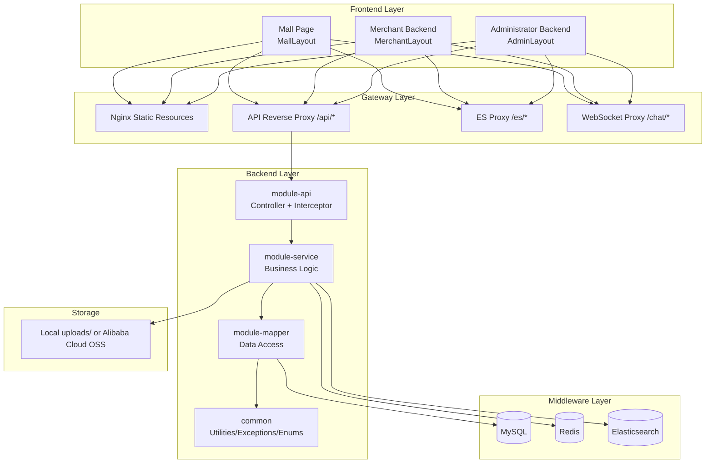
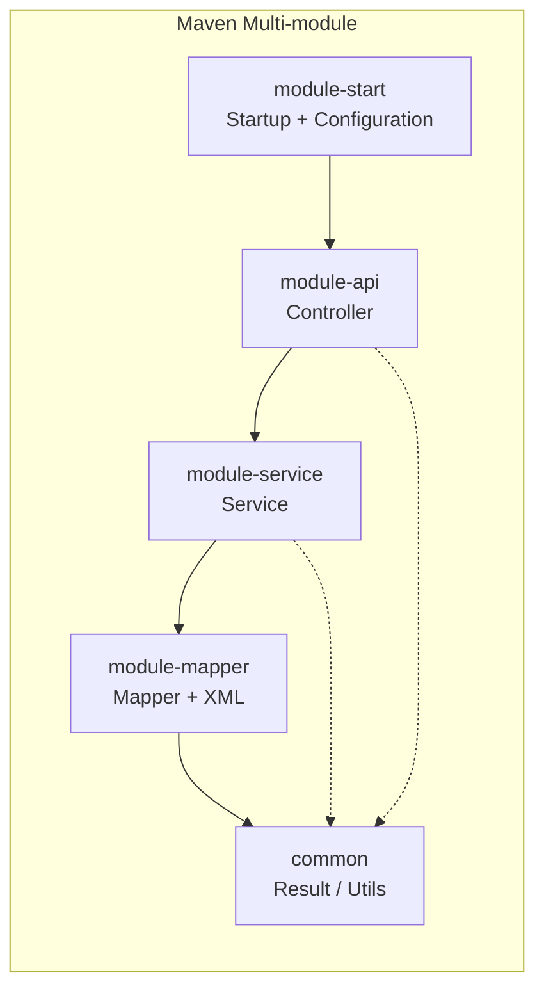
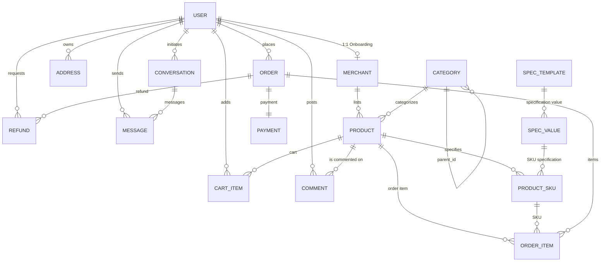

# Online Supermarket System - Server High-Level Design

> [简体中文](../zh/server-design.md) | English

---

## 1. Technology Selection

| Category | Technology | Version/Notes |
|------|------|------|
| Base framework | Spring Boot | 3.4.5 |
| JDK | Java 21 | |
| ORM | MyBatis | 3.0.4 |
| Pagination | PageHelper | |
| Database | MySQL | |
| Cache | Redis | Jedis / Lettuce |
| Search engine | Elasticsearch | |
| Authentication | JWT + Redis dual validation | |
| Authorization | Service-layer role/ownership checks | |
| Parameter validation | Spring Validation + custom annotations | |
| API documentation | Knife4j (OpenAPI 3.0) | 4.5.0 |
| Image storage | Local directory / Alibaba Cloud OSS | |
| Utility library | Lombok | |
| Logging | Logback + AOP operation log | |
| Scheduled tasks | Spring @Scheduled | |

---

## 2. Maven Multi-module Structure

```
chrono-bbs-server/                # Parent project (aggregation)
├── pom.xml                       # Parent POM, dependency management
├── common/                       # Common module
│   └── Unified response, exceptions, enums, utility classes, constants
├── module-api/                   # API module (Controller + VO + DTO)
│   └── REST APIs exposed externally
├── module-service/               # Business module (Service interfaces + implementations)
│   └── Core business logic
├── module-mapper/                # Data access module (Mapper + entities + XML)
│   └── MyBatis mapping layer
└── module-start/                 # Startup module
    └── Startup class + global configuration + static resources
```

### Module Dependencies

```
module-start
    └── module-api
            └── module-service
                    └── module-mapper
                            └── common
```

| Module | Responsibilities |
|------|------|
| **common** | Common base classes: `Result<T>`, `PageResult<T>`, `BusinessException`, error code enums, `RedisUtil`, `JwtUtil`, constant definitions |
| **module-mapper** | Entity classes, MyBatis Mapper interfaces, XML mapping files |
| **module-service** | Service interfaces + Impl implementations, DTO input definitions, business logic orchestration |
| **module-api** | Controllers, VO output definitions, interceptors (authorization/logging) |
| **module-start** | Spring Boot startup class, `application.yml`, global configuration (CORS/OSS/Knife4j), scheduled task scheduling |

---

## 3. Package Structure Design

Taking `module-api` as an example:

```
com.ncist.controller/
    ├── UserController.java          # User APIs
    ├── ProductController.java       # Product APIs
    ├── CategoryController.java      # Category APIs
    ├── SearchController.java        # Search APIs
    ├── CartController.java          # Cart APIs
    ├── OrderController.java         # Order APIs
    ├── PaymentController.java       # Payment APIs
    ├── AddressController.java       # Address APIs
    ├── CommentController.java       # Comment APIs
    ├── AdminController.java         # Administrator APIs
    ├── MerchantController.java      # Merchant APIs
    └── ChatController.java          # Instant messaging APIs
com.ncist.vo/                        # Output VOs
com.ncist.interceptor/               # Interceptors (JWT authorization, operation logging)
```

Taking `module-service` as an example:

```
com.ncist.service/
    ├── UserService.java             # Interface
    ├── impl/UserServiceImpl.java    # Implementation
    ├── ProductService.java
    ├── impl/ProductServiceImpl.java
    └── ... (same pattern, divided by module)
com.ncist.dto/                       # Input DTOs
```

Taking `module-mapper` as an example:

```
com.ncist.entity/                    # Entity classes
com.ncist.mapper/                    # Mapper interfaces
resources/mapper/                    # MyBatis XML
```

---

## 4. Unified Response and Exception System

### 4.1 Unified Return Format `Result<T>`

```java
// common module
public class Result<T> {
    private int code;         // Status code
    private String message;   // Message
    private T data;           // Data
    private long timestamp;   // Timestamp

    public static <T> Result<T> success(T data) { ... }
    public static <T> Result<T> fail(ErrorCode code) { ... }
    public static <T> Result<T> fail(int code, String msg) { ... }
}
```

### 4.2 Paginated Return `PageResult<T>`

```java
// common module
public class PageResult<T> {
    private long total;       // Total record count
    private int page;         // Current page
    private int size;         // Page size
    private List<T> list;     // Data list
}
```

### 4.3 Error Code Enum `ErrorCode`

```java
// common module, centrally managed
public enum ErrorCode {
    // General 1xxx
    SUCCESS(200, "Operation successful"),
    PARAM_ERROR(400, "Parameter error"),
    UNAUTHORIZED(401, "Not logged in"),
    FORBIDDEN(403, "No permission"),
    NOT_FOUND(404, "Resource not found"),
    SYSTEM_ERROR(500, "System error"),

    // User 2xxx
    USER_NOT_EXIST(2001, "User does not exist"),
    PASSWORD_ERROR(2002, "Incorrect password"),
    USERNAME_EXIST(2003, "Username already exists"),

    // Product 3xxx
    PRODUCT_NOT_FOUND(3001, "Product not found"),
    STOCK_INSUFFICIENT(3002, "Insufficient stock"),
    PRODUCT_OFF_SHELF(3003, "Product has been unlisted"),

    // Order 4xxx
    ORDER_NOT_FOUND(4001, "Order not found"),
    ORDER_STATUS_ERROR(4002, "Invalid order status"),
    ORDER_CANNOT_CANCEL(4003, "Order cannot be cancelled"),

    // Payment 5xxx
    PAY_FAILED(5001, "Payment failed"),
    CARD_INVALID(5002, "Invalid card number"),

    // Merchant 6xxx
    MERCHANT_NOT_APPROVED(6001, "Merchant has not been approved"),
    MERCHANT_EXIST(6002, "Onboarding application already submitted"),
}
```

### 4.4 Custom Business Exception

```java
// common module
public class BusinessException extends RuntimeException {
    private int code;
    public BusinessException(ErrorCode errorCode) {
        super(errorCode.getMessage());
        this.code = errorCode.getCode();
    }
}
```

### 4.5 Global Exception Handling

```java
// module-api or module-start
@RestControllerAdvice
public class GlobalExceptionHandler {

    @ExceptionHandler(BusinessException.class)
    public Result<Void> handleBusiness(BusinessException e) {
        return Result.fail(e.getCode(), e.getMessage());
    }

    @ExceptionHandler(MethodArgumentNotValidException.class)
    public Result<Void> handleValid(MethodArgumentNotValidException e) {
        // Extract @Valid validation failure information
    }

    @ExceptionHandler(Exception.class)
    public Result<Void> handleUnknown(Exception e) {
        log.error("Unknown exception", e);
        return Result.fail(ErrorCode.SYSTEM_ERROR);
    }
}
```

---

## 5. Authentication and Authorization System

### 5.1 JWT + Redis Dual Validation Flow

```
Login request → Validate username and password → Generate JWT token → Store in Redis(userId:token)
              → Return the token to the frontend

Subsequent requests → Interceptor extracts Header Authorization → Parse JWT to obtain userId
                    → Validate whether the token exists and matches in Redis → Allow/Reject
```

- **JWT**: Carries user identity information (userId, role), valid for 2 hours.
- **Redis**: Stores the token version number and supports active kick-out (delete the corresponding Redis key to invalidate immediately).
- **Logout**: Delete the token from Redis.

### 5.2 RBAC Permission Control (Service-Layer Checks)

The current implementation does not use AOP annotations. It uses a two-stage approach: interceptor authentication plus service-layer authorization.

1. `JwtInterceptor` validates the JWT and its Redis session, then writes `userId / username / role` into `UserContext`;
2. Every public service method checks the role and data ownership before business logic and throws `BusinessException` on violation.

Typical checks:

```java
// Admin role check (AdminServiceImpl)
private void requireAdmin() {
    if (!UserRoleEnum.ADMIN.getCode().equals(UserContext.getRole())) {
        throw new BusinessException(AdminErrorCode.NOT_ADMIN);
    }
}

// Merchant approval and product ownership (ProductServiceImpl)
Merchant merchant = requireApprovedMerchant(userId);
requireOwnership(productId, merchant.getId());
```

Other examples: merchants can only ship orders whose items all belong to them (`MerchantServiceImpl.ship`), refund review verifies merchant approval and product ownership (`RefundServiceImpl.requireReviewPermission`), and users can only operate on their own addresses, orders and refunds. Controllers only bind parameters and return `Result<T>`.

### 5.3 Captcha

Captchas are of two types, both stored in Redis:

| Type | Purpose | Redis Key | Validity | Description |
|------|------|-----------|--------|------|
| Graphical captcha | Login/registration/obtain password reset verification code | `verify:{uuid}` | 5min | Generate UUID + captcha image |
| SMS/email verification code | Reset password when the password is forgotten | `reset:code:{uuid}` | 5min | Returned directly in the response during the course project phase |

- A graphical captcha is required for login/registration to prevent brute-force attacks.
- For forgot password: validate the graphical captcha first → send an SMS/email verification code → reset the password with that verification code.
- Captchas are deleted from Redis immediately after use to guarantee one-time validity.

---

## 6. Parameter Validation

### 6.1 Spring Validation Annotations

```java
// DTO example
public class RegisterDTO {
    @NotBlank(message = "Username cannot be empty")
    @Size(min = 3, max = 20, message = "Username length must be 3-20")
    private String username;

    @NotBlank(message = "Password cannot be empty")
    @Size(min = 6, max = 20, message = "Password length must be 6-20")
    private String password;

    @NotBlank(message = "Phone number cannot be empty")
    @Pattern(regexp = "^1[3-9]\\d{9}$", message = "Invalid phone number format")
    private String phone;

    @EnumValue(enumClass = UserRoleEnum.class, message = "Invalid role value")
    private Integer role;
}
```

### 6.2 Custom Validation Annotation `@EnumValue`

```java
@Target(ElementType.FIELD)
@Retention(RetentionPolicy.RUNTIME)
@Constraint(validatedBy = EnumValueValidator.class)
public @interface EnumValue {
    Class<? extends Enum<?>> enumClass();
    String message() default "Invalid enum value";
}
```

---

## 7. Concurrency Control and Idempotency Design

### 7.1 Optimistic Locking

```sql
-- The product_sku table already has the field; no additional field is needed
UPDATE product_sku SET stock = stock - ? WHERE id = ? AND stock >= ?
-- Returns 0 rows when the condition is not met; the business layer checks and reports "Insufficient stock"
```

### 7.2 Redis Distributed Lock

```java
// Lock userId when placing an order to prevent concurrent duplicate orders
String lockKey = "lock:order:" + userId;
boolean locked = redisUtil.tryLock(lockKey, 10);  // 10-second timeout
if (!locked) {
    throw new BusinessException(ErrorCode.ORDER_DUPLICATE);
}
try {
    // Order placement logic
} finally {
    redisUtil.unlock(lockKey);
}
```

### 7.3 Duplicate Submission Prevention Token

```
Before ordering: frontend calls GET /api/order/submit-token → backend generates a UUID and stores it in Redis (expires in 5 minutes)
When ordering: frontend carries the token → backend validates and immediately deletes it → atomicity guarantees one-time validity
        If the token does not exist → duplicate submission → reject
```

### 7.4 Payment Idempotency

```java
// order_id is unique in the payment table; query before payment
Payment existing = paymentMapper.selectByOrderId(orderId);
if (existing != null && existing.getStatus() == SUCCESS) {
    return Result.success();  // Idempotent return
}
// Execute payment...
```

---

## 8. Transaction Management

### 8.1 Declarative Transactions

```java
@Service
public class OrderServiceImpl implements OrderService {

    @Override
    @Transactional(rollbackFor = Exception.class)
    public Order createOrder(Long userId, CreateOrderDTO dto) {
        // 1. Validate cart + stock
        // 2. Deduct Redis stock (Redis only, not in this transaction)
        // 3. Generate order number → insert into order table
        // 4. Insert into order_item table
        // 5. Delete selected cart items
        // 6. Deduct MySQL stock → synchronize Redis
        // Any step fails → roll back all
    }
}
```

### 8.2 Transaction Boundaries

| Operation | Same Transaction? | Description |
|------|------|------|
| Insert order + insert order_item + clear cart + deduct MySQL stock | ✅ Same transaction | MySQL write operations, guaranteed by ACID |
| Deduct Redis stock | ❌ Independent operation | Redis does not support rollback; compensate separately after order success/failure |
| Send ES synchronization message | ❌ Asynchronous after transaction | Does not affect the main flow |

---

## 9. ES Data Synchronization Strategy

### 9.1 Synchronization Method

Uses **async + MQ or thread pool**, without blocking the main flow:

```
Product listed/updated → Service layer finishes MySQL processing → asynchronously send ES update message
Product unlisted/deleted → Service layer finishes MySQL processing → asynchronously send ES delete message
```

> During the course design phase, `@Async` + a thread pool can replace MQ to simplify the architecture.

### 9.2 Synchronization Content

| Operation | ES Action |
|------|------|
| Product listing | INSERT into `product_index` |
| Product update (name/price/description) | UPDATE `product_index` |
| Product unlisting/deletion | DELETE from `product_index` |
| Order payment (sales change) | Scheduled task batch-updates the `sales` field |

---

## 10. File Upload (Local Directory / Alibaba Cloud OSS)

### 10.1 Upload Flow

```
Frontend selects an image → calls POST /api/upload/image
             → backend validation (format: jpg/png/webp, size: ≤2MB)
             → compression (proportionally scaled to 800px wide)
             → write to local uploads/ or upload to OSS based on upload.mode (directory: product/date/uuid.jpg)
             → return access URL (local /uploads/... or OSS URL) → frontend stores it in the form
```

### 10.2 Validation Rules

| Rule | Value |
|------|------|
| Allowed formats | jpg, jpeg, png, webp |
| Maximum per image | 2MB |
| Maximum per request | 4 images |
| Compression width | 800px (proportional scaling) |

---

## 11. Scheduled Tasks

> Implementation status: only `refreshSeckillStatus` (`SeckillStatusScheduler`, every 30 seconds) is implemented; the remaining tasks below are planned.

| Task | Execution Frequency | Description |
|------|------|------|
| `cancelTimeoutOrders` | Every 5 minutes | Scan orders with `status=Pending Payment AND created_at < 30 minutes ago`, change them to Cancelled, and restore stock |
| `syncSalesFromRedis` | Every 10 minutes | Read Redis `product:{id}:sales` and batch UPDATE MySQL `product.sales` |
| `cleanSearchHistory` | Every day at 3:00 AM | Delete history records with `searched_at < 30 days ago` |
| `syncStockFromRedis` | Every 5 minutes | Read Redis stock and batch synchronize MySQL `product_sku.stock` (fallback guarantee) |
| `cleanChatMessages` | Every day at 4:00 AM | Delete historical messages with `message.created_at < 30 days ago` |
| `refreshSeckillStatus` | Every 30 seconds | Refresh Flash-sale Coupon status (Not Started → In Progress → Ended) and batch-expire unused user coupons |

```java
@Configuration
@EnableScheduling
public class ScheduleConfig {

    @Scheduled(cron = "0 */5 * * * ?")
    public void cancelTimeoutOrders() { ... }

    @Scheduled(cron = "0 */10 * * * ?")
    public void syncSalesFromRedis() { ... }

    @Scheduled(cron = "0 0 3 * * ?")
    public void cleanSearchHistory() { ... }

    @Scheduled(cron = "0 */5 * * * ?")
    public void syncStockFromRedis() { ... }

    @Scheduled(cron = "0 0 4 * * ?")
    public void cleanChatMessages() { ... }

    @Scheduled(fixedDelay = 30_000)
    public void refreshSeckillStatus() { ... }
}
```

---

## 12. Logging System

### 12.1 Logback File Logs

- Console output: `DEBUG` in development, `INFO` in production
- Files roll daily: `logs/application.%d{yyyy-MM-dd}.log`
- Retained for 30 days

### 12.2 AOP Operation Log

```java
@Target(ElementType.METHOD)
@Retention(RetentionPolicy.RUNTIME)
public @interface OperationLog {
    String value();       // Operation description, e.g., "Review merchant onboarding"
    String module();      // Module, e.g., "Administrator"
}
```

```java
@Aspect
@Component
public class OperationLogAspect {
    @Around("@annotation(opLog)")
    public Object around(ProceedingJoinPoint pjp, OperationLog opLog) {
        // Record: user ID, username, IP, operation module, operation description, request parameters, elapsed time, result
        // Store in the operation_log table
    }
}
```

### 12.3 Operation Log Table (New)

| Field | Type | Description |
|------|------|------|
| id | BIGINT PK | Primary key |
| user_id | BIGINT | Operator ID |
| username | VARCHAR(50) | Operator username |
| ip | VARCHAR(50) | Operation IP |
| module | VARCHAR(50) | Module |
| action | VARCHAR(200) | Operation description |
| params | TEXT | Request parameters (JSON) |
| result | VARCHAR(50) | Result (success/failure) |
| cost_time | BIGINT | Elapsed time (ms) |
| created_at | DATETIME | Operation time |

> This table is appended to [db-design.md](./db-design.md).

---

## 13. WebSocket Instant Messaging

### 13.1 Overview

Users and merchants support **one-to-one private chat**; users can start a conversation by clicking "Contact Seller" on the product detail page.

| Feature | Description |
|------|------|
| Protocol | WebSocket + STOMP |
| Persistence | Messages stored in MySQL; automatically cleaned up after 30 days |
| History | Paginated queries; pull up to load more |
| Offline messages | Supported; unread messages are automatically pushed when the receiver comes online |
| Unread count | Unread counts maintained at the conversation level, stored in Redis + MySQL |

### 13.2 Database Tables

See Chapter 9 of [db-design.md](./db-design.md):

- **`conversation`**: Conversation table, `(user_id, merchant_id)` unique constraint
- **`message`**: Message table, `conversation_id` references the conversation

### 13.3 Spring WebSocket Configuration

```java
@Configuration
@EnableWebSocketMessageBroker
public class WebSocketConfig implements WebSocketMessageBrokerConfigurer {

    @Override
    public void registerStompEndpoints(StompEndpointRegistry registry) {
        // Client connection endpoint
        registry.addEndpoint("/ws")
                .setAllowedOriginPatterns("*")
                .withSockJS();  // Compatible with browsers that do not support WebSocket
    }

    @Override
    public void configureMessageBroker(MessageBrokerRegistry registry) {
        // Client subscription prefix (receiving messages)
        registry.enableSimpleBroker("/queue", "/topic");
        // Server-side message receiving prefix
        registry.setApplicationDestinationPrefixes("/app");
    }
}
```

### 13.4 Message Push Path Design

| Path | Direction | Description |
|------|------|------|
| `/app/chat.send` | Client → Server | Send message |
| `/queue/chat/{userId}` | Server → Client | Personal message push (one-to-one) |
| `/queue/chat/notify` | Server → Client | System notification (new conversation, offline message reminder) |

### 13.5 Send Message Flow

```
┌─────────┐     ┌─────────────┐     ┌──────────┐     ┌─────────┐
│ Sender  │     │  WebSocket  │     │  MySQL   │     │Receiver │
│ (User)  │     │  Controller │     │          │     │(Merchant)│
└────┬────┘     └──────┬──────┘     └────┬─────┘     └────┬────┘
     │                 │                │                 │
     │ /app/chat.send  │                │                 │
     │────────────────▶│                │                 │
     │                 │ INSERT message │                 │
     │                 │───────────────▶│                 │
     │                 │ UPDATE unread  │                 │
     │                 │───────────────▶│                 │
     │                 │                │                 │
     │                 │ /queue/chat/{merchantId}         │
     │                 │─────────────────────────────────▶│
     │                 │                │ (received if online) │
     │    return OK    │                │                 │
     │◀────────────────│                │                 │
     │                 │                │                 │
     Receiver offline?                                       │
     ─────────────────────────────────────────────────────  │
     Next time online → query message WHERE is_read=0 → batch push │
```

### 13.6 Core Code Design

#### ChatController

```java
@RestController
public class ChatController {

    @MessageMapping("/chat.send")
    public void sendMessage(@Payload SendMessageDTO dto, SimpMessageHeaderAccessor headerAccessor) {
        // 1. Parse sender information from JWT
        // 2. Validate that the sender is a participant in the conversation
        // 3. Build the message object → persist
        // 4. Update the conversation's last_message + the other party's unread count
        // 5. Push the message to the receiver's /queue/chat/{receiverId}
        // 6. If the receiver is online → deliver in real time
        //    If the receiver is offline → the message is persisted and pulled next time they come online
    }
}
```

#### Query Historical Messages

```java
// REST API, paginated retrieval
@GetMapping("/api/chat/history/{conversationId}")
public Result<PageResult<MessageVO>> history(
        @PathVariable Long conversationId,
        @RequestParam int page,
        @RequestParam(defaultValue = "20") int size) {
    // 1. Validate that the current user is a participant in the conversation
    // 2. PageHelper paginated query of message
    // 3. Return historical messages (newest to oldest)
}
```

#### Conversation List

```java
// REST API
@GetMapping("/api/chat/conversations")
public Result<List<ConversationVO>> listConversations() {
    // Query all conversations of the current user, in descending order of last_message_time
    // Return: the other party's avatar/name, last message summary, unread count, last message time
}
```

#### Mark as Read

```java
@PutMapping("/api/chat/read/{conversationId}")
public Result<Void> markRead(@PathVariable Long conversationId) {
    // UPDATE message SET is_read=1 WHERE conversation_id=? AND is_read=0
    // Reset the current user's unread count in the conversation to 0
}
```

### 13.7 Online Status Management (Redis)

| Cache Key | Content | Description |
|------|------|------|
| `online:{userId}` | true | SET when the user's WebSocket connects, DEL when disconnected; used to determine whether the user is online |

```java
// When the connection is established
@EventListener(SessionConnectEvent.class)
public void onConnect(SessionConnectEvent event) {
    Long userId = extractUserId(event);
    redisUtil.set("online:" + userId, "1", 30, TimeUnit.MINUTES);
    // Push unread messages received while offline
    pushOfflineMessages(userId);
}

// When the connection is disconnected
@EventListener(SessionDisconnectEvent.class)
public void onDisconnect(SessionDisconnectEvent event) {
    Long userId = extractUserId(event);
    redisUtil.del("online:" + userId);
}
```

### 13.8 Security

| Measure | Description |
|------|------|
| Connection authentication | Validate JWT from the request parameter `?token=xxx` during the WebSocket handshake; reject unauthenticated connections |
| Authorization protection | When sending a message, validate that `sender_id` is one of the conversation participants |
| Rate limiting | The same user can send at most 5 messages per second to prevent flooding (Redis counter) |

---

## 14. API Documentation (Knife4j)

The existing dependency `knife4j-openapi3-jakarta-spring-boot-starter` 4.5.0 already provides support. After startup, visit:

```
http://localhost:8080/doc.html
```

Add Swagger annotations to Controllers:

```java
@Tag(name = "Product Management", description = "Product CRUD APIs")
@RestController
@RequestMapping("/api/product")
public class ProductController {

    @Operation(summary = "Paginated product list query")
    @GetMapping("/list")
    public Result<PageResult<ProductVO>> list(ProductPageDTO dto) { ... }
}
```

---

## 15. UML Modeling

### 15.1 Deployment Diagram



### 15.2 Component Diagram



### 15.3 ER Diagram



---

## 16. Flash-sale Coupon Module

### 16.1 Design Goals

- **No overselling**: The coupon's `remain_count` must not become negative under concurrent claims.
- **No over-claiming**: The number of coupons claimed by the same user cannot exceed `per_user_limit`.
- **High availability**: Even when Redis fails, coupon claiming can still be completed through atomic deduction in the database.
- **Eventual consistency**: Consistency between Redis pre-deduction and MySQL persistence is guaranteed through compensation.

### 16.2 Claim Flow

```mermaid
flowchart TD
    A["POST /api/seckill/claim/{couponId}"] --> B["Validate coupon exists + status=1 + within the time window"]
    B --> C["Lazy-load remain / claimed keys in Redis"]
    C --> D["DECR seckill:remain:{couponId}"]
    D -->|result is negative| E["INCR restore → Sold out"]
    D -->|result is non-negative| F["INCR seckill:claimed:{couponId}:{userId}"]
    F -->|exceeds per_user_limit| G["DECR rollback + INCR restore stock → Already claimed"]
    F -->|not exceeded| H["Insert user_coupon (status=0)"]
    H --> I["MySQL remain_count - 1"]
    I --> J["Return SeckillClaimVO"]
    H -->|persistence exception| K["Transaction rollback + compensate Redis"]
    C -->|Redis exception| L["Degrade to database atomic deduction"]
```



### 16.3 Redis Keys and Degradation Strategy

| Key | Content | Expiration Time |
|------|------|----------|
| `seckill:remain:{couponId}` | Coupon remaining stock | Campaign end + 24h (minimum 1h) |
| `seckill:claimed:{couponId}:{userId}` | Number of coupons claimed by the user | Same as above |

- **Redis normal**: `DECR` stock → `INCR` user claim count → write `user_coupon` → decrement MySQL `remain_count`.
- **Redis unavailable**: Degrade to `UPDATE seckill_coupon SET remain_count = remain_count - 1 WHERE id = ? AND remain_count > 0`, then query `user_coupon` to validate the claim limit.
- **MySQL exception**: After transaction rollback, compensate Redis (add stock back, decrement claim count back); if compensation fails, only log it, with later reconciliation as the fallback.

### 16.4 Order Deduction

`POST /api/seckill/calculate` accepts `totalAmount` and an optional `userCouponId`:

1. No coupon selected: the original price is the final amount.
2. Validate that the user coupon exists, belongs to the current user, has Unused status, and the campaign has not expired.
3. Validate that the order amount meets `min_amount`.
4. Full reduction coupon discount = `min(discount_value, totalAmount)`; discount coupon discount = `totalAmount - totalAmount × discount_value / 100`.
5. Return `originalAmount` / `discountAmount` / `finalAmount` / `couponName`; when creating the order, write `userCouponId` and redeem the coupon.

### 16.5 Scheduled Tasks and Backend Management

- `SeckillStatusScheduler` refreshes coupon status every 30 seconds: Not Started → In Progress, In Progress → Ended, and batches unused expired coupons to Expired.
- Administrator APIs: create, edit, and delete coupons; when editing the total quantity, synchronize `remain_count` and the Redis stock key by the delta.
- User APIs: coupon list/details (guests can view), claim, my coupons (logged-in users).

> For table structures, see Chapter 10 of [db-design.md](./db-design.md); for API contracts, see Chapter 16 of [api-doc.md](./api-doc.md).
