# 详细设计

> [English](../en/detailed-design.md) | 简体中文


> 本系统为**单体服务架构**，Maven 多模块仅用于代码分层组织，运行时为单个 Spring Boot 进程。用户信息通过 `UserContext`（`ThreadLocal`）在请求链路中传递。

---

## 一、用户认证模块

### 1.1 获取图形验证码 — `GET /api/user/captcha`

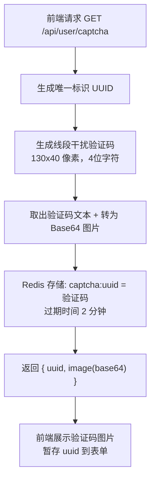

### 1.2 用户注册 — `POST /api/user/register`

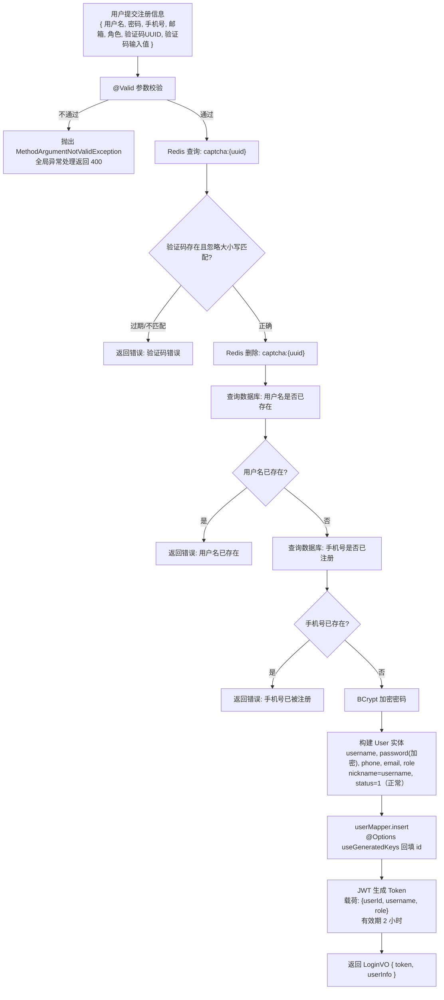

### 1.3 用户登录 — `POST /api/user/login`

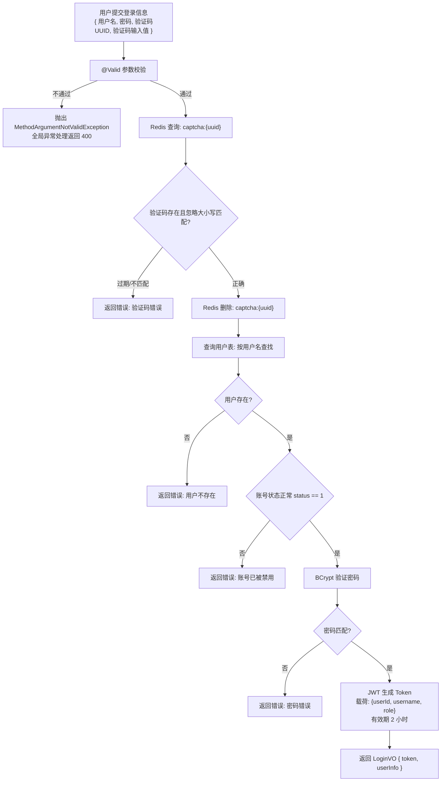

### 1.4 Token 刷新与过期处理（未提供独立刷新接口）

> 当前后端未提供独立的 Token 刷新接口。登录态由 `JwtInterceptor` 校验：JWT 过期或与服务端 `token:{userId}` 不一致时，直接返回 `TOKEN_EXPIRED` / `TOKEN_INVALID`，前端据此清除本地 token 并跳转登录页重新登录。Token 有效期 2 小时，与 Redis 缓存同生命周期。

### 1.5 用户登出 — `POST /api/user/logout`

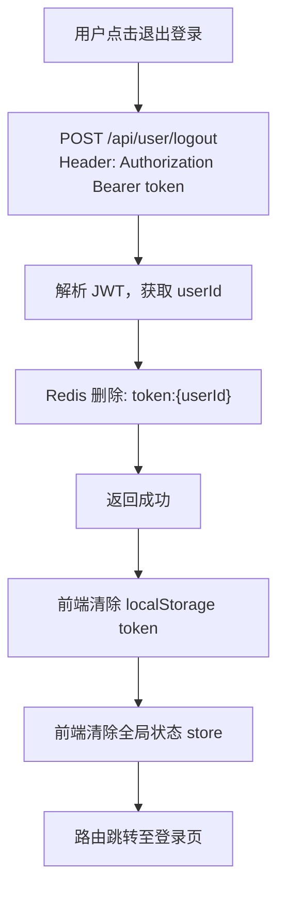

### 1.6 忘记密码 — 发送验证码 `POST /api/user/forgot-code`

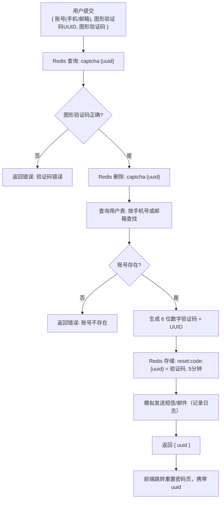

### 1.7 重置密码 — `POST /api/user/reset-password`

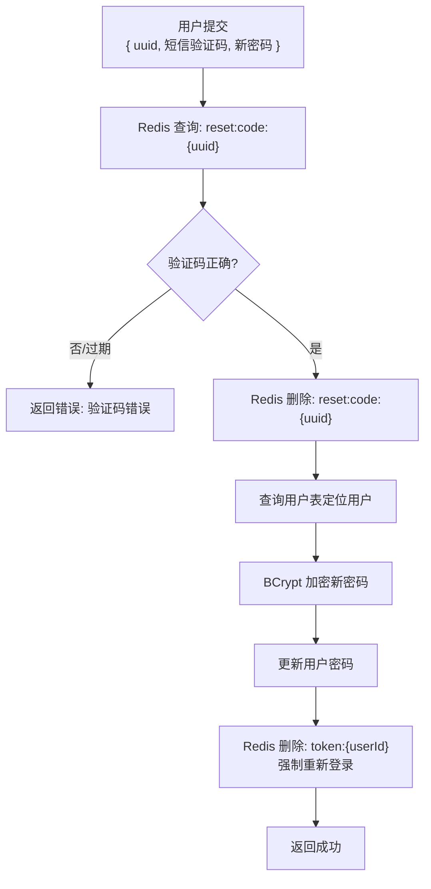

### 1.8 修改密码 — `PUT /api/user/password`

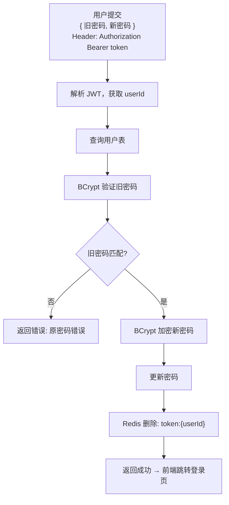

### 1.9 获取当前用户信息 — `GET /api/user/info`

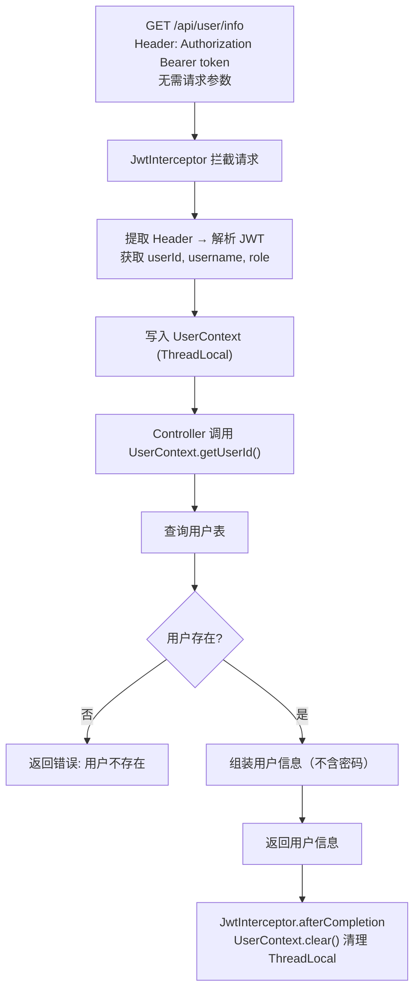

### 1.10 修改个人信息 — `PUT /api/user/profile`

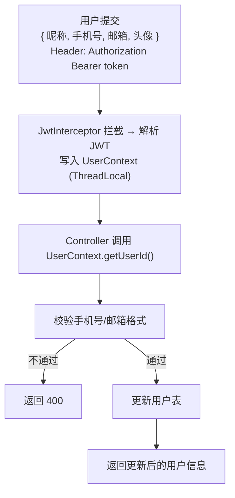

---

## 二、商品模块

### 2.1 商品列表查询 — `GET /api/product/list`

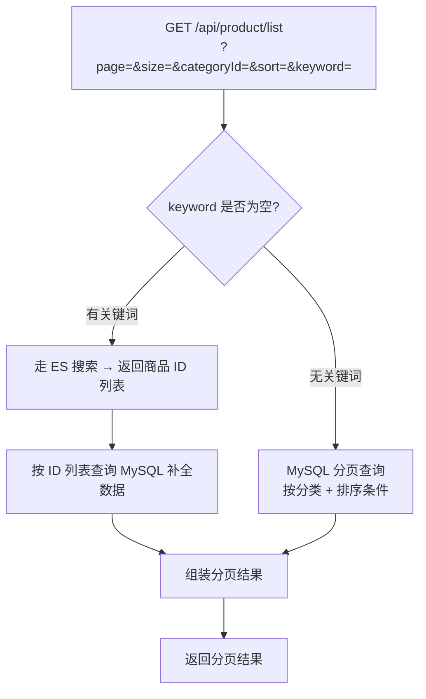

### 2.2 商品详情 — `GET /api/product/{id}`

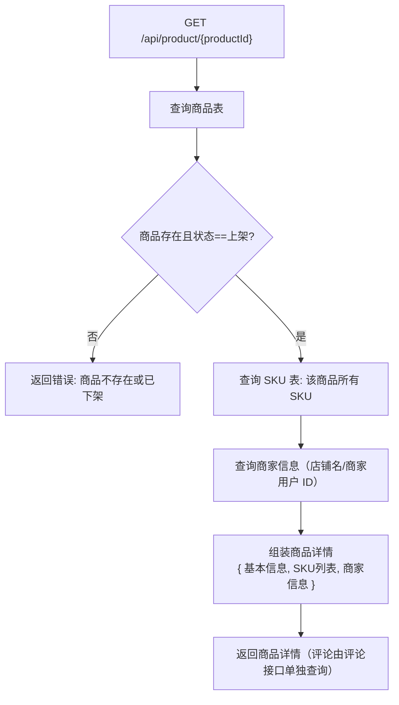

### 2.3 创建商品 — `POST /api/product`

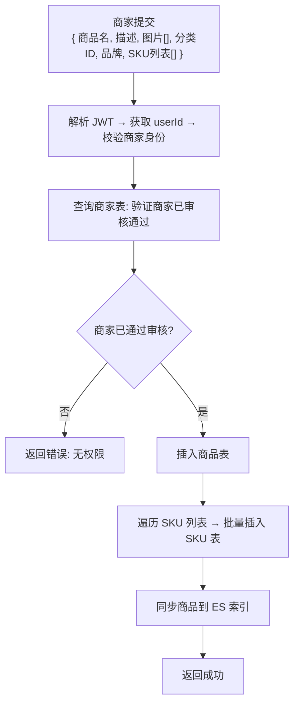

### 2.4 更新商品 — `PUT /api/product/{id}`

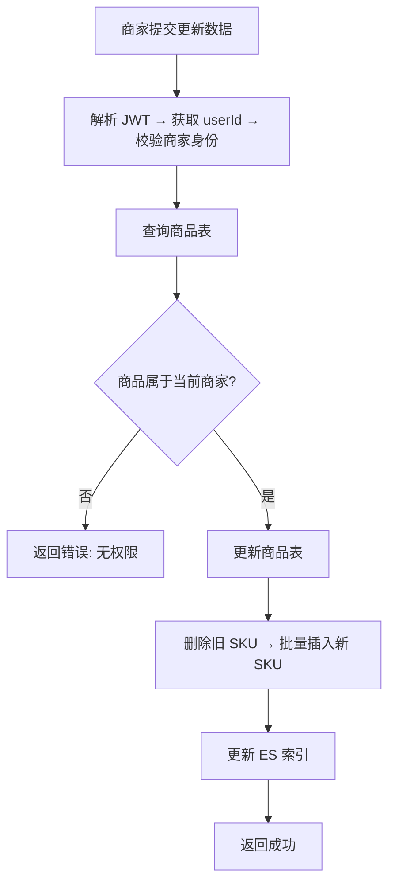

### 2.5 上架/下架商品 — `PUT /api/product/{id}/status`

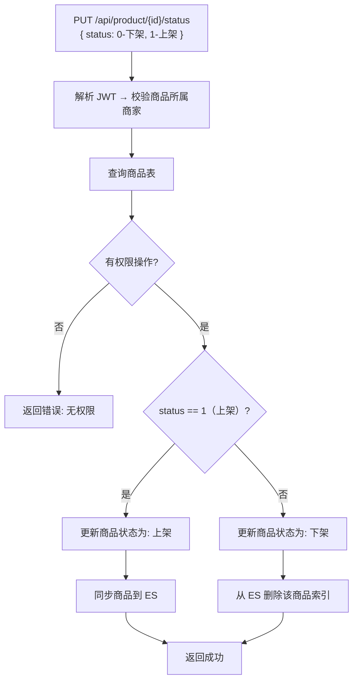

### 2.6 删除商品 — `DELETE /api/product/{id}`

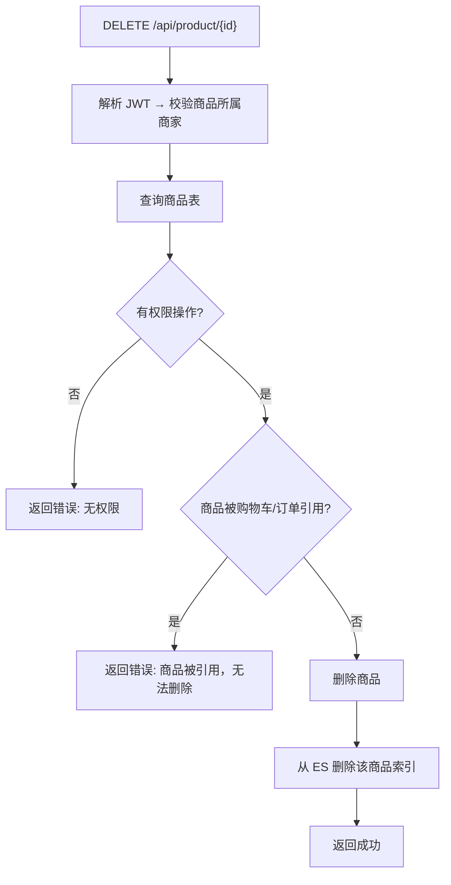

---

## 三、分类模块

### 3.1 获取分类树 — `GET /api/category/tree`

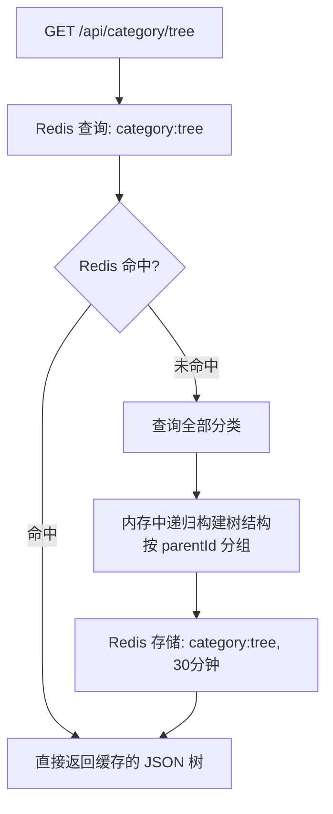

### 3.2 新增分类 — `POST /api/admin/categories`

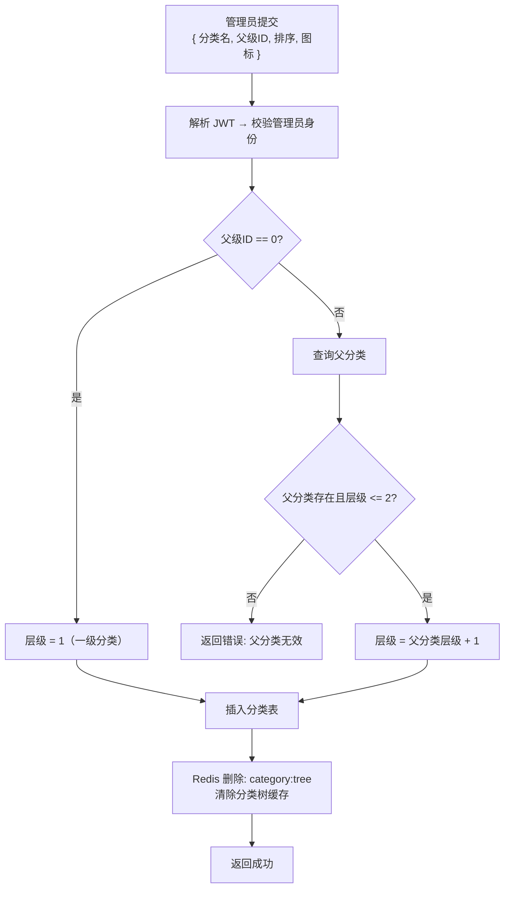

### 3.3 编辑分类 — `PUT /api/admin/categories/{id}`

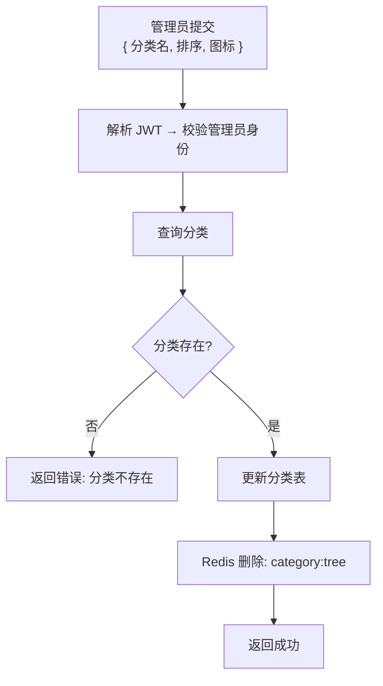

### 3.4 删除分类 — `DELETE /api/admin/categories/{id}`

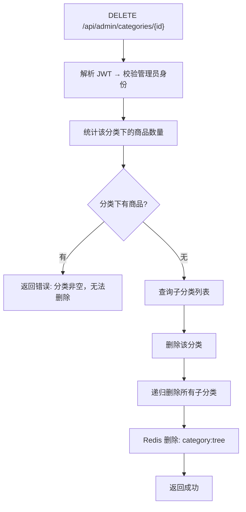

---

## 四、购物车模块

### 4.1 购物车列表 — `GET /api/cart/list`

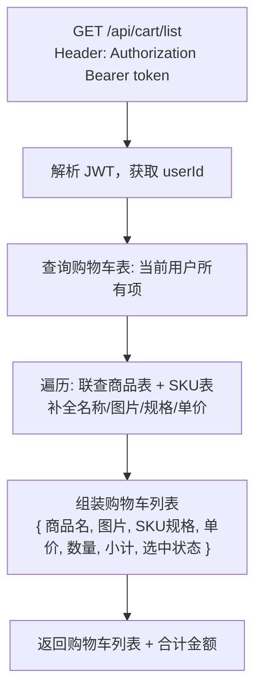

### 4.2 加入购物车 — `POST /api/cart/add`

```mermaid
flowchart TD
    A["用户提交<br/>{ SKU_ID, 数量 }<br/>Header: Authorization Bearer token"] --> B["解析 JWT，获取 userId"]
    B --> C["查询 SKU 表"]
    C --> D{"SKU 存在且库存 >= 数量?"}
    D -->|否| E["返回错误: 库存不足"]
    D -->|是| F["查询商品表"]
    F --> G{"商品状态 == 上架?"}
    G -->|否| H["返回错误: 商品已下架"]
    G -->|是| I["查询购物车表: 是否已有该 SKU"]
    I --> J{"已有该商品?"}
    J -->|是| K["更新: 数量 = 原数量 + 新数量"]
    J -->|否| L["插入购物车项<br/>(userId, productId, skuId, quantity, selected=1)"]
    K --> M["返回成功"]
    L --> M
```

### 4.3 修改数量 — `PUT /api/cart/update`

```mermaid
flowchart TD
    A["用户提交<br/>{ 购物车项ID, 数量 }"] --> B["解析 JWT，获取 userId"]
    B --> C["查询购物车项"]
    C --> D{"属于当前用户?"}
    D -->|否| E["返回错误: 无权操作"]
    D -->|是| F{"数量 > 0?"}
    F -->|是| G["查询 SKU 库存"]
    G --> H{"库存 >= 数量?"}
    H -->|否| I["返回错误: 库存不足"]
    H -->|是| J["更新购物车数量"]
    F -->|数量 == 0| K["删除该购物车项"]
    J --> L["返回成功"]
    K --> L
```

### 4.4 选中/取消 — `PUT /api/cart/select`

```mermaid
flowchart TD
    A["用户提交<br/>{ 选中的购物车项ID[] }"] --> B["解析 JWT，获取 userId"]
    B --> C["先将该用户所有项设为未选中"]
    C --> D["再批量将指定项设为选中"]
    D --> E["返回成功"]
```

### 4.5 删除购物车项 — `DELETE /api/cart/{id}`

```mermaid
flowchart TD
    A["DELETE /api/cart/{cartItemId}"] --> B["解析 JWT，获取 userId"]
    B --> C["查询购物车项"]
    C --> D{"属于当前用户?"}
    D -->|否| E["返回错误: 无权操作"]
    D -->|是| F["删除该购物车项"]
    F --> G["返回成功"]
```

### 4.6 全选/取消全选 — `PUT /api/cart/select-all`

```mermaid
flowchart TD
    A["用户提交<br/>{ selected: 1-全选, 0-取消全选 }"] --> B["解析 JWT，获取 userId"]
    B --> C["将当前用户所有购物车项设为指定选中状态"]
    C --> D["返回成功"]
```

### 4.7 清空购物车 — `DELETE /api/cart/clear`

```mermaid
flowchart TD
    A["DELETE /api/cart/clear"] --> B["解析 JWT，获取 userId"]
    B --> C["删除当前用户全部购物车项"]
    C --> D["返回成功"]
```

---

## 五、订单模块

### 5.1 获取防重 Token — `GET /api/order/submit-token`

```mermaid
flowchart TD
    A["前端结算页加载<br/>GET /api/order/submit-token"] --> B["解析 JWT，获取 userId"]
    B --> C["生成唯一标识 UUID"]
    C --> D["Redis 存储: order:submit-token:{token} = userId, 5分钟"]
    D --> E["返回 { token: uuid }"]
```

### 5.2 创建订单 — `POST /api/order/create`

```mermaid
flowchart TD
    A["用户提交下单数据<br/>{ 防重Token, 地址ID, 购物车项ID[], 优惠券ID? }"] --> B["解析 JWT，获取 userId"]
    B --> C["Redis 校验: order:submit-token:{token} == userId"]
    C --> D{"存在且绑定当前用户?"}
    D -->|否| E["返回错误: 请勿重复提交（token 已使用/过期）"]
    D -->|是| F["Redis 删除: order:submit-token:{token}<br/>（删除返回 true 才继续，保证只消费一次）"]
    F --> G["开启数据库事务"]
    G --> H["校验收货地址属主"]
    H --> I["查询购物车选中项（SQL 限定属主）"]
    I --> J{"商品上架且库存充足?"}
    J -->|否| K["事务回滚 → 返回错误: 库存不足/已下架"]
    J -->|是| L["原子扣减库存<br/>UPDATE stock = stock - 数量 WHERE stock >= 数量"]
    L --> M["计算金额 + 优惠券抵扣（复用 calculate 逻辑）"]
    M --> N["查询收货地址 → JSON 快照保存"]
    N --> O["生成订单编号（时间戳+随机数）"]
    O --> P["插入订单表 + 批量插入订单明细<br/>快照单价/数量/小计"]
    P --> Q["删除已下单的购物车项"]
    Q --> R["核销优惠券（条件更新防重复核销）"]
    R --> S["事务提交"]
    S --> T["返回 { 订单ID, 订单编号 }"]
```

### 5.3 订单列表 — `GET /api/order/list`

```mermaid
flowchart TD
    A["GET /api/order/list<br/>?page=&size=&status="] --> B["解析 JWT，获取 userId"]
    B --> C["分页查询订单表<br/>按 userId + status 筛选"]
    C --> D["遍历: 查询订单明细"]
    D --> E["组装分页结果"]
    E --> F["返回订单列表"]
```

### 5.4 订单详情 — `GET /api/order/{id}`

```mermaid
flowchart TD
    A["GET /api/order/{orderId}"] --> B["解析 JWT，获取 userId"]
    B --> C["查询订单表"]
    C --> D{"订单属于当前用户?"}
    D -->|否| E["返回错误: 无权查看"]
    D -->|是| F["查询订单明细"]
    F --> G["查询支付记录"]
    G --> H["查询退款记录"]
    H --> I["组装订单详情"]
    I --> J["返回订单详情"]
```

### 5.5 取消订单 — `PUT /api/order/{id}/cancel`

```mermaid
flowchart TD
    A["PUT /api/order/{orderId}/cancel<br/>?reason=取消原因"] --> B["解析 JWT，获取 userId"]
    B --> C["查询订单表"]
    C --> D{"订单属于当前用户?"}
    D -->|否| E["返回错误: 无权操作"]
    D -->|是| F{"订单状态 == 待支付?"}
    F -->|否| G["返回错误: 当前状态不可取消"]
    F -->|是| H["更新订单状态为: 已取消<br/>记录取消原因"]
    H --> I["恢复库存<br/>查询订单明细 → 逐项加回 SKU 库存"]
    I --> J["返回成功"]
```

### 5.6 确认收货 — `PUT /api/order/{id}/receive`

```mermaid
flowchart TD
    A["PUT /api/order/{orderId}/receive"] --> B["解析 JWT，获取 userId"]
    B --> C["查询订单表"]
    C --> D{"订单属于当前用户?"}
    D -->|否| E["返回错误: 无权操作"]
    D -->|是| F{"订单状态 == 已发货?"}
    F -->|否| G["返回错误: 当前状态不可确认收货"]
    F -->|是| H["更新订单状态为: 已完成(4)<br/>记录收货时间"]
    H --> I["返回成功"]
```

### 5.7 删除订单 — `DELETE /api/order/{id}`

```mermaid
flowchart TD
    A["DELETE /api/order/{orderId}"] --> B["解析 JWT，获取 userId"]
    B --> C["查询订单表"]
    C --> D{"订单属于当前用户?"}
    D -->|否| E["返回错误: 无权操作"]
    D -->|是| F{"订单处于可删除状态（已完成/已取消）?"}
    F -->|否| G["返回错误: 当前状态不可删除"]
    F -->|是| H["删除订单（及关联明细）"]
    H --> I["返回成功"]
```

---

## 六、支付模块

### 6.1 卡号支付 — `POST /api/payment/card`

```mermaid
flowchart TD
    A["用户提交银行卡信息<br/>{ 订单ID, 卡号, 有效期, CVV }"] --> B["解析 JWT，获取 userId"]
    B --> C["查询订单表"]
    C --> D{"订单属于当前用户 && 状态==待支付?"}
    D -->|否| E["返回错误: 订单状态异常"]
    D -->|是| F["查询支付表: 该订单是否已有记录"]
    F --> G{"已有支付记录?"}
    G -->|已支付| H["直接返回: 已支付（幂等）"]
    G -->|无/未支付| I["Luhn 算法校验卡号"]
    I --> J{"卡号合法?"}
    J -->|否| K["返回错误: 卡号无效"]
    J -->|是| L["校验有效期"]
    L --> M{"未过期?"}
    M -->|过期| N["返回错误: 卡已过期"]
    M -->|未过期| O["模拟扣款 → 插入支付记录(状态=成功)"]
    O --> P["更新订单状态为: 已支付<br/>记录支付时间"]
    P --> Q["更新商品销量 +1"]
    Q --> R["返回支付成功"]
```

### 6.2 生成支付二维码 — `POST /api/payment/qrcode`

```mermaid
flowchart TD
    A["POST /api/payment/qrcode<br/>{ 订单ID }"] --> B["解析 JWT，获取 userId"]
    B --> C["查询订单表"]
    C --> D{"订单有效?"}
    D -->|否| E["返回错误: 订单不存在"]
    D -->|是| F["生成二维码内容<br/>(订单ID + 金额 + 时间戳)"]
    F --> G["Redis 存储: qrcode:{orderId} = 待支付, 5分钟"]
    G --> H["返回 { 二维码内容 }"]
```

### 6.3 确认二维码支付 — `POST /api/payment/confirm-qrcode`

```mermaid
flowchart TD
    A["POST /api/payment/confirm-qrcode<br/>{ 订单ID }"] --> B["解析 JWT，获取 userId"]
    B --> C["Redis 查询: qrcode:{orderId}"]
    C --> D{"二维码未过期?"}
    D -->|过期/不存在| E["返回错误: 二维码已过期"]
    D -->|存在| F["查询支付表: 该订单是否已支付"]
    F --> G{"已支付?"}
    G -->|已支付| H["直接返回: 已支付（幂等）"]
    G -->|未支付| I["插入支付记录(方式=二维码, 状态=成功)"]
    I --> J["更新订单状态为: 已支付"]
    J --> K["Redis 删除: qrcode:{orderId}"]
    K --> L["更新商品销量"]
    L --> M["返回支付成功"]
```

---

## 七、收货地址模块

### 7.1 地址列表 — `GET /api/address/list`

```mermaid
flowchart TD
    A["GET /api/address/list"] --> B["解析 JWT，获取 userId"]
    B --> C["查询地址表: 当前用户所有地址<br/>按 默认优先 + 创建时间倒序"]
    C --> D["返回地址列表"]
```

### 7.2 新增地址 — `POST /api/address`

```mermaid
flowchart TD
    A["用户提交<br/>{ 收件人, 手机号, 省, 市, 区, 详细地址, 是否默认 }"] --> B["解析 JWT，获取 userId"]
    B --> C{"是否设为默认地址?"}
    C -->|是| D["先将该用户其他地址取消默认"]
    C -->|否| E["插入地址表"]
    D --> E
    E --> F["返回成功"]
```

### 7.3 编辑地址 — `PUT /api/address/{id}`

```mermaid
flowchart TD
    A["PUT /api/address/{id}<br/>{ 收件人, 手机号, ... , 是否默认 }"] --> B["解析 JWT，获取 userId"]
    B --> C["查询地址"]
    C --> D{"地址属于当前用户?"}
    D -->|否| E["返回错误: 无权操作"]
    D -->|是| F{"是否设为默认?"}
    F -->|是| G["先将其他地址取消默认"]
    F -->|否| H["更新地址表"]
    G --> H
    H --> I["返回成功"]
```

### 7.4 删除地址 — `DELETE /api/address/{id}`

```mermaid
flowchart TD
    A["DELETE /api/address/{addressId}"] --> B["解析 JWT，获取 userId"]
    B --> C["查询地址"]
    C --> D{"地址属于当前用户?"}
    D -->|否| E["返回错误: 无权操作"]
    D -->|是| F["检查是否有关联的未完成订单"]
    F --> G{"有关联未完成订单?"}
    G -->|是| H["返回错误: 无法删除，有关联订单"]
    G -->|否| I["删除地址"]
    I --> J["返回成功"]
```

### 7.5 设为默认地址 — `PUT /api/address/default/{id}`

```mermaid
flowchart TD
    A["PUT /api/address/default/{addressId}"] --> B["解析 JWT，获取 userId"]
    B --> C["查询地址"]
    C --> D{"地址属于当前用户?"}
    D -->|否| E["返回错误: 无权操作"]
    D -->|是| F["先将该用户所有地址取消默认"]
    F --> G["将指定地址设为默认"]
    G --> H["返回成功"]
```

---

## 八、评论模块

### 8.1 评论列表 — `GET /api/comment/list/{productId}`

```mermaid
flowchart TD
    A["GET /api/comment/list/{productId}<br/>?page=&size=&star="] --> B["分页查询评论表<br/>按商品ID + 评分筛选"]
    B --> C["遍历: 查用户表获取头像/昵称"]
    C --> D["遍历: 查评论表获取追评/回复"]
    D --> E["组装分页结果"]
    E --> F["返回评论列表"]
```

### 8.2 发表初评 — `POST /api/comment`

```mermaid
flowchart TD
    A["用户提交<br/>{ 商品ID, 订单明细ID, 内容, 评分, 图片[] }"] --> B["解析 JWT，获取 userId"]
    B --> C["查询订单明细"]
    C --> D{"订单明细属于当前用户?"}
    D -->|否| E["返回错误: 无权评价"]
    D -->|是| F["查询订单表"]
    F --> G{"订单状态 == 已完成(4)?"}
    G -->|否| H["返回错误: 收货后才能评价"]
    G -->|是| I["查询评论表: 该订单明细是否已有初评"]
    I --> J{"已有初评?"}
    J -->|是| K["返回错误: 已评价过"]
    J -->|否| L["插入评论(is_append=0, star=评分)"]
    L --> M["图片使用上传接口返回的 URL"]
    M --> N["返回评论 ID"]
```

### 8.3 发表追评 — `POST /api/comment/append`

```mermaid
flowchart TD
    A["用户提交<br/>{ 初评ID, 追评内容 }"] --> B["解析 JWT，获取 userId"]
    B --> C["查询初评记录"]
    C --> D{"初评存在 && 属于当前用户 && 未追评?"}
    D -->|否| E["返回错误: 不能追评"]
    D -->|是| F["插入评论(关联初评ID, is_append=1)"]
    F --> G["返回成功"]
```

### 8.4 商家回复 — `POST /api/comment/reply`

```mermaid
flowchart TD
    A["商家提交<br/>{ 评论ID, 回复内容 }"] --> B["解析 JWT，获取 userId"]
    B --> C["查询商家表: 验证商家身份且已通过审核"]
    C --> D{"是商家且已通过审核?"}
    D -->|否| E["返回错误: 无权限"]
    D -->|是| F["查询该评论"]
    F --> G["查询该评论对应的商品"]
    G --> H{"商品属于当前商家?"}
    H -->|否| I["返回错误: 无权回复"]
    H -->|是| J["插入评论(关联评论ID, parent_id=评论ID)"]
    J --> K["返回成功"]
```

---

## 九、退款/退货模块

### 9.1 申请退款/退货 — `POST /api/refund`

```mermaid
flowchart TD
    A["用户提交<br/>{ 订单明细ID, 类型(退款/退货), 原因, 金额 }"] --> B["解析 JWT，获取 userId"]
    B --> C["查询订单明细"]
    C --> D{"订单明细属于当前用户?"}
    D -->|否| E["返回错误: 无权操作"]
    D -->|是| F["查询订单表"]
    F --> G{"订单状态 IN [已支付(2), 已发货(3), 已完成(4)]?"}
    G -->|否| H["返回错误: 当前状态不可退款"]
    G -->|是| I["查询退款表: 该明细是否已有退款记录"]
    I --> J{"已有退款记录?"}
    J -->|是| K["返回错误: 已申请过退款"]
    J -->|否| L["插入退款记录(status=待审核)"]
    L --> M["返回成功"]
```

### 9.2 退款列表 — `GET /api/refund/my`、`GET /api/merchant/refunds`、`GET /api/admin/refunds`

```mermaid
flowchart TD
    A["退款列表请求（按角色选择对应路径）"] --> B["解析 JWT → 获取 userId → 获取角色"]
    B --> C{"角色?"}
    C -->|普通用户| D["GET /api/refund/my：按 userId 筛选"]
    C -->|商家| E["GET /api/merchant/refunds：按商家 ID 筛选"]
    C -->|管理员| F["GET /api/admin/refunds：查询全部"]
    D --> G["组装分页结果"]
    E --> G
    F --> G
    G --> H["返回退款列表"]
```

### 9.3 退款详情 — `GET /api/refund/{id}`

```mermaid
flowchart TD
    A["GET /api/refund/{refundId}"] --> B["解析 JWT，获取 userId"]
    B --> C["查询退款单"]
    C --> D{"退款单属于当前用户?"}
    D -->|否| E["返回错误: 无权查看"]
    D -->|是| F["组装退款详情<br/>{ 退款金额, 状态, 审核意见, 物流信息 }"]
    F --> G["返回退款详情"]
```

### 9.4 审核退款/退货 — `PUT /api/refund/{id}/review`

```mermaid
flowchart TD
    A["商家/管理员提交<br/>{ approved: 1-同意, 0-拒绝, 原因 }"] --> B["解析 JWT → 获取 userId → 角色"]
    B --> C["查询退款单"]
    C --> D{"有审核权限?<br/>商家需资质有效且商品归属自己"}
    D -->|否| E["返回错误: 无权限"]
    D -->|是| F{"退款单待审核?"}
    F -->|否| G["返回错误: 已审核过"]
    F -->|是| H{"审核通过?"}
    H -->|拒绝| I["更新退款状态: 已拒绝<br/>记录拒绝原因"]
    I --> J["订单恢复为已完成(4)"]
    H -->|通过| K{"退款类型?"}
    K -->|仅退款| L["更新退款状态: 已通过<br/>订单置为: 已退款"]
    K -->|退货| M["更新退款状态: 待寄回<br/>等待买家填写退货物流"]
    L --> N["返回成功"]
    M --> N
    J --> N
```

### 9.5 填写退货物流 — `PUT /api/refund/{id}/return`

```mermaid
flowchart TD
    A["买家提交<br/>{ 快递公司, 物流单号 }"] --> B["解析 JWT，获取 userId"]
    B --> C["查询退款单"]
    C --> D{"属于当前用户且状态 == 待寄回?"}
    D -->|否| E["返回错误: 当前状态不可填写物流"]
    D -->|是| F["保存退货物流信息<br/>退款状态更新为: 待商家收货"]
    F --> G["返回成功"]
```

### 9.6 确认收到退货 — `PUT /api/refund/{id}/return-received`

```mermaid
flowchart TD
    A["PUT /api/refund/{id}/return-received"] --> B["解析 JWT → 获取 userId → 角色"]
    B --> C["查询退款单"]
    C --> D{"有权限（商家/管理员）?"}
    D -->|否| E["返回错误: 无权限"]
    D -->|是| F{"退款状态 == 待商家收货?"}
    F -->|否| G["返回错误: 当前状态不可确认收货"]
    F -->|是| H["退款状态更新为: 退货完成<br/>订单标记为: 已退款"]
    H --> I["返回成功"]
```

---

## 十、即时通讯模块

### 10.1 获取会话列表 — `GET /api/chat/conversations`

```mermaid
flowchart TD
    A["GET /api/chat/conversations"] --> B["解析 JWT，获取 userId"]
    B --> C["查询会话表: 当前用户所有会话"]
    C --> D["遍历: 计算未读数 → 组装会话列表"]
    D --> E["返回会话列表"]
```

### 10.2 获取历史消息 — `GET /api/chat/history/{conversationId}`

```mermaid
flowchart TD
    A["GET /api/chat/history/{conversationId}<br/>?page=&size="] --> B["解析 JWT，获取 userId"]
    B --> C["查询会话表"]
    C --> D{"会话参与者包含当前用户?"}
    D -->|否| E["返回错误: 无权查看"]
    D -->|是| F["分页查询消息表（从新到旧）"]
    F --> G["返回分页消息列表"]
```

### 10.3 创建/获取会话 — `POST /api/chat/conversation`

```mermaid
flowchart TD
    A["用户提交<br/>{ merchantId, productId }"] --> B["解析 JWT，获取 userId"]
    B --> C{"会话已存在?"}
    C -->|是| D["返回已有会话"]
    C -->|否| E["创建新会话"]
    E --> F["返回会话信息"]
    D --> F
```

### 10.4 标记会话已读 — `PUT /api/chat/read/{conversationId}`

```mermaid
flowchart TD
    A["PUT /api/chat/read/{conversationId}"] --> B["解析 JWT，获取 userId"]
    B --> C["将会话中对方发送的消息标记为已读"]
    C --> D["清零该会话未读数"]
    D --> E["返回成功"]
```

### 10.5 未读消息总数 — `GET /api/chat/unread-count`

```mermaid
flowchart TD
    A["GET /api/chat/unread-count"] --> B["解析 JWT，获取 userId"]
    B --> C["统计当前用户所有会话的未读消息总数"]
    C --> D["返回 { count }"]
```

### 10.6 WebSocket 建立连接 — `ws://host/chat/{userId}?token=jwt`

```mermaid
sequenceDiagram
    actor 前端 as 前端 WebSocket
    participant 后端 as ChatWebSocketEndpoint
    participant Redis as Redis
    participant DB as 数据库

    前端 ->> 后端: ws://host/chat/{userId}?token=xxx
    后端 ->> 后端: 解析 queryString 中的 token → JWT 解析 userId
    后端 ->> Redis: 校验 token:{userId} == token（防冒连）
    alt Token 无效 / userId 与路径不一致
        后端 -->> 前端: 关闭连接 (VIOLATED_POLICY)
    else Token 有效
        后端 ->> 后端: 本地 SESSIONS 缓存 userId -> Session<br/>（已有旧连接则顶下线）
        后端 ->> Redis: set online:{userId} = "1"
        后端 ->> DB: 查询未读消息
        后端 -->> 前端: 补推离线期间的消息
    end
```

### 10.7 WebSocket 发送消息

```mermaid
sequenceDiagram
    actor 用户A as 用户 A
    participant WS as ChatWebSocketEndpoint
    participant DB as 数据库
    actor 用户B as 用户 B (商家)

    用户A ->> WS: 发送消息 { conversationId, content, type }
    WS ->> WS: 解析 JSON → ChatService.sendMessage
    WS ->> DB: 保存消息 + 更新会话(最后消息/时间) + 对方未读 +1
    WS ->> DB: 查询会话对端 userId
    WS ->> WS: 从本地 SESSIONS 获取接收方 Session
    alt 接收方在线（本地 Session 存在）
        WS -->> 用户B: 实时推送消息
    else 接收方离线
        WS ->> WS: 消息已持久化，等待对方上线补推
    end
    WS -->> 用户A: 回显消息（已发送状态）
```

### 10.8 WebSocket 关闭连接

```mermaid
sequenceDiagram
    actor 前端 as 前端
    participant 后端 as ChatWebSocketEndpoint
    participant Redis as Redis

    前端 ->> 后端: WebSocket close / 页面关闭
    后端 ->> 后端: @OnClose 触发
    后端 ->> 后端: 本地 SESSIONS 移除 userId -> Session
    后端 ->> Redis: delete online:{userId}
```

---

## 十一、商家模块

### 11.1 商家入驻申请 — `POST /api/merchant/apply`

```mermaid
flowchart TD
    A["用户提交<br/>{ 店铺名称, 营业执照, 联系电话 }"] --> B["解析 JWT，获取 userId"]
    B --> C["查询商家表: 当前用户是否已有记录"]
    C --> D{"已有申请记录?"}
    D -->|是| E["返回错误: 您已提交过入驻申请"]
    D -->|否| F["插入商家记录(status=0 待审核)"]
    F --> G["返回成功"]
```

> 商家自助注册：注册接口允许 `role=2` 并必填 `shopName`，注册事务内直接创建 `status=0` 的待审核商家记录；`POST /api/merchant/apply` 供已注册的普通用户补充提交入驻申请。两种方式都只允许提交一次，审核通过后由管理员将用户角色更新为商家。

### 11.2 商家订单管理 — `GET /api/merchant/orders`

```mermaid
flowchart TD
    A["GET /api/merchant/orders<br/>?page=&size=&status="] --> B["解析 JWT，获取 userId"]
    B --> C["查询商家表"]
    C --> D{"商家已通过审核?"}
    D -->|否| E["返回错误: 无权限"]
    D -->|是| F["分页查询订单表: 按商家ID + 状态筛选"]
    F --> G["组装分页结果"]
    G --> H["返回订单列表"]
```

### 11.3 商家发货 — `PUT /api/merchant/ship/{orderId}`

```mermaid
flowchart TD
    A["商家提交<br/>{ 快递单号, 物流公司 }"] --> B["解析 JWT，获取 userId"]
    B --> C["查询订单表"]
    C --> D{"订单中商品属于当前商家?"}
    D -->|否| E["返回错误: 无权操作"]
    D -->|是| F{"订单状态 == 已支付?"}
    F -->|否| G["返回错误: 当前状态不可发货"]
    F -->|是| H["更新订单状态: 已发货<br/>记录发货时间 + 物流信息"]
    H --> I["返回成功"]
```

### 11.4 销售统计 — `GET /api/merchant/stats`

```mermaid
flowchart TD
    A["GET /api/merchant/stats?startDate=&endDate="] --> B["解析 JWT，获取 userId"]
    B --> C["聚合查询订单表<br/>按商家ID + 时间范围"]
    C --> D["统计维度<br/>营业额 / 订单量 / 销量排行 / 退款率 / 时段趋势"]
    D --> E["组装统计结果返回"]
```

### 11.5 商家信息 — `GET /api/merchant/info`

```mermaid
flowchart TD
    A["GET /api/merchant/info"] --> B["解析 JWT，获取 userId"]
    B --> C["查询商家表"]
    C --> D{"商家记录存在?"}
    D -->|否| E["返回错误: 未入驻"]
    D -->|是| F["返回店铺信息 + 审核状态"]
```

### 11.6 商家商品列表 — `GET /api/merchant/products`

```mermaid
flowchart TD
    A["GET /api/merchant/products<br/>?page=&size=&status="] --> B["解析 JWT，获取 userId"]
    B --> C["校验商家身份"]
    C --> D["分页查询商品表: 按商家ID + 状态筛选"]
    D --> E["返回商品列表"]
```

---

## 十二、管理员模块

### 12.1 用户列表 — `GET /api/admin/users`

```mermaid
flowchart TD
    A["GET /api/admin/users<br/>?page=&size=&keyword=&status="] --> B["解析 JWT → 校验管理员角色"]
    B --> C{"角色 == 管理员?"}
    C -->|否| D["返回错误: 无权限"]
    C -->|是| E["分页查询用户表<br/>按关键词 + 状态筛选"]
    E --> F["返回分页用户列表"]
```

### 12.2 禁用/启用用户 — `PUT /api/admin/users/{id}/status`

```mermaid
flowchart TD
    A["PUT /api/admin/users/{id}/status<br/>{ status: 0-禁用, 1-正常 }"] --> B["解析 JWT → 校验管理员"]
    B --> C{"管理员?"}
    C -->|否| D["返回错误: 无权限"]
    C -->|是| E["查询用户表"]
    E --> F["更新用户状态（禁用/启用）"]
    F --> G{"是禁用操作?"}
    G -->|是| H["Redis 删除: token:{userId}<br/>强制下线"]
    G -->|否| I["返回成功"]
    H --> I
```

### 12.3 商家审核列表 — `GET /api/admin/merchants`

```mermaid
flowchart TD
    A["GET /api/admin/merchants<br/>?page=&size=&status="] --> B["解析 JWT → 校验管理员"]
    B --> C["分页查询商家表<br/>按审核状态筛选"]
    C --> D["组装分页结果"]
    D --> E["返回商家申请列表"]
```

### 12.4 审核商家 — `PUT /api/admin/merchants/{id}/review`

```mermaid
flowchart TD
    A["管理员提交<br/>{ 审核结果, 原因 }"] --> B["解析 JWT → 校验管理员"]
    B --> C["查询商家记录"]
    C --> D{"状态 == 待审核?"}
    D -->|否| E["返回错误: 已审核过"]
    D -->|是| F{"审核通过?"}
    F -->|通过| G["更新商家状态: 已通过<br/>记录审核时间"]
    F -->|拒绝| H["更新商家状态: 已拒绝<br/>记录拒绝原因 + 审核时间"]
    G --> I["返回成功"]
    H --> I
```

### 12.5 全局订单 — `GET /api/admin/orders`

```mermaid
flowchart TD
    A["GET /api/admin/orders<br/>?page=&size=&status=&startDate=&endDate="] --> B["解析 JWT → 校验管理员"]
    B --> C["分页查询订单表<br/>按状态 + 时间范围筛选 (全部商家)"]
    C --> D["组装分页结果"]
    D --> E["返回全平台订单列表"]
```

### 12.6 数据报表 — `GET /api/admin/report`

```mermaid
flowchart TD
    A["GET /api/admin/report?startDate=&endDate="] --> B["解析 JWT → 校验管理员"]
    B --> C["聚合统计"]
    C --> D["平台 GMV / 新增用户数 / 订单总量"]
    C --> E["退款率 / 热销品类 Top10 / 商家排行"]
    C --> F["时段销售趋势"]
    D --> G["组装报表返回"]
    E --> G
    F --> G
```

### 12.7 商品管理 — `GET/PUT/DELETE /api/admin/products`

```mermaid
flowchart TD
    A["GET /api/admin/products<br/>?page=&size=&keyword=&status="] --> B["解析 JWT → 校验管理员"]
    B --> C["分页查询全平台商品"]
    C --> D["返回商品列表"]

    A2["PUT /api/admin/products/{id} / {id}/status"] --> B2["校验管理员"]
    B2 --> C2["修改商品信息 / 上下架（全平台强制）"]
    C2 --> D2["同步更新 ES 索引"]

    A3["DELETE /api/admin/products/{id}"] --> B3["校验管理员"]
    B3 --> C3["删除商品"]
    C3 --> D3["从 ES 删除索引"]
```

### 12.8 重建搜索索引 — `POST /api/admin/search-index/rebuild`

```mermaid
flowchart TD
    A["POST /api/admin/search-index/rebuild"] --> B["解析 JWT → 校验管理员"]
    B --> C["全量读取商品数据"]
    C --> D["批量重建 ES 索引 chrono_product"]
    D --> E["返回重建结果"]
```

---

## 十三、搜索模块

> 实现说明：搜索相关接口均为 `GET`（不是 POST），ES 文档已包含返回所需全部字段，检索结果直接组装返回，**不再回查 MySQL**；未实现品牌/价格聚合筛选。

### 13.1 搜索建议 — `GET /api/search/suggest`

```mermaid
flowchart TD
    A["用户输入关键词（实时触发）"] --> B["GET /api/search/suggest?keyword="]
    B --> C["构建 ES 查询<br/>match_bool_prefix(name) + term(status=1)"]
    C --> D["查询 ES: chrono_product（size=10，仅取 name）"]
    D --> E["按命中顺序去重商品名"]
    E --> F["返回字符串数组"]
```

### 13.2 商品搜索 — `GET /api/search`

```mermaid
flowchart TD
    A["GET /api/search<br/>keyword / categoryId / brand / minPrice / maxPrice / sort / page / size"] --> B{"keyword 与 categoryId 都为空?"}
    B -- 是 --> C["返回空分页"]
    B -- 否 --> D["登录用户写入搜索历史（同词先删后插）"]
    D --> E["构建 ES 查询<br/>must: multi_match(name^3, description, brand, operator=AND)<br/>filter: term(status=1) + term(categoryId) + term(brand) + range(minPrice)"]
    E --> F["排序：综合(可选 _score, sales) / sales_desc / price_asc / price_desc / time_desc"]
    F --> G["查询 ES: chrono_product（from/size）"]
    G --> H["解析 hits → SearchItemVO（id/name/description/brand/categoryId/categoryName/minPrice/sales/image）"]
    H --> I["返回分页结果（total/page/size/list）"]
```

### 13.3 搜索历史 — `GET /api/search/history`

```mermaid
flowchart TD
    A["GET /api/search/history"] --> B["解析 JWT，获取 userId"]
    B --> C["查询 search_history 表<br/>按搜索时间倒序，取最近 20 条（同词已去重）"]
    C --> D["返回搜索历史列表"]
    E["DELETE /api/search/history"] --> F["按 userId 删除全部记录"]
```

### 13.4 热门搜索 — `GET /api/search/hot`

```mermaid
flowchart TD
    A["GET /api/search/hot"] --> B["聚合统计 search_history 表<br/>按关键词出现次数倒序"]
    B --> C["取前 N 条热门关键词"]
    C --> D["返回热门搜索列表"]
```

### 13.5 同步商品到 ES

```mermaid
flowchart TD
    A["商品上架/更新 触发同步"] --> B["组装 ES 文档<br/>{ id, name, description, brand, categoryId, categoryName, minPrice, sales, image, status, createdAt }"]
    B --> C["ES Index 请求: chrono_product / _doc / {productId}（按 id 覆盖写）"]
    C --> D["ES 自动创建或更新文档"]
    D --> E["同步完成（异常仅记日志，不回滚主业务）"]
```

### 13.6 从 ES 删除商品

```mermaid
flowchart TD
    A["商品下架/删除 触发删除"] --> B["ES Delete 请求: chrono_product / _doc / {productId}"]
    B --> C{"文档不存在（404）?"}
    C -- 是 --> D["静默忽略"]
    C -- 否 --> E["删除完成"]
```

---

## 十四、秒杀券模块

### 14.1 券列表与详情 — `GET /api/seckill/list`、`GET /api/seckill/detail/{id}`

```mermaid
flowchart TD
    A["领券中心 / 首页券入口"] --> B["GET /api/seckill/list<br/>{ status?, page, size }"]
    B --> C["校验 status ∈ {0,1}，分页参数兜底"]
    C --> D["查询 seckill_coupon 分页 + 总数"]
    D --> E["组装 SeckillCouponVO<br/>{ 名称, 优惠类型/值, 门槛, 剩余量, 限领, 时间, 状态 }"]
    E --> F["返回 PageResult"]

    A --> G["点击券卡片"]
    G --> H["GET /api/seckill/detail/{id}"]
    H --> I{"券是否存在"}
    I -->|否| J["404 券不存在"]
    I -->|是| K["返回券详情"]
```

### 14.2 抢领券 — `POST /api/seckill/claim/{couponId}`

```mermaid
flowchart TD
    A["登录用户点击领取"] --> B["校验券存在 + 活动进行中"]
    B --> C["Redis 懒加载 seckill:remain:{couponId}"]
    C --> D["DECR 剩余库存"]
    D --> E{"结果 < 0 ?"}
    E -->|是| F["回补库存 → 已抢光"]
    E -->|否| G["INCR seckill:claimed:{couponId}:{userId}"]
    G --> H{"超过每人限领 ?"}
    H -->|是| I["回补库存/计数 → 已领取"]
    H -->|否| J["插入 user_coupon（status=0）"]
    J --> K["MySQL remain_count - 1"]
    K --> L["返回 SeckillClaimVO"]
    J -->|异常| M["事务回滚 + Redis 补偿"]
    C -->|Redis 不可用| N["降级：数据库原子扣减<br/>UPDATE ... WHERE remain_count > 0"]
    N --> O["数据库校验限领数量"]
```

**关键设计：**

- Redis 先扣库存、再记领取计数，避免高并发下超卖与超领。
- Redis 故障时降级为数据库原子扣减（`remain_count > 0` 条件更新），保证可用性。
- 数据库写入失败时补偿 Redis（回补库存、回退计数），保证最终一致。

### 14.3 下单抵扣 — `POST /api/seckill/calculate`

```mermaid
flowchart TD
    A["结算页选择优惠券"] --> B["POST /api/seckill/calculate<br/>{ totalAmount, userCouponId }"]
    B --> C{"userCouponId 为空"}
    C -->|是| D["原价即实付"]
    C -->|否| E["校验用户券存在/归属当前用户/未使用"]
    E --> F["校验券未过期"]
    F --> G["校验满足最低消费门槛"]
    G --> H["计算优惠：满减券取面额；折扣券按折扣值计算"]
    H --> I["返回 { originalAmount, discountAmount, finalAmount, couponName }"]
```

### 14.4 后台管理与状态刷新

| 接口 | 权限 | 说明 |
|------|------|------|
| `POST /api/seckill/create` | 管理员 | 创建券，`remain_count` 初始化为 `total_count` |
| `PUT /api/seckill/update/{id}` | 管理员 | 修改券信息；总量变化时同步剩余库存与 Redis 键 |
| `DELETE /api/seckill/{id}` | 管理员 | 删除券 |
| `GET /api/seckill/my-coupons` | 登录用户 | 我的优惠券，按未使用/已使用/已过期筛选 |

`SeckillStatusScheduler` 每 30 秒刷新一次：

- 未开始 → 进行中：`start_time <= now 且 status = 0`
- 进行中 → 已结束：`end_time < now 且 status = 1`
- 未使用的用户券随活动结束批量置为已过期

---

## 十五、接口清单

| 模块 | 路径前缀 | 接口数 | 权限 |
|------|----------|--------|------|
| 用户认证 | `/api/user` | 9 | 公开/登录 |
| 商品 | `/api/product` | 6 | 公开/商家 |
| 分类 | `/api/category` | 2 | 公开 |
| 购物车 | `/api/cart` | 7 | 登录用户 |
| 订单 | `/api/order` | 7 | 登录用户 |
| 支付 | `/api/payment` | 4 | 登录用户 |
| 收货地址 | `/api/address` | 6 | 登录用户 |
| 评论 | `/api/comment` | 4 | 公开查看/登录用户/商家 |
| 退款 | `/api/refund` | 6 | 登录用户/商家/管理员 |
| 商家 | `/api/merchant` | 7 | 注册用户入驻/商家 |
| 管理员 | `/api/admin` | 15 | 管理员 |
| 文件上传 | `/api/upload` | 1 | 登录用户/商家/管理员 |
| 即时通讯 | `/api/chat` | 5 | 登录用户/商家 |
| 搜索 | `/api/search` | 5 | 公开/登录用户 |
| 秒杀券 | `/api/seckill` | 8 | 公开查看/登录抢领/管理员 |
| **合计** | | **92** | |

---

## 十六、缓存策略

| 缓存 Key | 类型 | 过期 | 用途 |
|----------|------|------|------|
| `captcha:{uuid}` | String | 2分钟 | 图形验证码 |
| `reset:code:{uuid}` | String | 5分钟 | 重置密码验证码 |
| `reset:account:{uuid}` | String | 5分钟 | 重置密码验证码绑定的用户ID |
| `token:{userId}` | String(JWT) | 2小时 | 用户登录态 |
| `order:submit-token:{token}` | String | 5分钟 | 下单防重（值为 userId） |
| `qrcode:{orderId}` | String | 5分钟 | 支付二维码 |
| `category:tree` | JSON | 30分钟 | 分类树 |
| `online:{userId}` | String | 连接期间 | WebSocket 在线状态（值为 "1"） |
| `seckill:remain:{couponId}` | String | 活动期间 | 秒杀券剩余库存 |
| `seckill:claimed:{couponId}:{userId}` | String | 活动期间 | 秒杀券个人领取计数 |

---

## 十七、数据库表与职责

| 表名 | 对应模块 | 说明 |
|------|----------|------|
| `user` | 认证 | 用户基本信息、密码哈希、角色、状态 |
| `merchant` | 商家 | 店铺信息、营业执照、审核状态 |
| `category` | 分类 | 分类树、层级、排序 |
| `spec_template` | 商品 | 规格模板（颜色/尺码等） |
| `spec_value` | 商品 | 规格值（红色/XL 等） |
| `product` | 商品 | 商品基本信息、上下架状态 |
| `product_sku` | 商品 | 规格、价格、库存 |
| `cart_item` | 购物车 | 用户购物车项、选中状态 |
| `order` | 订单 | 订单主表、状态流转、地址快照 |
| `order_item` | 订单 | 订单明细、快照价格数量 |
| `payment` | 支付 | 支付记录、支付方式 |
| `refund` | 退款 | 退款申请、审核 |
| `address` | 收货地址 | 收货地址 |
| `comment` | 评论 | 初评/追评/回复 |
| `search_history` | 搜索 | 用户搜索历史 |
| `conversation` | 即时通讯 | 会话列表 |
| `message` | 即时通讯 | 消息记录 |
| `seckill_coupon` | 秒杀券 | 券定义、总量/剩余量、活动时间窗 |
| `user_coupon` | 秒杀券 | 用户领券记录、使用状态 |
| `operation_log` | 管理后台 | AOP 操作日志（表结构预留，当前未启用） |

---

## 十八、事务与锁设计

| 场景 | 策略 | 说明 |
|------|------|------|
| 下单 | 防重 Token + 数据库事务 | Redis 防重 Token 防重复提交，事务保证订单+扣库存原子性 |
| 库存扣减 | 乐观锁（条件更新）`WHERE stock >= ?` | 原子扣减防止超卖 |
| 抢领秒杀券 | Redis 原子扣减 + 数据库事务 | Redis `DECR`/`INCR` 防超卖超领，MySQL 写入失败时补偿 Redis |
| 支付 | 订单状态条件更新 | `UPDATE order SET status=已支付 WHERE status=待支付`，更新 0 行即拒绝重复支付 |
| 退款审核 | 乐观锁（状态机） | 只有"待审核"状态可审核 |

---

## 十九、部署架构

```mermaid
graph TB
    subgraph 用户浏览器["用户浏览器"]
        BR["浏览器"]
    end

    subgraph Nginx["Nginx (Port 80)"]
        NG["静态文件 + 反向代理"]
    end

    subgraph 应用["Spring Boot 应用 (Port 8080)"]
        BE["chrono-bbs-server<br/>单 JAR 运行"]
    end

    subgraph 基础设施["Docker Compose 基础设施"]
        DB[("MySQL 8.0<br/>Port 3306")]
        RD[("Redis 7<br/>Port 6379")]
        ES[("Elasticsearch 7.17<br/>Port 9200")]
    end

    BR -->|"/" 静态资源| NG
    BR -->|"/api/*"| NG
    BR -->|"/es/*"| NG
    BR -->|"ws:// /chat/"| NG

    NG -->|proxy_pass| BE
    NG -->|proxy_pass| ES
    NG -->|proxy_pass upgrade| BE

    BE --> DB
    BE --> RD
    BE --> ES
```

> Maven 多模块（common / module-mapper / module-service / module-api / module-start）仅用于代码分层组织，运行时合并为单个 Spring Boot JAR。

---

## 二十、前端设计参考

### 页面路由结构

| 路由 | 页面 | 权限 |
|------|------|------|
| `/home` | 首页商品列表（`/` 重定向至此） | 公开 |
| `/product/:id` | 商品详情 | 公开 |
| `/search` | 搜索结果 | 公开 |
| `/coupons` | 领券中心 | 公开 |
| `/help/:type` | 帮助中心 | 公开 |
| `/login` | 登录 | 公开 |
| `/register` | 注册（买家/商家） | 公开 |
| `/forgot-password` | 忘记密码 | 公开 |
| `/cart` | 购物车 | 登录用户 |
| `/checkout` | 结算 | 登录用户 |
| `/payment/:orderId` | 支付 | 登录用户 |
| `/orders` | 订单列表 | 登录用户 |
| `/order/:id` | 订单详情 | 登录用户 |
| `/payments` | 支付记录 | 登录用户 |
| `/refunds` | 退款/售后 | 登录用户 |
| `/profile` | 重定向至 `/settings` | 登录用户 |
| `/settings` | 账户设置 | 登录用户 |
| `/address` | 地址管理 | 登录用户 |
| `/chat/:conversationId?` | 即时通讯 | 登录用户 |
| `/merchant/apply` | 商家入驻 | 普通用户/商家 |
| `/merchant/*` | 商家后台 | 商家 |
| `/admin/*` | 管理员后台 | 管理员 |

### 全局状态

| Store | 数据 | 用途 |
|-------|------|------|
| `userStore` | token / userInfo / role | 登录状态、权限判断（持久化到 localStorage） |

> 当前仅 `userStore` 为全局 Pinia 状态；购物车、订单、聊天等数据由各页面组件按需拉取并在组件内维护，未建立独立 Store。

### 数据流

```mermaid
flowchart LR
    subgraph Vue["Vue 组件"]
        V["页面 Views"]
        C["通用组件"]
    end

    subgraph Store["全局状态 Pinia"]
        US["userStore<br/>token / userInfo / role"]
    end

    subgraph API["API 层"]
        AX["Axios<br/>请求/响应拦截器"]
    end

    subgraph Backend["后端"]
        BE["Spring Boot<br/>REST API"]
        ES["Elasticsearch<br/>REST API"]
        WS["WebSocket<br/>ws://"]
    end

    V <--> US
    C <--> US

    V --> AX
    AX --> BE
    BE --> ES
    V --> WS

    AX -- "请求拦截: 注入 Token" --> AX
    AX -- "响应拦截: 401 → 清除 token → 跳转登录" --> AX
```

---

## 总结

| 模块 | 函数数 | 说明 |
|------|--------|------|
| 用户认证 | 9 | 验证码/注册/登录/登出/忘记密码/重置密码/改密/信息/修改资料 |
| 商品 | 6 | 列表/详情/创建/更新/上下架/删除 |
| 分类 | 2 | 分类树/子分类 |
| 购物车 | 7 | 列表/加入/修改数量/选中/全选/删除/清空 |
| 订单 | 7 | 防重Token/创建/列表/详情/取消/确认收货/删除 |
| 支付 | 4 | 卡号支付/二维码/确认支付/支付记录 |
| 收货地址 | 6 | 列表/详情/新增/编辑/删除/设为默认 |
| 评论 | 4 | 列表/初评/追评/商家回复 |
| 退款/退货 | 6 | 申请/列表/详情/审核/寄回/确认收货 |
| 即时通讯 | 5 | 会话列表/历史消息/创建会话/标记已读/未读数（WebSocket 端点另计） |
| 商家 | 7 | 入驻申请/信息/商品/订单/发货/退款/统计 |
| 管理员 | 15 | 用户/禁用启用/商家审核/分类/商品/订单/退款/报表/重建索引 |
| 文件上传 | 1 | 图片上传 |
| 搜索 | 5 | 建议/搜索/历史/清空历史/热门搜索 |
| 秒杀券 | 8 | 列表/详情/抢领/我的券/创建/更新/删除/计算 |
| **合计** | **92** | |