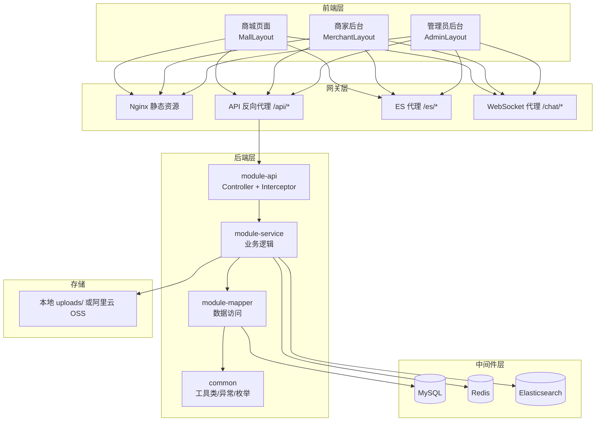
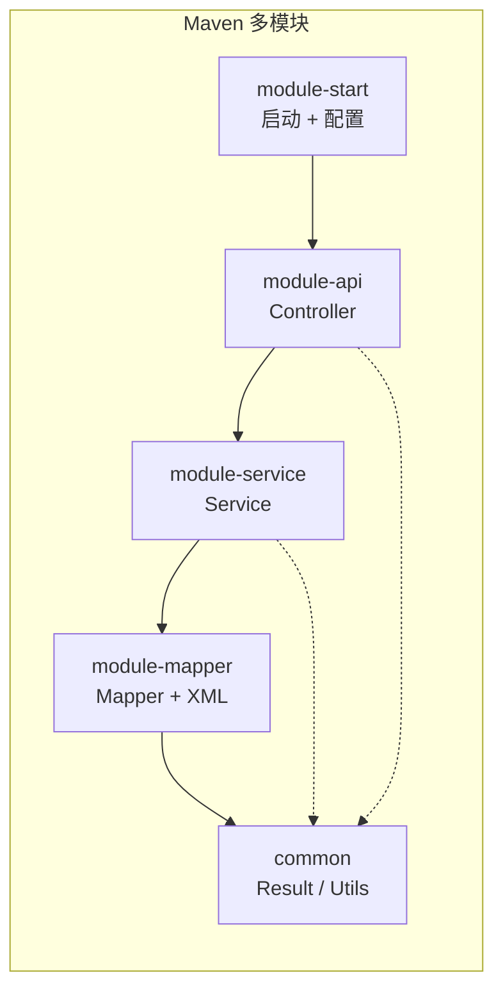
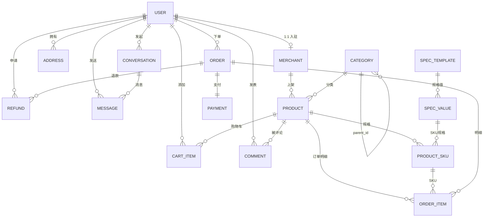
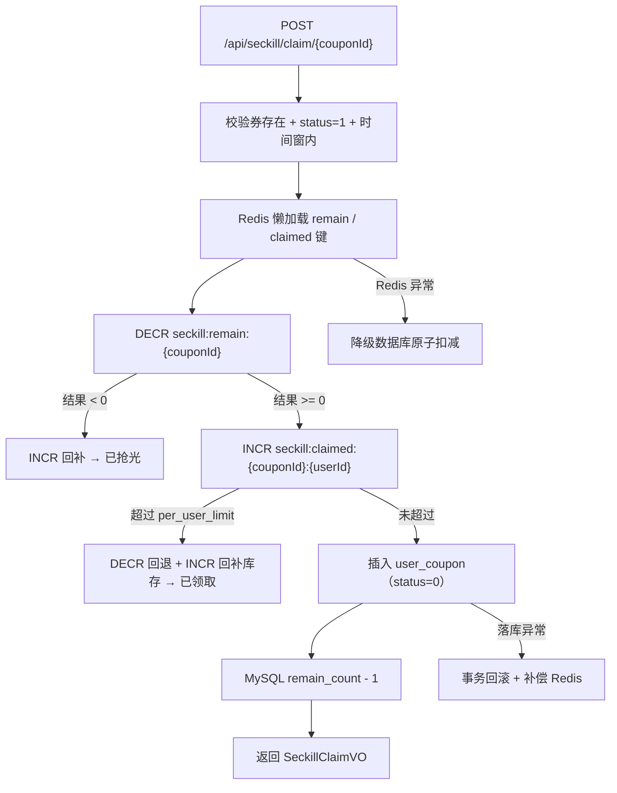

# 网上超市系统 - 服务端概要设计

> [English](../en/server-design.md) | 简体中文


---

## 一、技术选型

| 类别 | 技术 | 版本/说明 |
|------|------|------|
| 基础框架 | Spring Boot | 3.4.5 |
| JDK | Java 21 | |
| ORM | MyBatis | 3.0.4 |
| 分页 | PageHelper | |
| 数据库 | MySQL | |
| 缓存 | Redis | Jedis / Lettuce |
| 搜索引擎 | Elasticsearch | |
| 认证 | JWT + Redis 双校验 | |
| 鉴权 | Service 层角色/数据归属校验 | |
| 参数校验 | Spring Validation + 自定义注解 | |
| 接口文档 | Knife4j (OpenAPI 3.0) | 4.5.0 |
| 图片存储 | 本地目录 / 阿里云 OSS | |
| 工具库 | Lombok | |
| 日志 | Logback（AOP 操作日志预留，未启用） | |
| 定时任务 | Spring @Scheduled | |

---

## 二、Maven 多模块结构

```
chrono-bbs-server/                # 父项目（聚合）
├── pom.xml                       # 父 POM，依赖管理
├── common/                       # 公共模块
│   └── 统一返回、异常、枚举、工具类、常量
├── module-api/                   # API 模块（Controller + VO + DTO）
│   └── 对外暴露的 REST 接口
├── module-service/               # 业务模块（Service 接口 + 实现）
│   └── 核心业务逻辑
├── module-mapper/                # 数据访问模块（Mapper + 实体 + XML）
│   └── MyBatis 映射层
└── module-start/                 # 启动模块
    └── 启动类 + 全局配置 + 静态资源
```

### 模块依赖关系

```
module-start
    └── module-api
            └── module-service
                    └── module-mapper
                            └── common
```

| 模块 | 职责 |
|------|------|
| **common** | 通用基类：`Result<T>`、`PageResult<T>`、`BusinessException`、错误码枚举、`JwtUtil`、`UserContext`、`@Public` 注解 |
| **module-mapper** | 实体类 Entity、MyBatis Mapper 接口、XML 映射文件 |
| **module-service** | Service 接口 + Impl 实现、DTO 入参定义、业务逻辑编排 |
| **module-api** | Controller、VO 出参定义、WebSocket 端点、全局异常处理 |
| **module-start** | Spring Boot 启动类、`application.yml`、全局配置（跨域/OSS/Knife4j）、定时任务调度 |

---

## 三、包结构设计

以 `module-api` 为例：

```
com.ncist.controller/
    ├── AuthController.java          # 用户认证接口
    ├── ProductController.java       # 商品接口
    ├── CategoryController.java      # 分类接口
    ├── SearchController.java        # 搜索接口
    ├── CartController.java          # 购物车接口
    ├── OrderController.java         # 订单接口
    ├── PaymentController.java       # 支付接口
    ├── AddressController.java       # 地址接口
    ├── CommentController.java       # 评论接口
    ├── RefundController.java        # 退款接口
    ├── MerchantController.java      # 商家接口
    ├── AdminController.java         # 管理员接口
    ├── SeckillController.java       # 秒杀券接口
    ├── UploadController.java        # 文件上传接口
    ├── ChatController.java          # 即时通讯接口
    └── NotificationController.java  # 站内通知接口
com.ncist.websocket/                 # WebSocket 端点（@ServerEndpoint）
com.ncist.vo/                        # 出参 VO
com.ncist.interceptor/               # 拦截器（JWT 鉴权）
```

以 `module-service` 为例：

```
com.ncist.service/
    ├── AuthService.java             # 接口
    ├── impl/AuthServiceImpl.java    # 实现
    ├── ProductService.java
    ├── impl/ProductServiceImpl.java
    ├── NotificationService.java     # 站内通知接口
    ├── impl/NotificationServiceImpl.java
    └── ...（同上按模块划分）
com.ncist.dto/                       # 入参 DTO
com.ncist.scheduler/                 # 定时任务（秒杀券状态刷新）
```

以 `module-mapper` 为例：

```
com.ncist.entity/                    # 实体类（含 Notification）
com.ncist.mapper/                    # Mapper 接口（含 NotificationMapper）
resources/mapper/                    # MyBatis XML
```

---

## 四、统一响应与异常体系

### 4.1 统一返回格式 `Result<T>`

```java
// common 模块
public class Result<T> {
    private int code;         // 状态码
    private String message;   // 提示信息
    private T data;           // 数据
    private long timestamp;   // 时间戳

    public static <T> Result<T> success(T data) { ... }
    public static <T> Result<T> fail(ErrorCode code) { ... }
    public static <T> Result<T> fail(int code, String msg) { ... }
}
```

### 4.2 分页返回 `PageResult<T>`

```java
// common 模块
public class PageResult<T> {
    private long total;       // 总记录数
    private int page;         // 当前页
    private int size;         // 每页大小
    private List<T> list;     // 数据列表
}
```

### 4.3 错误码枚举 `ErrorCode`

```java
// common 模块，集中管理
public enum ErrorCode {
    // 通用 1xxx
    SUCCESS(200, "操作成功"),
    PARAM_ERROR(400, "参数错误"),
    UNAUTHORIZED(401, "未登录"),
    FORBIDDEN(403, "无权限"),
    NOT_FOUND(404, "资源不存在"),
    SYSTEM_ERROR(500, "系统异常"),

    // 用户 2xxx
    USER_NOT_EXIST(2001, "用户不存在"),
    PASSWORD_ERROR(2002, "密码错误"),
    USERNAME_EXIST(2003, "用户名已存在"),

    // 商品 3xxx
    PRODUCT_NOT_FOUND(3001, "商品不存在"),
    STOCK_INSUFFICIENT(3002, "库存不足"),
    PRODUCT_OFF_SHELF(3003, "商品已下架"),

    // 订单 4xxx
    ORDER_NOT_FOUND(4001, "订单不存在"),
    ORDER_STATUS_ERROR(4002, "订单状态异常"),
    ORDER_CANNOT_CANCEL(4003, "订单不可取消"),

    // 支付 5xxx
    PAY_FAILED(5001, "支付失败"),
    CARD_INVALID(5002, "卡号无效"),

    // 商家 6xxx
    MERCHANT_NOT_APPROVED(6001, "商家未审核通过"),
    MERCHANT_EXIST(6002, "已提交过入驻申请"),
}
```

### 4.4 自定义业务异常

```java
// common 模块
public class BusinessException extends RuntimeException {
    private int code;
    public BusinessException(ErrorCode errorCode) {
        super(errorCode.getMessage());
        this.code = errorCode.getCode();
    }
}
```

### 4.5 全局异常拦截

```java
// module-api 或 module-start
@RestControllerAdvice
public class GlobalExceptionHandler {

    @ExceptionHandler(BusinessException.class)
    public Result<Void> handleBusiness(BusinessException e) {
        return Result.fail(e.getCode(), e.getMessage());
    }

    @ExceptionHandler(MethodArgumentNotValidException.class)
    public Result<Void> handleValid(MethodArgumentNotValidException e) {
        // 提取 @Valid 校验失败信息
    }

    @ExceptionHandler(Exception.class)
    public Result<Void> handleUnknown(Exception e) {
        log.error("未知异常", e);
        return Result.fail(ErrorCode.SYSTEM_ERROR);
    }
}
```

---

## 五、认证鉴权体系

### 5.1 JWT + Redis 双校验流程

```
登录请求 → 校验用户名密码 → 生成 JWT Token → 存入 Redis(token:{userId} = token)
         → 返回 Token 给前端

后续请求 → 拦截器提取 Header Authorization → 解析 JWT 获取 userId
         → 校验 Redis 中 Token 是否存在且一致 → 放行/拒绝
```

- **JWT**：承载用户身份信息（userId、role），有效期 2 小时
- **Redis**：存当前有效 Token 字符串（`token:{userId}`），支持主动踢人（删除对应 Key 即可立即失效）
- **登出**：删除 Redis 中 Token

### 5.2 RBAC 权限控制（Service 层校验）

当前实现未使用 AOP 注解，而是采用“拦截器认证 + Service 层鉴权”两段式：

1. `JwtInterceptor` 校验 JWT 与 Redis 中的登录态，将 `userId / username / role` 写入 `UserContext`；
2. 各 Service 的 public 方法在执行业务前校验角色与数据归属，越权时抛出 `BusinessException`。

典型校验方法：

```java
// 管理员角色校验（AdminServiceImpl）
private void requireAdmin() {
    if (!UserRoleEnum.ADMIN.getCode().equals(UserContext.getRole())) {
        throw new BusinessException(AdminErrorCode.NOT_ADMIN);
    }
}

// 商家资质与商品归属校验（ProductServiceImpl）
Merchant merchant = requireApprovedMerchant(userId);
requireOwnership(productId, merchant.getId());
```

同类校验还包括：商家发货前校验订单商品全部归属自己（`MerchantServiceImpl.ship`）、退款审核前校验商家资质与商品归属（`RefundServiceImpl.requireReviewPermission`）、用户只能操作本人地址/订单/退款等。Controller 仅负责参数绑定与返回 `Result<T>`。

### 5.3 验证码

验证码分为两种类型，均存入 Redis：

| 类型 | 用途 | Redis Key | 有效期 | 说明 |
|------|------|-----------|--------|------|
| 图形验证码 | 登录/注册/获取重置密码验证码 | `captcha:{uuid}` | 2min | 生成 UUID + 验证码图片 |
| 短信/邮箱验证码 | 忘记密码时重置密码 | `reset:code:{uuid}` | 5min | 课程阶段直接返回在响应中 |

- 登录/注册时需输入图形验证码，防止暴力破解
- 忘记密码时：先校验图形验证码 → 发送短信/邮箱验证码 → 用该验证码重置密码
- 验证码使用后立即从 Redis 删除，保证一次性有效

---

## 六、参数校验

### 6.1 Spring Validation 注解

```java
// DTO 示例
public class RegisterDTO {
    @NotBlank(message = "用户名不能为空")
    @Size(min = 3, max = 20, message = "用户名长度3-20")
    private String username;

    @NotBlank(message = "密码不能为空")
    @Size(min = 6, max = 20, message = "密码长度6-20")
    private String password;

    @NotBlank(message = "手机号不能为空")
    @Pattern(regexp = "^1[3-9]\\d{9}$", message = "手机号格式不正确")
    private String phone;

    @EnumValue(enumClass = UserRoleEnum.class, message = "角色值不合法")
    private Integer role;
}
```

### 6.2 自定义校验注解 `@EnumValue`

```java
@Target(ElementType.FIELD)
@Retention(RetentionPolicy.RUNTIME)
@Constraint(validatedBy = EnumValueValidator.class)
public @interface EnumValue {
    Class<? extends Enum<?>> enumClass();
    String message() default "枚举值不合法";
}
```

---

## 七、并发控制与幂等设计

### 7.1 乐观锁

```sql
-- product_sku 表已有字段，无需额外添加
UPDATE product_sku SET stock = stock - ? WHERE id = ? AND stock >= ?
-- 条件不满足时返回 0 行，业务层判断后提示"库存不足"
```

### 7.2 防重复提交 Token

```
下单前：前端调 GET /api/order/submit-token → 后端生成 UUID 存 Redis
        键 order:submit-token:{token}，值为 userId，5 分钟过期
下单时：前端携带该 Token → 后端校验 userId 归属并立即删除 → 原子性保证一次有效
        若 Token 不存在或不属于当前用户 → 重复提交 → 拒绝
```

### 7.3 支付幂等

```java
// 先校验订单归属与 status=待支付，再写入支付记录
// 最后以状态条件更新订单：并发/重复支付时更新 0 行，抛异常回滚
int rows = orderMapper.markPaid(orderId, userId);
if (rows == 0) {
    throw new BusinessException(PaymentErrorCode.ORDER_NOT_PAYABLE);
}
```

---

## 八、事务管理

### 8.1 声明式事务

```java
@Service
public class OrderServiceImpl implements OrderService {

    @Override
    @Transactional(rollbackFor = Exception.class)
    public CreateOrderVO createOrder(Long userId, CreateOrderDTO dto) {
        // 1. 校验并消费防重复提交 Token（DELETE 原子保证只可用一次）
        // 2. 校验收货地址属主
        // 3. 查询购物车选中项（SQL 限定属主），校验上架与库存
        // 4. 原子扣减库存（UPDATE ... WHERE stock >= 数量）
        // 5. 计算金额，用券抵扣
        // 6. 写入地址快照 → 插入 order 表
        // 7. 插入 order_item 表（下单时价格快照）
        // 8. 清理已下单的购物车项
        // 9. 核销优惠券（状态条件保证并发下不重复核销）
        // 任何步骤异常 → 全部回滚
    }
}
```

### 8.2 事务边界

| 操作 | 是否在同一事务 | 说明 |
|------|------|------|
| 消费防重 Token | ❌ Redis 操作 | 在事务方法内执行 DELETE，但不随 MySQL 事务回滚，删除即消费 |
| 插 order + 插 order_item + 清购物车 + 扣 MySQL 库存 + 核销券 | ✅ 同一事务 | MySQL 写操作，ACID 保证 |
| 发送 ES 同步消息 | ❌ 事务内同步调用 | 内部吞异常，失败仅记日志 |

---

## 九、ES 数据同步策略

### 9.1 同步方式（实现现状）

采用 **同步调用 + 异常隔离**：商品 Service 处理完 MySQL 后直接调用 `ProductSearchIndexService` 同步 ES，
同步逻辑内部捕获全部异常，仅记录 WARN 日志，**不影响也不回滚商品主业务**（未引入 MQ/@Async）。

```
商品上架/更新 → Service 层处理完 MySQL → 同步写入/覆盖 ES 文档
商品下架/删除 → Service 层处理完 MySQL → 同步删除 ES 文档（文档本不存在时忽略 404）
应用启动      → 索引不存在则创建 mapping；索引为空时全量同步上架商品
```

### 9.2 同步内容

索引名 `chrono_product`，字段：`id`、`name`、`description`、`brand`、`categoryId`、`categoryName`、`minPrice`、`sales`、`image`、`status`、`createdAt`。

| 操作 | ES 动作 |
|------|------|
| 商品新建（默认下架） | 不写入索引，上架时写入 |
| 商品上架 | INSERT/覆盖 `chrono_product` |
| 商品更新（名称/描述/品牌/价格/SKU） | UPDATE `chrono_product`（重新计算最低价） |
| 商品下架/删除 | DELETE 从 `chrono_product` |
| 订单支付（销量变化） | 暂未实现定时同步，销量在商品更新或全量初始化时刷新 |

---

## 十、文件上传（本地目录 / 阿里云 OSS）

### 10.1 上传流程

```
前端选择图片 → 调用 POST /api/upload/image
             → 后端校验（格式：jpg/png/webp，大小：≤2MB）
             → 压缩（按比例缩放到 800px 宽）
             → 按 upload.mode 写入本地 uploads/ 或上传到 OSS（目录：product/日期/uuid.jpg）
             → 返回访问 URL（本地 /uploads/... 或 OSS URL）→ 前端存储到表单
```

### 10.2 校验规则

| 规则 | 值 |
|------|------|
| 允许格式 | jpg, jpeg, png, webp |
| 单张最大 | 2MB |
| 一次最多 | 4 张 |
| 压缩宽度 | 800px（等比缩放） |

---

## 十一、定时任务

> 实现状态：当前仅实现 `refreshSeckillStatus`（`SeckillStatusScheduler`，每 30 秒刷新秒杀券状态并过期用户券）；下表其余任务为后续规划。

| 任务 | 执行频率 | 说明 |
|------|------|------|
| `cancelTimeoutOrders` | 每 5 分钟 | 扫描 `status=待支付 AND created_at < 30分钟前` 的订单，改为已取消，恢复库存 |
| `syncSalesFromRedis` | 每 10 分钟 | 读取 Redis `product:{id}:sales`，批量 UPDATE MySQL `product.sales` |
| `cleanSearchHistory` | 每天凌晨 3:00 | 删除 `searched_at < 30天前` 的历史记录 |
| `syncStockFromRedis` | 每 5 分钟 | 读取 Redis 库存，批量同步 MySQL `product_sku.stock`（兜底保障） |
| `cleanChatMessages` | 每天凌晨 4:00 | 删除 `message.created_at < 30天前` 的历史消息 |
| `refreshSeckillStatus` | 每 30 秒 | 刷新秒杀券状态（未开始→进行中→已结束），并批量过期未使用的用户券 |

```java
@Component
@RequiredArgsConstructor
public class SeckillStatusScheduler {

    private final SeckillCouponMapper seckillCouponMapper;
    private final UserCouponMapper userCouponMapper;

    @Scheduled(fixedDelay = 30_000)
    public void refreshSeckillStatus() {
        int activated = seckillCouponMapper.activateStarted(); // 到点未开始 → 进行中
        int finished = seckillCouponMapper.finishEnded();      // 到点进行中 → 已结束
        int expired = userCouponMapper.expireEnded();          // 活动结束后未使用用户券 → 已过期
    }
}
```

---

## 十二、日志体系

### 12.1 Logback 文件日志

- 控制台输出：开发环境 `DEBUG`，生产 `INFO`
- 文件按天滚动：`logs/application.%d{yyyy-MM-dd}.log`
- 保留 30 天

### 12.2 AOP 操作日志（预留，未启用）

> 当前版本仅保留 `operation_log` 表与 Mapper 接口，尚未实现 `@OperationLog` 注解与 AOP 切面；以下为设计草案。

```java
@Target(ElementType.METHOD)
@Retention(RetentionPolicy.RUNTIME)
public @interface OperationLog {
    String value();       // 操作描述，如"审核商家入驻"
    String module();      // 模块，如"管理员"
}
```

```java
@Aspect
@Component
public class OperationLogAspect {
    @Around("@annotation(opLog)")
    public Object around(ProceedingJoinPoint pjp, OperationLog opLog) {
        // 记录：用户ID、用户名、IP、操作模块、操作描述、请求参数、耗时、结果
        // 存入 operation_log 表
    }
}
```

### 12.3 操作日志表（新增）

| 字段 | 类型 | 说明 |
|------|------|------|
| id | BIGINT PK | 主键 |
| user_id | BIGINT | 操作人 ID |
| username | VARCHAR(50) | 操作人用户名 |
| ip | VARCHAR(50) | 操作 IP |
| module | VARCHAR(50) | 模块 |
| action | VARCHAR(200) | 操作描述 |
| params | TEXT | 请求参数（JSON） |
| result | VARCHAR(50) | 结果（成功/失败） |
| cost_time | BIGINT | 耗时（ms） |
| created_at | DATETIME | 操作时间 |

> 此表追加到 [db-design.md](./db-design.md) 中。

---

## 十三、WebSocket 即时通讯

### 13.1 概述

用户和商家之间支持**一对一私聊**，用户从商品详情页点击"联系卖家"即可发起会话。

| 特性 | 说明 |
|------|------|
| 协议 | 原生 WebSocket（JSR 356，`@ServerEndpoint`，非 STOMP） |
| 持久化 | 消息存入 MySQL；30 天自动清理为规划任务，当前未启用 |
| 历史记录 | 分页查询，上拉加载更多 |
| 离线消息 | 支持，接收方上线后自动推送未读消息 |
| 未读计数 | 会话级别维护未读数，存储在 MySQL `conversation.user_unread` / `merchant_unread` |
| 在线状态 | Redis `online:{userId}`，连接建立/断开时写入/删除 |

### 13.2 数据库表

详见 [db-design.md](./db-design.md) 第九章：

- **`conversation`**：会话表，`(user_id, merchant_id)` 唯一约束；`merchant_id` 存商家用户 ID（`user.id`），不是 merchant 表主键
- **`message`**：消息表，`conversation_id` 关联会话；`sender_id` 为发送者用户 ID

### 13.3 WebSocket 端点

```java
@Component
@ServerEndpoint("/chat/{userId}")
public class ChatWebSocketEndpoint {

    // 本地在线连接（userId -> Session），用于实时推送
    private static final Map<Long, Session> SESSIONS = new ConcurrentHashMap<>();

    @OnOpen
    public void onOpen(Session session, @PathParam("userId") String userIdText) {
        // 1. 解析路径 userId 与 queryString 中的 token
        // 2. JwtUtil 校验 token，且 token.userId == 路径 userId
        // 3. 与 Redis token:{userId} 一致（防冒连）
        // 4. 顶下线：同 userId 旧连接关闭
        // 5. Redis 标记在线 online:{userId}
        // 6. 推送离线期间未读消息
    }

    @OnMessage
    public void onMessage(String text) {
        // 1. JSON 反序列化 SendMessageDTO
        // 2. chatService.sendMessage(userId, dto) 入库
        // 3. 回显给发送方
        // 4. 接收方在线则实时推送（SESSIONS.get(receiverId)）
    }

    @OnClose
    public void onClose() {
        // 移除本地会话，Redis online:{userId} 删除
    }
}
```

### 13.4 消息推送路径设计

| 通道 | 方向 | 说明 |
|------|------|------|
| `ws://host/chat/{userId}?token=` | 客户端 → 服务端 | 建立连接（握手鉴权） |
| `@OnMessage` 接收 JSON | 客户端 → 服务端 | 发送消息 |
| `session.sendText` | 服务端 → 客户端 | 实时推送（接收方在线时） |

> 消息帧 JSON：`{ type, conversationId, messageId, senderId, senderRole, content, productId, isRead, timestamp }`；错误帧：`{ type: "ERROR", message }`。

### 13.5 发送消息流程

```
┌─────────┐     ┌─────────────┐     ┌──────────┐     ┌─────────┐
│ 发送方   │     │ WebSocket   │     │  MySQL   │     │ 接收方   │
│ (用户)   │     │   端点      │     │          │     │ (商家)  │
└────┬────┘     └──────┬──────┘     └────┬─────┘     └────┬────┘
     │ 发送 JSON 消息   │                │                 │
     │────────────────▶│                │                 │
     │                 │ INSERT message │                 │
     │                 │───────────────▶│                 │
     │                 │ UPDATE unread  │                 │
     │                 │───────────────▶│                 │
     │                 │  回显 + 实时推送（接收方在线时）   │
     │◀────────────────│─────────────────────────────────▶│
     │                 │                │                 │
     接收方离线？                                               │
     ─────────────────────────────────────────────────────  │
     下次上线 → @OnOpen 拉取 is_read=0 消息 → 逐条推送          │
```

### 13.6 核心 REST 接口（ChatController）

```java
@RestController
@RequestMapping("/api/chat")
public class ChatController {

    @GetMapping("/conversations")              // 会话列表（按 last_message_time 倒序）
    @GetMapping("/history/{conversationId}")   // 历史消息分页（从新到旧）
    @PostMapping("/conversation")              // 创建会话（基于商品/商家）
    @PutMapping("/read/{conversationId}")      // 标记已读（重置未读数）
    @GetMapping("/unread-count")               // 未读消息总数
}
```

### 13.7 在线状态管理（Redis）

| 缓存 Key | 内容 | 说明 |
|------|------|------|
| `online:{userId}` | "1" | 用户 WebSocket 连接时 SET，断开时 DELETE，用于判断是否在线 |
| `token:{userId}` | JWT | 握手鉴权：连接携带 token 必须与服务端记录一致 |

```java
@Service
public class RedisOnlineService {
    public void setOnline(Long userId) {
        stringRedisTemplate.opsForValue().set("online:" + userId, "1");
    }
    public void setOffline(Long userId) {
        stringRedisTemplate.delete("online:" + userId);
    }
    public boolean isTokenValid(Long userId, String token) {
        return token.equals(stringRedisTemplate.opsForValue().get("token:" + userId));
    }
}
```

### 13.8 安全性

| 措施 | 说明 |
|------|------|
| 连接鉴权 | 握手时从 `?token=xxx` 校验 JWT，且 token.userId 与路径一致、与 Redis `token:{userId}` 一致 |
| 顶下线 | 同 userId 新连接建立时关闭旧连接（"账号在其他位置连接"） |
| 越权防护 | 发送消息时校验发送者是 conversation 的参与者之一 |

---

## 十四、接口文档（Knife4j）

现有依赖 `knife4j-openapi3-jakarta-spring-boot-starter` 4.5.0 已支持，启动后访问：

```
http://localhost:8080/doc.html
```

Controller 添加 Swagger 注解即可：

```java
@Tag(name = "商品管理", description = "商品增删改查接口")
@RestController
@RequestMapping("/api/product")
public class ProductController {

    @Operation(summary = "分页查询商品列表")
    @GetMapping("/list")
    public Result<PageResult<ProductVO>> listProducts(
            @RequestParam(required = false) Long categoryId,
            @RequestParam(defaultValue = "1") Integer page,
            @RequestParam(defaultValue = "10") Integer size) { ... }
}
```

---

## 十五、UML 建模

### 15.1 部署图



### 15.2 组件图



### 15.3 ER 图



---

## 十六、秒杀券模块

### 16.1 设计目标

- **不超卖**：券的 `remain_count` 在并发领取下不能为负。
- **不超领**：同一用户领取数量不能超过 `per_user_limit`。
- **高可用**：Redis 故障时仍可通过数据库原子扣减完成领券。
- **最终一致**：Redis 预扣减与 MySQL 落库之间通过补偿保证一致。

### 16.2 抢领流程



### 16.3 Redis 键与降级策略

| Key | 内容 | 过期时间 |
|------|------|----------|
| `seckill:remain:{couponId}` | 券剩余库存 | 活动结束 + 24h（不足 1h 按 1h） |
| `seckill:claimed:{couponId}:{userId}` | 用户已领数量 | 同上 |

- **Redis 正常**：`DECR` 库存 → `INCR` 用户领取计数 → 写 `user_coupon` → 扣减 MySQL `remain_count`。
- **Redis 不可用**：降级为 `UPDATE seckill_coupon SET remain_count = remain_count - 1 WHERE id = ? AND remain_count > 0`，再查 `user_coupon` 校验限领。
- **MySQL 异常**：事务回滚后补偿 Redis（库存加回、领取计数减回），补偿失败仅记录日志，由后续对账兜底。

### 16.4 下单抵扣

`POST /api/seckill/calculate` 接收 `totalAmount` 与可选的 `userCouponId`：

1. 未选券：原价即实付。
2. 校验用户券存在、归属当前用户、状态为未使用、活动未过期。
3. 校验订单金额满足 `min_amount`。
4. 满减券优惠 = `min(discount_value, totalAmount)`；折扣券优惠 = `totalAmount - totalAmount × discount_value / 100`。
5. 返回 `originalAmount` / `discountAmount` / `finalAmount` / `couponName`，创建订单时写入 `userCouponId` 并核销。

### 16.5 定时任务与后台管理

- `SeckillStatusScheduler` 每 30 秒刷新券状态：未开始→进行中、进行中→已结束，并批量将未使用的过期券置为已过期。
- 管理员接口：创建、编辑、删除券；编辑总量时按增量同步 `remain_count` 与 Redis 库存键。
- 用户接口：券列表/详情（游客可查看）、抢领、我的优惠券（登录用户）。

> 表结构见 [db-design.md](./db-design.md) 第十章，接口契约见 [api-doc.md](./api-doc.md) 第 16 章。
---

## 十七、站内通知与消息中心

### 17.1 设计目标

- 交易节点（下单、支付、发货、退款/退货）自动生成站内通知，用户无需依赖实时聊天即可查看进度。
- 买家与商家共用通知中心，按接收人 `user_id` 隔离；商家只收到与自己商品相关的通知。
- 通知与聊天消息分表存储，避免占用 `conversation` / `message` 会话资源。

### 17.2 通知事件

| 事件 | 接收人 | 标题 | 关联对象 |
|------|--------|------|----------|
| 下单成功 | 买家 | 订单提交成功 | 订单 |
| 支付成功 | 买家 | 订单支付成功 | 订单 |
| 支付成功 | 订单内各商品所属商家 | 新订单待发货 | 订单 |
| 商家发货 | 买家 | 订单已发货 | 订单 |
| 买家申请退款/退货 | 退款商品所属商家 | 新的退款申请 | 退款单 |
| 审核通过/拒绝 | 买家 | 退款申请已通过 / 退款申请被拒绝 | 退款单 |
| 买家填写退货物流 | 商家 | 买家已寄回商品 | 退款单 |
| 商家确认收到退货 | 买家 | 退款已完成 | 退款单 |

商家订单通知按 `order_item JOIN product JOIN merchant` 聚合，只统计该商家自己的商品小计，避免多商家订单金额串店。

### 17.3 服务与表

- 表：`notification`（`user_id`、`type`、`title`、`content`、`related_type`、`related_id`、`is_read`、`created_at`）。
- 服务：`NotificationService` / `NotificationServiceImpl`，业务服务在事务内调用 `notifyXxx`；通知写入失败只记日志，不影响下单/支付/退款主流程。
- 数据访问：`NotificationMapper`，查询与已读均带 `user_id` 条件，防止越权。

### 17.4 接口

| 方法 | 路径 | 说明 |
|------|------|------|
| GET | `/api/notification/list` | 分页查询本人通知，支持 `unreadOnly` |
| GET | `/api/notification/unread-count` | 未读数量 |
| PUT | `/api/notification/{id}/read` | 单条已读 |
| PUT | `/api/notification/read-all` | 全部已读 |

### 17.5 前端入口

- 商城顶部“🔔 通知”按钮显示未读角标，路由 `/notifications`。
- 商家中心侧边栏增加“消息通知”入口；按角色点击通知跳转到买家订单详情、商家订单/退款页或管理员订单/退款页。
