# 网上超市系统面向对象开发步骤与设计分析

> 本文以“网上超市系统”为背景，说明面向对象开发从需求到设计、实现、测试的完整步骤，并对关键设计进行分析。
>
> 说明：本文聚焦分析方法、职责划分与设计步骤，使用业务概念描述，不展开具体技术产品、框架或代码命名。

---

## 一、面向对象开发的基本认识

### 1.1 核心思想

面向对象开发不是先写代码再补设计，而是围绕“对象”逐步完成：

1. **识别对象**：从业务中找到有明确职责的事物，如用户、商品、订单、优惠券。
2. **封装行为**：把数据和对数据的操作放在同一个对象中，避免数据与行为分离。
3. **分配职责**：明确每个对象“负责什么、不负责什么”，通过对象之间的协作完成用例。
4. **抽象与多态**：对共同行为进行抽象，对变化部分进行隔离，使系统容易扩展。
5. **迭代细化**：需求、分析、设计、实现之间不是一次性瀑布，而是逐步细化、反复校验。

### 1.2 本项目的分析路径

本项目采用“需求驱动、用例为中心、领域模型为骨架、职责分配为核心”的分析路径：

这条路径的重点是：**先弄清楚系统要做什么，再决定由哪些对象来做，最后才决定怎么实现**。

---

## 二、面向对象开发总体步骤

### 2.1 八个阶段

| 阶段 | 核心问题 | 主要活动 | 交付物 | 质量检查 |
|------|----------|----------|--------|----------|
| 1. 需求获取 | 系统为谁解决什么问题 | 访谈、观察、整理业务流程、明确范围 | 需求清单、业务规则、约束 | 角色是否齐全、边界是否清晰 |
| 2. 用例建模 | 用户如何使用系统 | 识别角色、用例、主流程与异常流程 | 用例图、用例规约 | 每个角色是否有完整用例 |
| 3. 领域分析 | 业务中有哪些对象 | 名词分析、识别对象与关系、建立领域模型 | 领域对象清单、关系图 | 对象职责是否单一、关系是否必要 |
| 4. 对象分析 | 每个对象负责什么 | 职责分配、对象协作、时序分析 | 职责表、协作图、时序图 | 是否存在“上帝对象”、职责是否均衡 |
| 5. 架构设计 | 系统如何分层与分块 | 分层、模块划分、依赖方向、接口边界 | 架构图、模块清单 | 依赖是否单向、模块是否高内聚 |
| 6. 详细设计 | 每个部分如何实现 | 对象细节、接口契约、数据模型、状态与异常 | 类图、接口说明、数据设计、状态图 | 设计是否可落地、异常是否覆盖 |
| 7. 实现 | 如何把设计变成可运行系统 | 按依赖顺序编码、单元测试、联调 | 可运行系统、测试记录 | 是否符合设计、测试是否通过 |
| 8. 测试与维护 | 系统是否满足需求 | 集成测试、端到端测试、验收、缺陷修复 | 测试报告、问题清单、变更记录 | 需求覆盖、边界覆盖、回归通过 |

### 2.2 阶段之间的关系

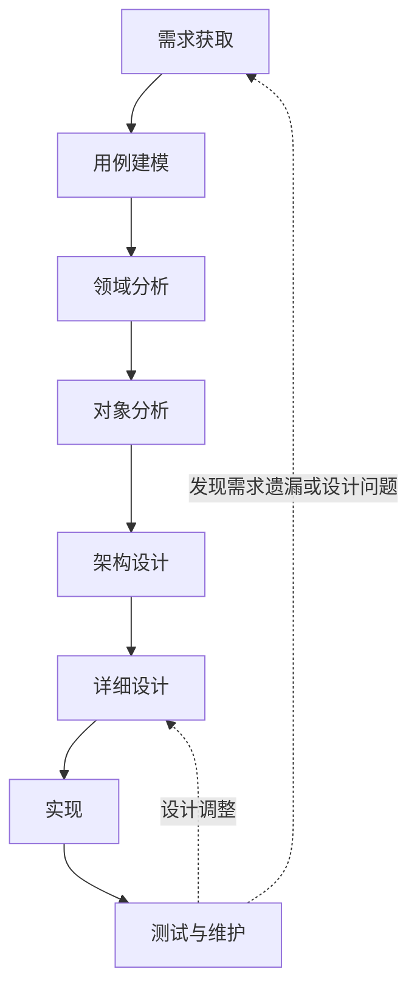

**关键原则：**

- 每个阶段都要有明确的输入和输出，不能“凭感觉”进入下一阶段。
- 下一阶段发现的问题要回溯到上一阶段修正，而不是在代码中临时打补丁。
- 文档不是目的，文档的作用是让需求、设计、实现之间保持可追溯。

---

## 三、需求获取与分析

### 3.1 业务目标与范围

本系统面向网上超市业务，核心目标是：

- 让顾客能够按分类或关键词找到商品，查看商品详情并完成购买。
- 让商家能够管理自己的商品、订单、退款与评论。
- 让管理员能够管理用户、审核商家、管理分类与全平台商品订单，并查看销售报表。
- 通过购物车、订单、支付、退款、优惠券等对象协作，形成完整的交易闭环。

**范围边界：**

- 包含：商品浏览、购物车、下单、模拟支付、退款、评论、商家入驻、后台管理、优惠券。
- 不包含：真实银行支付清算、真实物流轨迹、真实短信邮件通道。
- 设计预留但当前未完整实现：搜索服务、实时聊天。

### 3.2 角色识别

| 角色 | 目标 | 主要用例 |
|------|------|----------|
| 游客 | 浏览商品，决定是否注册 | 浏览商品、查看详情、按分类筛选、查看评论、浏览领券中心 |
| 注册用户 | 完成购买、售后与互动 | 登录、购物车、下单、支付、确认收货、退款、评论、领券 |
| 商家 | 经营店铺、处理订单与售后 | 入驻申请、商品管理、库存管理、订单发货、退款审核、评论回复、销售统计 |
| 管理员 | 维护平台秩序与数据 | 用户管理、商家审核、分类管理、全平台商品/订单管理、退款审核、优惠券管理、销售报表 |

### 3.3 用例图

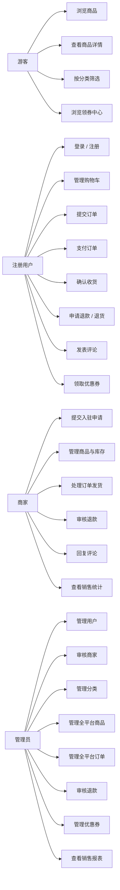

### 3.4 核心用例规约

#### 用例 1：用户注册与登录

| 项目 | 内容 |
|------|------|
| 参与者 | 游客、注册用户 |
| 前置条件 | 用户能够访问系统 |
| 主流程 | 输入账号信息 → 校验验证码 → 校验账号唯一性 → 创建用户 → 返回登录状态 |
| 异常流程 | 账号已存在、验证码错误、密码不符合规则、账号被禁用 |
| 后置条件 | 用户获得登录状态，可访问需要身份的用例 |

#### 用例 2：浏览与查找商品

| 项目 | 内容 |
|------|------|
| 参与者 | 游客、注册用户、商家、管理员 |
| 前置条件 | 商品已上架 |
| 主流程 | 进入首页 → 按分类逐级筛选或输入关键词 → 查看商品列表 → 打开商品详情 |
| 异常流程 | 分类不存在、商品已下架、商品不存在 |
| 后置条件 | 用户获得商品信息，可加入购物车或发起咨询 |

#### 用例 3：管理购物车

| 项目 | 内容 |
|------|------|
| 参与者 | 注册用户 |
| 前置条件 | 用户已登录，商品已上架 |
| 主流程 | 选择商品规格与数量 → 加入购物车 → 修改数量或勾选状态 → 删除不需要的商品 |
| 异常流程 | 库存不足、商品已下架、数量非法、未登录 |
| 后置条件 | 购物车数据与用户选择状态保持一致 |

#### 用例 4：提交订单

| 项目 | 内容 |
|------|------|
| 参与者 | 注册用户 |
| 前置条件 | 购物车中有选中商品，收货地址有效，库存充足 |
| 主流程 | 确认收货地址 → 确认商品与金额 → 获取防重复提交凭证 → 创建订单 → 扣减库存 → 清理已下单购物车项 |
| 异常流程 | 库存不足、地址无效、重复提交、商品状态变化、金额校验失败 |
| 后置条件 | 生成待支付订单，订单明细保存下单时的价格与地址快照 |

#### 用例 5：支付订单

| 项目 | 内容 |
|------|------|
| 参与者 | 注册用户 |
| 前置条件 | 订单处于待支付状态 |
| 主流程 | 选择支付方式 → 校验支付信息 → 记录支付结果 → 将订单置为已支付 |
| 异常流程 | 订单状态不允许支付、支付信息格式错误、重复支付 |
| 后置条件 | 支付记录与订单状态一致，重复支付不会产生重复扣款 |

#### 用例 6：申请与审核退款

| 项目 | 内容 |
|------|------|
| 参与者 | 注册用户、商家、管理员 |
| 前置条件 | 订单已支付或已完成，且符合退款条件 |
| 主流程 | 用户选择订单明细并填写原因 → 生成退款申请 → 商家或管理员审核 → 通过后执行退款 |
| 异常流程 | 退款金额超过明细小计、重复申请、状态不允许、审核意见缺失 |
| 后置条件 | 退款单状态与订单状态同步，退款金额可追溯 |

#### 用例 7：商家入驻与审核

| 项目 | 内容 |
|------|------|
| 参与者 | 注册用户、管理员 |
| 前置条件 | 用户已注册 |
| 主流程 | 用户提交店铺信息 → 系统保存为待审核 → 管理员审核 → 通过后用户获得商家身份 |
| 异常流程 | 重复申请、资料不完整、审核意见缺失 |
| 后置条件 | 商家状态与用户角色保持一致 |

#### 用例 8：领取优惠券与下单抵扣

| 项目 | 内容 |
|------|------|
| 参与者 | 游客、注册用户、管理员 |
| 前置条件 | 优惠券在活动时间内，剩余数量大于零 |
| 主流程 | 浏览券列表 → 查看券详情 → 登录后领取 → 下单时选择券 → 计算优惠 → 创建订单并核销 |
| 异常流程 | 已抢光、超过每人限领、活动未开始或已结束、订单金额未达到门槛、券已使用或已过期 |
| 后置条件 | 用户券状态与订单优惠金额一致，库存与领取数量不出现负数 |

### 3.5 需求分类

| 类别 | 内容 |
|------|------|
| 功能需求 | 注册登录、商品与分类、购物车、订单、支付、退款、评论、商家、管理员、优惠券、搜索、聊天 |
| 非功能需求 | 响应时间、并发能力、安全性、可用性、可维护性、数据一致性 |
| 业务约束 | 三级分类、金额以最小货币单位保存、地址下单快照、订单状态机、库存不得为负、优惠券限领 |
| 范围约束 | 课程设计项目，支付与消息通道采用模拟或简化实现 |

### 3.6 从需求中提取候选对象

采用“名词分析法”：从用例描述中找出名词，判断它是对象、属性还是无关概念。

| 名词 | 是否对象 | 判断理由 |
|------|----------|----------|
| 用户 | 是 | 有身份、角色、状态，有注册登录等行为 |
| 商家 | 是 | 有店铺信息、审核状态，有商品与订单管理职责 |
| 商品 | 是 | 有名称、描述、图片、状态，有上下架行为 |
| 商品规格项 | 是 | 有价格与库存，是交易的最小单位 |
| 分类 | 是 | 有层级与父子关系，支撑商品组织 |
| 购物车项 | 是 | 有用户、商品规格、数量、选中状态 |
| 订单 | 是 | 有状态、金额、地址快照，有取消与确认收货行为 |
| 订单明细 | 是 | 保存下单时的商品、价格、数量快照 |
| 支付记录 | 是 | 记录支付方式、金额、结果 |
| 退款单 | 是 | 记录退款原因、金额、审核状态 |
| 收货地址 | 是 | 有收货人、电话、地区与详细地址 |
| 评论 | 是 | 有内容、评分、追评与回复 |
| 优惠券 | 是 | 有面额、门槛、总量、剩余量、活动时间 |
| 用户券 | 是 | 记录某用户领取的券及其使用状态 |
| 会话与消息 | 是 | 有参与者、消息内容、已读状态 |
| 金额、数量、状态 | 否 | 是对象的值属性，不宜单独建模为业务对象 |
| 页面、按钮 | 否 | 是界面元素，不是领域对象 |

---

## 四、领域分析：建立领域模型

### 4.1 领域对象清单

| 领域对象 | 业务含义 | 关键属性 | 主要职责 |
|----------|----------|----------|----------|
| 用户 | 系统使用者 | 账号、密码、昵称、角色、状态 | 维护身份信息、角色与可用状态 |
| 商家 | 入驻店铺 | 店铺名、联系方式、审核状态、审核意见 | 维护店铺资料，承接商品与订单管理 |
| 分类 | 商品分类 | 名称、父级、层级、排序、图标 | 组织商品，提供分类树 |
| 规格模板 | 规格类型 | 名称 | 定义颜色、尺码等规格维度 |
| 规格值 | 规格取值 | 所属模板、取值、排序 | 提供具体规格选项 |
| 商品 | 可销售商品 | 名称、描述、图片、品牌、分类、商家、状态、销量 | 维护商品信息与上下架状态 |
| 商品规格项 | 可交易单元 | 所属商品、规格组合、价格、库存 | 承载价格与库存，参与购物车和订单 |
| 购物车项 | 用户的待购项 | 用户、商品规格项、数量、选中状态 | 记录购买意向，支持修改与删除 |
| 订单 | 一次交易 | 订单号、用户、地址快照、金额、状态、时间节点 | 管理交易状态与金额 |
| 订单明细 | 订单中的商品行 | 订单、商品、规格项、数量、单价、小计 | 保存下单时的价格与数量快照 |
| 支付记录 | 支付结果 | 订单、支付方式、金额、状态、时间 | 记录支付事实，支持幂等判断 |
| 退款单 | 售后申请 | 订单明细、申请人、类型、金额、原因、审核状态 | 管理退款流程与审核结果 |
| 收货地址 | 收货信息 | 收货人、电话、地区、详细地址、默认标记 | 提供下单地址，支持下单快照 |
| 评论 | 商品评价 | 商品、用户、订单明细、内容、评分、追评、回复 | 记录评价与商家回复 |
| 优惠券 | 可领取的券 | 名称、优惠类型、优惠值、门槛、总量、剩余量、时间窗、限领数 | 定义活动规则与库存 |
| 用户券 | 用户领取的券 | 用户、券、状态、使用订单、领取时间、使用时间 | 记录领取与核销状态 |
| 会话 | 用户与商家的对话 | 参与者、最后消息、未读数 | 组织消息，维护未读状态 |
| 消息 | 单条聊天内容 | 会话、发送者、内容、类型、已读状态 | 保存消息与已读事实 |
| 操作日志 | 后台操作记录 | 操作人、模块、动作、参数、结果、耗时 | 支持审计与问题追踪 |

### 4.2 领域对象关系

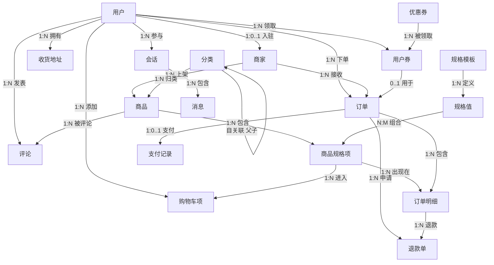

### 4.3 聚合与一致性边界

| 聚合根 | 聚合内对象 | 一致性要求 |
|--------|------------|------------|
| 用户 | 用户、角色、状态 | 账号唯一，角色与状态合法 |
| 商家 | 商家、审核信息 | 一个用户最多一个商家身份 |
| 商品 | 商品、规格项、规格组合 | 商品与规格项同时有效，价格与库存不出现负数 |
| 购物车 | 购物车项 | 同一用户同一规格项不重复，数量合法 |
| 订单 | 订单、订单明细、支付记录、退款单 | 订单状态迁移合法，金额与明细一致 |
| 优惠券 | 优惠券、用户券 | 总量与剩余量一致，用户领取数量不超过限领 |
| 评论 | 评论、追评、回复 | 评论必须来自真实订单明细 |
| 会话 | 会话、消息 | 同一对用户与商家只有一个会话，未读数与消息一致 |

**聚合设计的意义：**

- 一个聚合内的对象由聚合根统一维护，避免外部随意修改内部状态。
- 跨聚合的操作通过明确的业务动作完成，例如“下单”会同时影响订单、库存、购物车。
- 聚合边界也是事务边界设计的重要依据。

### 4.4 业务规则与不变量

| 规则 | 约束说明 | 违反时的处理 |
|------|----------|--------------|
| 分类层级 | 最多三级，父级必须存在且层级连续 | 拒绝创建或修改 |
| 商品状态 | 下架商品不能加入购物车或下单 | 提示商品不可购买 |
| 库存 | 库存不得为负 | 条件扣减，失败则提示库存不足 |
| 购物车 | 同一用户同一规格项合并数量 | 已存在时累加或更新 |
| 订单状态 | 只能按合法状态迁移 | 非法迁移直接拒绝 |
| 订单金额 | 实付金额与明细、优惠、运费一致 | 金额校验失败不创建订单 |
| 地址快照 | 下单后地址变化不影响历史订单 | 下单时保存快照 |
| 支付幂等 | 同一订单重复支付只记录一次成功 | 已支付订单直接返回成功结果 |
| 退款金额 | 不得超过对应订单明细的小计 | 超出则拒绝申请 |
| 优惠券限领 | 领取数量不超过每人限领 | 超出则拒绝领取 |
| 优惠券门槛 | 订单金额达到最低消费金额 | 未达到则不可使用 |
| 优惠券时效 | 只能在活动时间内领取和使用 | 过期后置为已过期 |
| 商家审核 | 只有审核通过的商家能进入经营功能 | 未通过或已拒绝时拦截 |
| 评论资格 | 只能评价已完成订单中的商品 | 无资格时拒绝发表 |
| 操作日志 | 关键后台操作必须留痕 | 记录操作人、动作、结果 |

### 4.5 状态模型

#### 订单状态

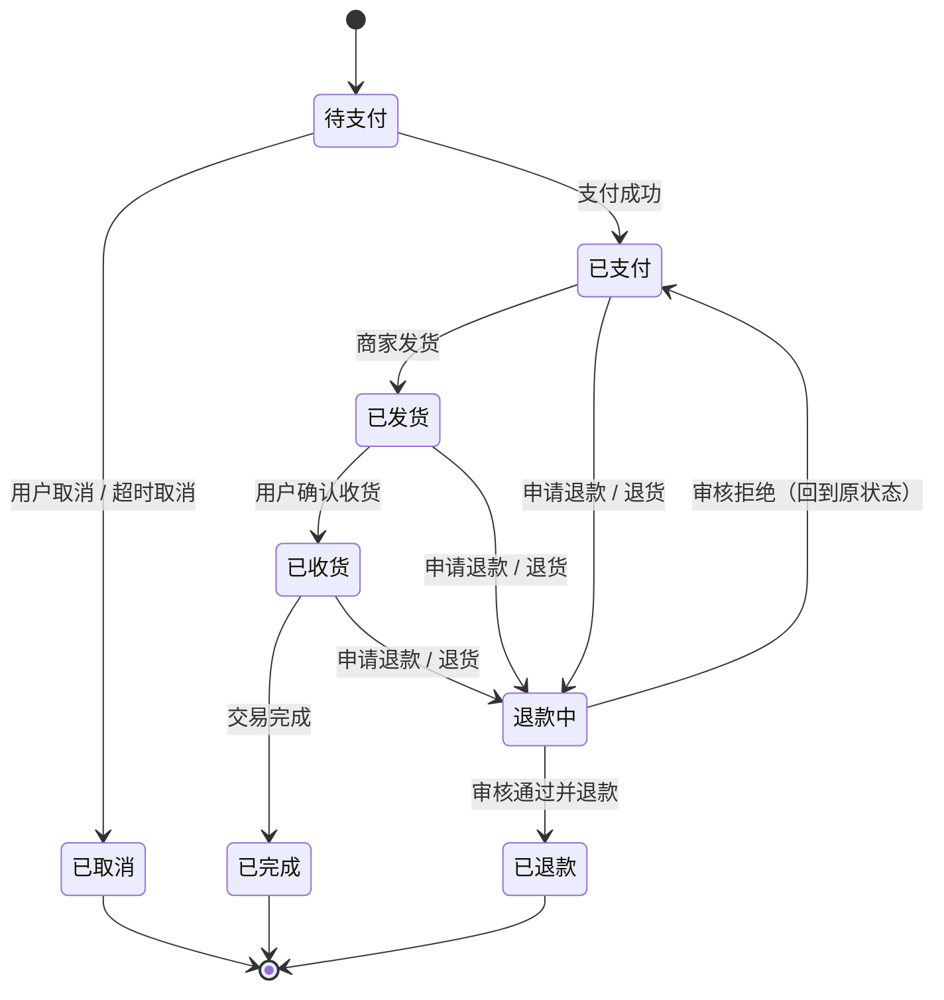

#### 退款单状态

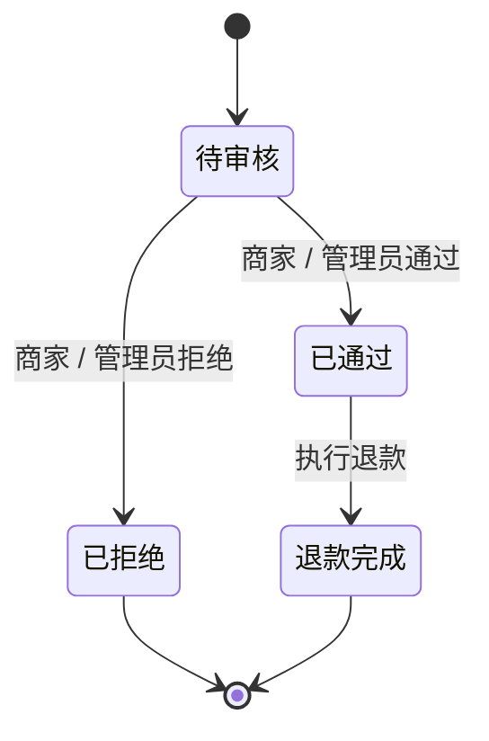

#### 用户券状态

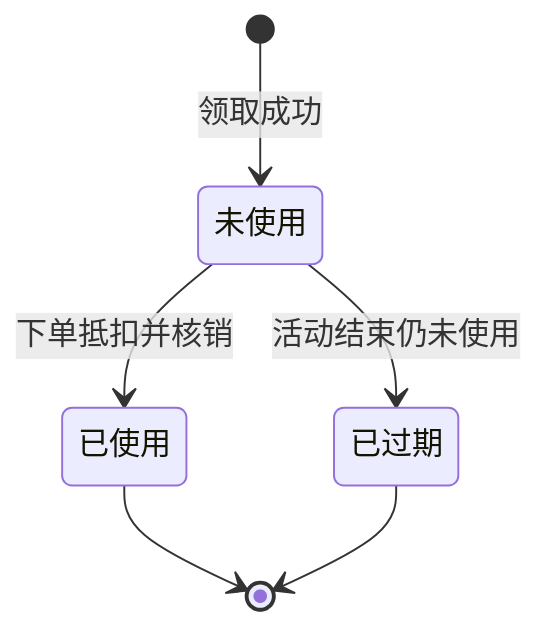

### 4.6 领域模型检查

- 每个对象是否只有一项核心职责？
- 对象之间的关系是否表达了真实业务含义？
- 是否把本应属于对象的行为放到了外部流程中？
- 是否把值属性误建模成独立对象？
- 聚合边界是否与事务边界一致？
- 状态迁移是否覆盖正常流程与异常流程？
- 是否存在可以通过计算得到、却重复保存的数据？

---

## 五、对象分析：职责分配与协作

### 5.1 三类分析对象

| 类型 | 职责 | 本项目的体现 |
|------|------|--------------|
| 边界对象 | 与用户交互，接收输入、展示结果 | 登录页、商品页、购物车页、订单页、商家后台、管理员后台 |
| 控制对象 | 协调一个用例的执行顺序 | 登录处理、下单处理、支付处理、退款处理、领券处理 |
| 实体对象 | 表达业务概念与规则 | 用户、商品、订单、优惠券、退款单等 |

对象分析的重点不是“有哪些页面”，而是**一个用例从边界到实体，经过哪些对象、每个对象承担什么职责**。

### 5.2 关键用例的对象协作

#### 5.2.1 登录协作

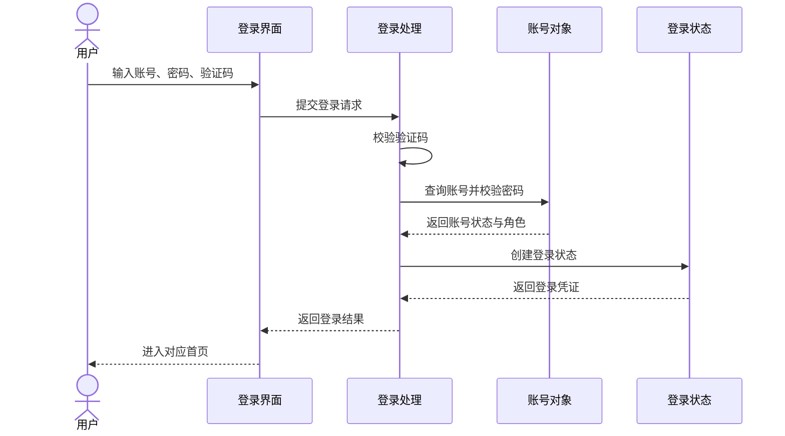

**职责说明：**

- 登录界面只负责收集输入和展示结果。
- 登录处理负责流程编排、验证码校验和异常处理。
- 账号对象负责账号查询、密码校验与状态判断。
- 登录状态负责凭证的生成与失效。

#### 5.2.2 下单协作

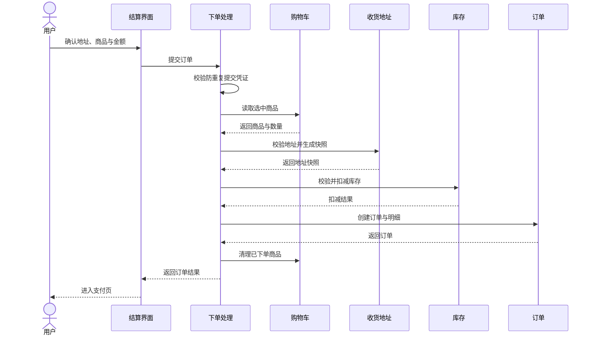

**职责说明：**

- 结算界面负责确认信息，不直接修改库存或订单。
- 下单处理负责用例编排、校验顺序和失败补偿。
- 购物车提供待购项，地址提供快照，库存负责扣减，订单负责保存交易结果。
- 任何一步失败都要保证已执行步骤可回滚或补偿。

#### 5.2.3 支付协作

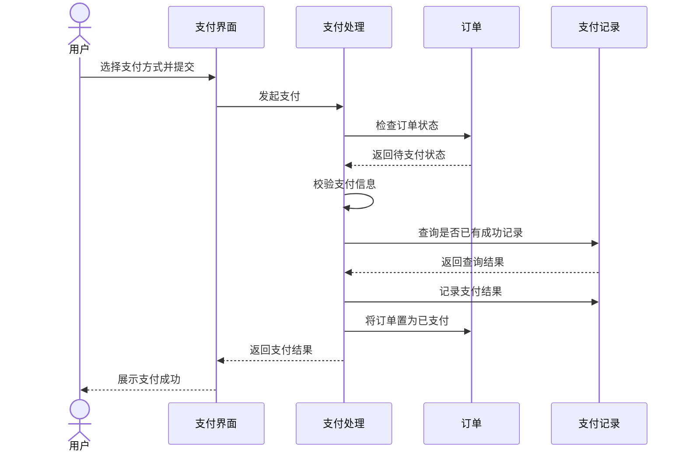

**职责说明：**

- 支付处理负责支付方式校验、幂等判断和状态迁移。
- 订单对象负责判断当前状态是否允许支付。
- 支付记录负责保存支付事实，避免重复扣款。

#### 5.2.4 领券协作

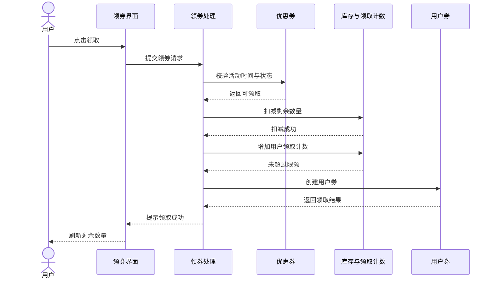

**职责说明：**

- 领券处理负责活动校验、库存扣减、限领校验和失败补偿。
- 优惠券对象提供活动规则，用户券对象记录领取事实。
- 库存与领取计数属于高频变化数据，与数据库中的最终数据需要保持一致。

#### 5.2.5 退款协作

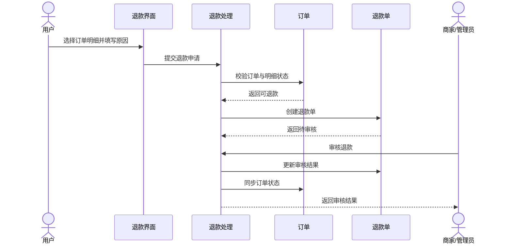

**职责说明：**

- 退款处理负责资格校验、金额校验、审核流转和状态同步。
- 订单对象负责判断订单与明细是否允许退款。
- 退款单对象负责保存申请、审核与退款结果。

### 5.3 职责分配表

| 对象 | 核心职责 | 主要协作者 |
|------|----------|------------|
| 用户 | 维护身份、角色与状态 | 登录处理、商家、订单 |
| 商家 | 维护店铺资料与审核状态 | 用户、商品、订单、管理员 |
| 商品 | 维护商品信息与上下架 | 分类、商家、规格项 |
| 商品规格项 | 维护价格与库存 | 商品、购物车、订单 |
| 购物车 | 维护用户待购项 | 用户、商品规格项、下单处理 |
| 订单 | 维护交易状态与金额 | 用户、商家、支付记录、退款单 |
| 支付记录 | 记录支付事实与幂等判断 | 订单、支付处理 |
| 退款单 | 维护退款申请与审核 | 订单、订单明细、审核处理 |
| 优惠券 | 维护活动规则与库存 | 领券处理、用户券、订单 |
| 用户券 | 维护领取与核销状态 | 用户、优惠券、订单 |
| 评论 | 维护评价、追评与回复 | 用户、商家、订单明细 |
| 会话 | 维护对话与未读数 | 用户、商家、消息 |
| 操作日志 | 记录后台操作事实 | 管理员、各后台处理 |

### 5.4 职责分配原则

1. **信息专家**：谁拥有数据，谁就负责与这些数据最相关的行为。例如库存扣减由商品规格项负责，而不是由界面负责。
2. **创建者**：谁拥有创建某对象所需的信息，谁就负责创建它。例如订单由下单处理创建，因为下单处理掌握用户、购物车、地址和金额信息。
3. **控制器**：界面不直接执行业务规则，由控制对象协调用例流程。
4. **低耦合**：对象之间尽量通过少量、稳定的接口协作，避免一个对象直接操作另一个对象的内部数据。
5. **高内聚**：一个对象只做一类事情，避免“什么都知道、什么都能做”的上帝对象。
6. **单一职责**：一个对象的变化原因应尽量只有一个。
7. **依赖倒置**：业务规则不依赖具体实现，而依赖稳定的抽象。

---

## 六、架构设计

### 6.1 分层架构

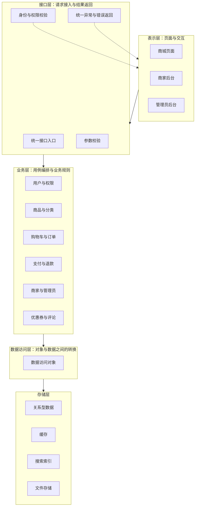

**分层职责：**

- **表示层**：页面展示、用户输入、状态反馈，不写业务规则。
- **接口层**：接收请求、校验身份与参数、调用业务层、统一返回结果和异常。
- **业务层**：实现用例流程、业务规则、事务边界和对象协作。
- **数据访问层**：完成业务对象与数据记录之间的转换，不承载业务规则。
- **存储层**：关系型数据、缓存、搜索索引和文件存储。

### 6.2 模块划分

| 模块 | 职责 | 依赖方向 | 对外提供 |
|------|------|----------|----------|
| 基础模块 | 统一返回、错误码、异常、用户上下文、通用工具 | 不依赖业务模块 | 通用能力 |
| 数据访问模块 | 业务对象、数据访问接口、数据查询定义 | 依赖基础模块 | 数据访问能力 |
| 业务模块 | 用例实现、业务规则、对象协作 | 依赖数据访问模块 | 业务服务 |
| 接口模块 | 请求接入、参数校验、权限校验、统一异常 | 依赖业务模块 | 对外接口 |
| 启动模块 | 应用装配、配置、拦截器、运行入口 | 依赖接口模块 | 可运行系统 |

**依赖原则：**

- 依赖方向单向向下，不允许下层反向依赖上层。
- 接口模块不直接访问数据，业务模块不直接处理页面。
- 基础模块保持稳定，避免因业务变化频繁修改。

### 6.3 接口设计

#### 6.3.1 统一返回结构

所有接口使用统一返回结构，包含：

| 部分 | 含义 |
|------|------|
| 状态码 | 表示成功或具体错误类型 |
| 提示信息 | 面向用户的错误描述 |
| 数据 | 业务返回内容，可为空 |

统一返回的好处是：前端只需一套处理逻辑，错误码可集中维护，接口行为可预期。

#### 6.3.2 统一错误码

错误码按业务模块划分，例如：

- 账号与登录错误
- 商品与分类错误
- 购物车错误
- 订单与支付错误
- 退款错误
- 商家与管理员错误
- 优惠券错误
- 文件上传错误

每个错误码对应明确的业务含义和提示信息，避免所有异常都返回“系统错误”。

#### 6.3.3 参数校验

- 入参对象统一校验：必填、长度、格式、范围。
- 业务校验放在业务层：库存、状态、权限、归属关系。
- 校验失败返回明确错误，不进入业务处理。

#### 6.3.4 权限设计

| 角色 | 可访问范围 |
|------|------------|
| 游客 | 商品浏览、商品详情、分类、公开券列表、评论查看 |
| 注册用户 | 游客权限 + 购物车、订单、支付、地址、退款、评论、领券 |
| 商家 | 用户权限 + 商家后台的商品、订单、退款、评论、统计 |
| 管理员 | 管理后台的用户、商家、分类、商品、订单、退款、优惠券、报表 |

权限校验分两层：

1. **身份校验**：是否已登录、登录状态是否有效。
2. **角色校验**：当前角色是否允许访问该功能。

#### 6.3.5 幂等与防重复

- 下单前获取防重复提交凭证，提交时校验并立即失效。
- 支付前查询是否已有成功支付记录，避免重复扣款。
- 领券时同时校验库存与用户领取数量，避免超领。
- 退款审核只允许从“待审核”状态进入，避免重复审核。

### 6.4 数据设计

| 设计点 | 说明 |
|--------|------|
| 实体与关系 | 用户、商家、商品、订单等按业务对象建表，关系通过关联字段表达 |
| 金额 | 以最小货币单位保存，避免小数精度问题 |
| 快照 | 订单保存地址快照与商品价格快照，避免后续变化影响历史数据 |
| 状态 | 用明确的状态值表达订单、退款、优惠券等生命周期 |
| 索引 | 高频查询字段建立索引，组合查询使用联合索引 |
| 缓存 | 热门商品、分类树、库存、销量、验证码等使用缓存 |
| 搜索索引 | 商品名称、描述、品牌、分类、价格等进入搜索索引 |
| 审计 | 关键后台操作记录操作人、动作、参数、结果与耗时 |

### 6.5 界面设计

| 界面区域 | 设计要点 |
|----------|----------|
| 商城页面 | 顶部导航、分类入口、商品列表、商品详情、购物车、订单、个人中心 |
| 商家后台 | 商品管理、评论管理、订单管理、退款审核、销售统计 |
| 管理员后台 | 用户管理、商家审核、分类管理、全平台商品/订单、退款审核、优惠券管理、销售报表 |
| 状态反馈 | 加载、空数据、失败、无权限、库存不足、操作成功等状态都要有明确反馈 |
| 路由与权限 | 不同角色进入不同布局，未登录访问受限页面时跳转登录 |
| 一致性 | 同一业务在不同页面使用一致的字段名称、金额格式和状态文案 |

### 6.6 横切关注点

| 关注点 | 设计方式 | 作用 |
|--------|----------|------|
| 身份认证 | 请求进入时统一校验登录凭证 | 避免每个接口重复写校验逻辑 |
| 权限控制 | 按角色和资源归属判断 | 防止越权访问 |
| 参数校验 | 入参统一校验 | 把非法请求挡在业务层之外 |
| 异常处理 | 统一捕获并转换为标准错误 | 避免异常信息泄露，保证返回格式一致 |
| 操作日志 | 关键操作统一记录 | 支持审计与问题追踪 |
| 事务管理 | 在业务层定义事务边界 | 保证订单、库存、支付等操作的一致性 |
| 缓存 | 高频读取数据集中缓存 | 降低数据访问压力 |
| 定时任务 | 超时订单取消、状态刷新、历史清理 | 处理不依赖用户触发的业务 |

### 6.7 设计原则

| 原则 | 在本项目中的体现 |
|------|------------------|
| 单一职责 | 页面只负责展示，业务处理负责流程，数据访问负责对象与数据转换 |
| 开闭原则 | 新增支付方式、优惠类型、业务模块时，尽量通过扩展而不是修改已有流程 |
| 依赖倒置 | 业务层依赖稳定的抽象接口，不直接依赖具体实现 |
| 接口隔离 | 按业务域拆分接口，避免一个接口承担过多不相关职责 |
| 里氏替换 | 同类业务实现遵循统一契约，替换实现不影响调用方 |
| 高内聚低耦合 | 同一业务域的对象放在一起，跨域通过少量稳定接口协作 |
| 信息隐藏 | 对象内部状态通过行为修改，不暴露可随意修改的内部数据 |
| 关注点分离 | 认证、校验、异常、日志等横切逻辑与业务逻辑分离 |

### 6.8 复用与变化隔离

| 设计思想 | 应用场景 | 效果 |
|----------|----------|------|
| 接口与实现分离 | 各业务域的服务接口与实现 | 调用方依赖契约，实现可替换、可测试 |
| 统一入口与统一返回 | 所有对外接口 | 前端处理一致，错误可集中管理 |
| 对象组装与分步构建 | 订单、商品、优惠券等复杂对象 | 避免构造参数过多，提升可读性 |
| 按类型分支的优惠计算 | 满减券与折扣券 | 新增优惠类型时集中扩展计算逻辑 |
| 状态驱动流程 | 订单、退款、优惠券 | 用状态约束行为，避免非法操作 |
| 横切逻辑集中处理 | 认证、异常、日志、校验 | 业务代码更纯粹，规则更统一 |
| 缓存与数据补偿 | 库存、销量、优惠券剩余量 | 兼顾访问速度与最终一致 |
| 定时任务补偿 | 超时订单、状态刷新、历史清理 | 处理无用户触发的后台流程 |

---

## 七、详细设计步骤

详细设计是把“对象与职责”落到“可实现的契约与结构”的过程。建议按以下步骤推进。

### 7.1 第一步：明确设计目标与约束

**输入：** 需求分析、领域模型、非功能需求。

**活动：**

- 明确系统边界、角色范围、必须实现的核心用例。
- 明确业务约束：金额精度、库存非负、状态迁移、权限范围。
- 明确非功能约束：响应时间、并发量、可用性、可维护性。
- 明确设计取舍：哪些功能完整实现，哪些功能做设计预留。

**输出：** 设计目标清单、约束清单、范围说明。

**检查点：** 设计目标是否可验证？约束是否具体？范围是否与需求一致？

### 7.2 第二步：划分子系统与模块

**输入：** 领域模型、用例分组。

**活动：**

- 按业务域划分子系统：用户与权限、商品与分类、购物车与订单、支付与退款、商家与管理员、优惠券与评论。
- 按职责划分层次：表示、接口、业务、数据访问、存储。
- 明确模块依赖方向，禁止循环依赖。
- 明确每个模块对外提供的能力。

**输出：** 架构图、模块清单、依赖关系。

**检查点：** 每个模块是否有清晰职责？依赖是否单向？是否存在职责重叠？

### 7.3 第三步：设计领域对象与职责

**输入：** 领域模型、用例规约。

**活动：**

- 为每个对象定义属性、行为和不变式。
- 明确聚合根与聚合边界。
- 把业务规则放到最合适的对象中。
- 区分实体对象、值对象和计算属性。
- 识别对象之间的创建、查询、修改、删除关系。

**输出：** 对象职责表、对象关系图、业务规则清单。

**检查点：** 是否存在上帝对象？是否有对象只有数据没有行为？规则是否集中且可追踪？

### 7.4 第四步：设计对象协作与时序

**输入：** 对象职责、核心用例。

**活动：**

- 为每个核心用例绘制对象协作时序。
- 明确每个步骤由哪个对象负责、调用哪个对象、返回什么结果。
- 识别失败点与补偿动作。
- 检查是否存在跨层直接调用或职责越界。

**输出：** 用例时序图、协作说明、异常处理说明。

**检查点：** 每个用例是否有完整主流程与异常流程？失败后是否能保持一致？

### 7.5 第五步：设计接口契约

**输入：** 用例规约、对象协作。

**活动：**

- 按业务域定义接口分组。
- 定义每个接口的入参、出参、错误码和权限要求。
- 统一返回结构与异常格式。
- 设计分页、筛选、排序等通用参数。
- 设计幂等、防重复提交和权限校验规则。

**输出：** 接口清单、入参出参说明、错误码说明、权限矩阵。

**检查点：** 接口是否覆盖全部用例？错误码是否明确？权限是否逐接口确认？

### 7.6 第六步：设计数据模型

**输入：** 领域对象、接口契约。

**活动：**

- 把领域对象映射为数据表与关联关系。
- 设计主键、唯一约束、索引和状态字段。
- 设计快照字段，保存下单时的地址与价格。
- 设计金额、数量、时间等字段的精度与格式。
- 设计缓存键、搜索索引与数据同步方式。
- 设计数据初始化与测试数据。

**输出：** 数据设计说明、表关系图、索引说明、初始化脚本。

**检查点：** 数据是否冗余但合理？索引是否支撑高频查询？快照是否覆盖关键历史信息？

### 7.7 第七步：设计状态与异常

**输入：** 业务规则、对象生命周期。

**活动：**

- 为订单、退款、优惠券等对象建立状态图。
- 明确每个状态允许的操作和禁止的操作。
- 设计异常分类：参数错误、权限错误、状态错误、资源不足、重复操作、系统错误。
- 设计失败后的回滚、补偿和提示。
- 设计超时、重复提交、并发冲突的处理方式。

**输出：** 状态图、状态迁移表、异常清单、补偿策略。

**检查点：** 非法状态是否被拦截？异常是否可理解、可恢复？补偿是否覆盖关键失败点？

### 7.8 第八步：设计界面与交互

**输入：** 用例规约、接口契约。

**活动：**

- 按角色设计布局：商城、商家后台、管理员后台。
- 设计页面信息结构：列表、详情、表单、弹窗、状态提示。
- 设计页面之间的跳转关系与权限拦截。
- 设计加载、空数据、失败、无权限等状态。
- 设计表单校验、提交反馈和危险操作确认。

**输出：** 页面结构说明、交互流程、界面原型、路由与权限说明。

**检查点：** 用户能否顺利完成主流程？异常状态是否有反馈？不同角色是否看到正确入口？

### 7.9 第九步：设计非功能能力

**输入：** 非功能需求、架构设计。

**活动：**

- 性能：缓存热点数据、优化高频查询、限制分页大小。
- 安全：密码加密、登录状态校验、角色权限、参数校验、防止越权。
- 可用性：异常兜底、失败补偿、定时任务、健康检查。
- 可维护性：分层清晰、职责单一、错误码统一、文档同步。
- 可测试性：业务逻辑与界面解耦，关键用例可独立验证。

**输出：** 非功能设计说明、风险清单、验证方式。

**检查点：** 每项非功能需求是否有对应设计？是否有可验证的指标？

### 7.10 第十步：设计评审与基线

**输入：** 全部设计成果。

**活动：**

- 组织需求、设计、实现人员共同评审。
- 检查需求覆盖、职责分配、接口一致性、数据一致性。
- 记录问题、责任人和修改计划。
- 形成设计基线，后续变更必须记录原因和影响。

**输出：** 评审记录、问题清单、设计基线。

**检查点：** 需求是否全部有设计对应？问题是否闭环？变更是否可追溯？

---

## 八、实现与测试步骤

### 8.1 实现顺序

建议按依赖关系从稳定到易变、从基础到业务推进：

1. 基础能力：统一返回、错误码、异常、身份上下文。
2. 用户与权限：注册、登录、角色、状态。
3. 商品与分类：分类树、商品、规格、库存。
4. 购物车：加入、修改、删除、勾选。
5. 订单与支付：下单、库存扣减、支付、状态流转。
6. 退款与评论：售后流程、评价与回复。
7. 商家与管理员：入驻审核、商品订单管理、报表。
8. 优惠券：活动、领取、抵扣、核销。
9. 搜索与聊天：按设计预留逐步实现。

**实现原则：**

- 先让核心用例闭环，再补边缘功能。
- 每完成一个业务域，同步补齐接口说明、数据脚本和测试。
- 发现设计问题时先修改设计，再修改代码，避免设计与实现脱节。

### 8.2 编码规范

- 分层清晰：表示、接口、业务、数据访问各司其职。
- 命名一致：业务对象、接口、错误码使用统一术语。
- 异常统一：业务异常与系统异常分开处理。
- 事务明确：在业务层定义事务边界，避免在界面层或数据层随意开启事务。
- 注释适度：解释业务规则和设计意图，不重复代码字面含义。
- 变更记录：重要修改同步更新变更日志和相关文档。

### 8.3 测试层次

| 层次 | 测试对象 | 目的 | 示例 |
|------|----------|------|------|
| 单元测试 | 单个业务对象或处理逻辑 | 验证规则与分支 | 库存不足、优惠计算、状态迁移 |
| 集成测试 | 多个对象与数据访问协作 | 验证协作与数据一致性 | 下单扣库存、支付幂等、领券限领 |
| 端到端测试 | 从界面到数据的完整流程 | 验证用户可完成业务 | 登录、下单、支付、退款 |
| 验收测试 | 需求与业务规则 | 验证系统满足目标 | 角色权限、核心流程、异常提示 |

### 8.4 测试用例设计方法

- **正常流程**：每一步都合法，验证主流程可完成。
- **边界值**：库存为 0、数量为 1、金额刚好达到门槛、领取数量刚好等于限领。
- **异常流程**：参数缺失、状态不允许、越权访问、重复提交。
- **并发场景**：同一商品同时下单、同一优惠券同时领取、同一订单重复支付。
- **权限矩阵**：逐角色验证可访问与不可访问的接口和页面。
- **数据一致性**：订单与明细金额一致、库存与销量一致、优惠券总量与剩余量一致。

### 8.5 质量门禁

- 代码可编译，关键用例可运行。
- 单元测试与集成测试通过。
- 接口说明与实际行为一致。
- 数据初始化脚本可重复执行。
- 变更日志记录完整。
- 设计文档与实现同步更新。

---

## 九、设计成果与文档对应

| 阶段 | 主要成果 | 对应文档 |
|------|----------|----------|
| 需求获取与分析 | 业务背景、角色、功能需求、业务规则、优先级 | 需求分析文档 |
| 可行性分析 | 技术、进度、经济、运行可行性 | 可行性分析文档 |
| 领域分析 | 领域对象、关系、聚合、业务规则、状态模型 | 数据库设计文档、详细设计文档 |
| 对象分析 | 职责分配、对象协作、时序说明 | 详细设计文档 |
| 架构设计 | 分层、模块、依赖、接口边界 | 服务端设计文档、客户端设计文档 |
| 详细设计 | 接口契约、数据设计、状态与异常、界面设计 | 详细设计文档、接口文档、界面设计文档 |
| 实现与测试 | 可运行系统、测试用例、测试记录 | 测试规范、变更日志 |
| 建模成果 | 用例、组件、关系、时序、活动流程 | 建模图文件 |

> 文档之间应保持术语一致、角色一致、状态一致。任何设计变更都应同步更新对应文档和变更记录。

---

## 十、设计检查清单

### 10.1 需求检查

- [ ] 角色是否齐全，是否存在未识别的参与者？
- [ ] 每个角色是否有完整的主流程用例？
- [ ] 每个用例是否有前置条件、后置条件和异常流程？
- [ ] 非功能需求和业务约束是否明确？
- [ ] 范围边界是否清楚，是否说明了暂不实现的部分？

### 10.2 领域检查

- [ ] 领域对象是否来自业务，而不是来自页面或数据表？
- [ ] 每个对象是否有明确职责和关键属性？
- [ ] 对象关系是否表达真实业务含义？
- [ ] 聚合边界是否与一致性要求匹配？
- [ ] 业务规则是否集中、可追踪、可验证？
- [ ] 状态模型是否覆盖正常与异常流程？

### 10.3 职责检查

- [ ] 是否存在承担过多职责的上帝对象？
- [ ] 是否存在只有数据、没有行为的贫血对象？
- [ ] 业务规则是否放在了正确的对象中？
- [ ] 对象之间是否通过稳定接口协作？
- [ ] 界面是否直接操作了业务数据或数据存储？

### 10.4 架构检查

- [ ] 分层是否清晰，依赖是否单向？
- [ ] 模块是否高内聚、低耦合？
- [ ] 接口层是否只做接入、校验和返回？
- [ ] 业务层是否承载用例编排和业务规则？
- [ ] 横切关注点是否集中处理，而不是散落各处？

### 10.5 数据检查

- [ ] 金额、数量、时间的精度和格式是否统一？
- [ ] 是否保存了必要的快照数据？
- [ ] 主键、唯一约束和索引是否满足查询与一致性要求？
- [ ] 缓存数据与最终数据是否有一致性保障？
- [ ] 数据初始化脚本是否可重复执行？

### 10.6 接口检查

- [ ] 接口是否覆盖全部核心用例？
- [ ] 入参、出参、错误码是否明确？
- [ ] 权限是否逐接口确认？
- [ ] 是否处理了重复提交、重复支付、重复领取？
- [ ] 接口说明是否与实际行为一致？

### 10.7 界面检查

- [ ] 不同角色是否进入正确的布局和页面？
- [ ] 主流程是否顺畅，步骤是否清晰？
- [ ] 加载、空数据、失败、无权限是否有反馈？
- [ ] 危险操作是否有确认？
- [ ] 表单校验和错误提示是否明确？

### 10.8 测试检查

- [ ] 单元测试是否覆盖核心规则和分支？
- [ ] 集成测试是否覆盖对象协作与数据一致性？
- [ ] 端到端测试是否覆盖核心业务流程？
- [ ] 是否测试了边界、异常、并发和权限？
- [ ] 缺陷修复后是否进行了回归测试？

---

## 十一、总结

本项目的面向对象开发可以概括为一条主线：

1. **从业务出发**：先识别角色、用例和业务规则，明确系统边界。
2. **建立领域模型**：把业务中的名词转化为有职责的对象，明确关系、聚合和状态。
3. **分配对象职责**：让每个对象做自己最了解的事，通过协作完成用例。
4. **设计架构与接口**：用分层和模块控制复杂度，用稳定契约隔离变化。
5. **落实详细设计**：把对象、协作、数据、状态、异常、界面逐一落到可实现的设计。
6. **实现与验证**：按依赖顺序实现，用单元、集成、端到端测试验证需求与设计。
7. **持续维护**：需求变化时回溯设计与文档，保持代码、设计、文档三者一致。

面向对象开发的核心不是“用了多少个对象”，而是**职责是否清晰、协作是否合理、变化是否可控**。只要坚持从需求到对象、从对象到职责、从职责到协作的分析顺序，系统就能在功能增加和需求变化时保持可理解、可维护、可扩展。
